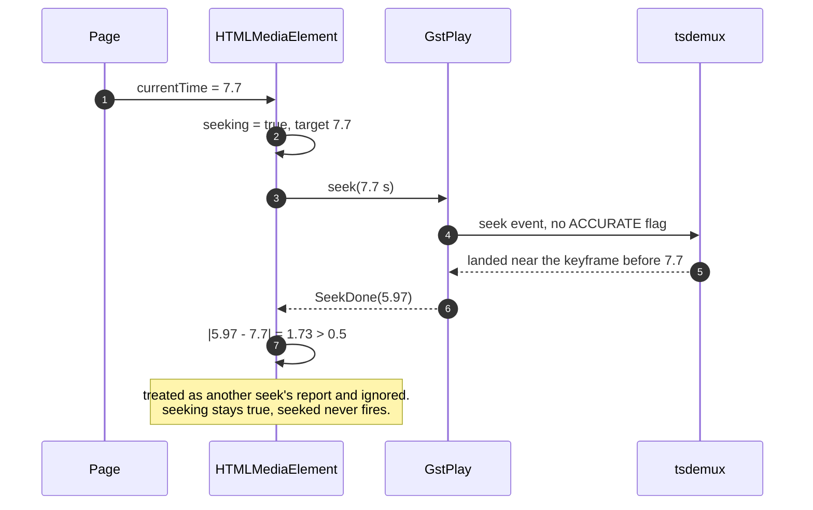
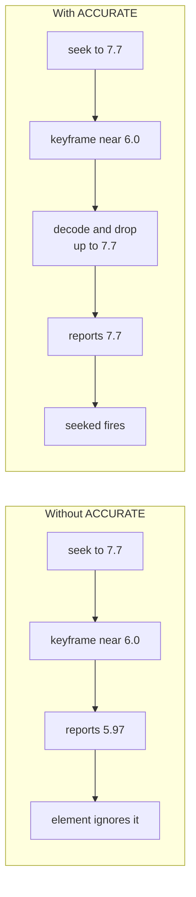

> One change of the Servo fork: `review/03`, 3 of 29 in the stack.
> Below it: [`review/02`](https://github.com/Airodonack/servo/tree/review/02). Above it: [`review/04`](https://github.com/Airodonack/servo/tree/review/04).
> The change itself: [commit 5372aaf8133afe6ce48b3d5aff30dab6cbadca3c](https://github.com/Airodonack/servo/commit/5372aaf8133afe6ce48b3d5aff30dab6cbadca3c). This README sits in a commit on top of it and is not part of the pull request.
> The whole stack: [overview README](https://github.com/Airodonack/servo/blob/vodscribe/main/README.md).

# Seeks in the GStreamer player land on the requested time

Setting `currentTime` on some videos left the element stuck: `seeking`
stayed `true`, `seeked` never fired, and playback did not resume. This
change makes the GStreamer player seek to the exact time asked for, which
ends the seek normally.

It is six lines in one file, but it changes every seek the GStreamer backend
makes, so it is worth understanding before sending.

## The problem

Two layers disagree about where a seek landed.

- **GStreamer's player (GstPlay)** sends a seek without the `ACCURATE` flag
  unless told otherwise. A demuxer may then jump to any nearby sync point (a
  keyframe) and report that position. A file with an index, such as MP4, lands
  exactly anyway. A file without one, such as MPEG-TS, lands up to a
  keyframe interval early.
- **The media element** only accepts a "seek done" whose position is within
  0.5 s of what it asked for
  ([`SEEK_POSITION_THRESHOLD`](https://github.com/Airodonack/servo/blob/5372aaf8133afe6ce48b3d5aff30dab6cbadca3c/components/script/dom/html/embedded_content/htmlmediaelement.rs#L122-L125),
  checked in
  [`playback_seek_done`](https://github.com/Airodonack/servo/blob/5372aaf8133afe6ce48b3d5aff30dab6cbadca3c/components/script/dom/html/embedded_content/htmlmediaelement.rs#L2954-L2970)).
  The check exists so that a late "seek done" from an earlier, abandoned seek
  is not mistaken for the current one.

When the demuxer lands more than 0.5 s away, the element decides the report
belongs to some other seek and ignores it. No other report comes, so the
seek never ends.



## The change

Where the backend builds GstPlay's configuration
([player.rs, lines 547 to 558](https://github.com/Airodonack/servo/blob/5372aaf8133afe6ce48b3d5aff30dab6cbadca3c/components/media/backends/gstreamer/player.rs#L547-L558)),
one call turns on accurate seeking:

```rust
config.set_position_update_interval(500u32);
config.set_seek_accurate(true); // new
```

With it, GstPlay adds the `ACCURATE` flag to every seek. The demuxer still
starts at a keyframe, but the pipeline decodes and drops the frames up to the
target before it reports the seek done. The report then matches the request
and the element finishes the seek.



There is one GstPlay configuration in the backend, so this covers plain
`src` playback and, later in the stack, Media Source playback.

## Options considered

| Option | What it would take | Why not chosen |
|---|---|---|
| **Accurate seeks for every player** (this change) | One config line | Chosen: smallest change, `currentTime` ends where the page asked, as the spec requires for an ordinary seek. Costs time on files without an index (below). |
| Widen the element's 0.5 s threshold | Change one constant | The gap is as large as the keyframe interval: 2 s here, often 4 to 10 s in recorded streams. Any fixed value fails on some file, and a wide one lets an old seek's report end a new seek. The picture would also show a frame seconds away from `currentTime`. |
| Accept whatever position the backend reports and move `currentTime` there | Element change in `playback_seek_done` | The spec only allows an approximate position for `fastSeek()`. A page that seeks with `currentTime` expects to land there. Captions, transcripts and frame stepping depend on it. |
| Accurate for `currentTime`, keyframe-only for `fastSeek()` | Per-seek flags | GstPlay only accepts a new configuration while stopped ([gstplay.c, lines 4673 to 4702](https://github.com/Airodonack/gstreamer/blob/1.28.6/subprojects/gst-plugins-bad/gst-libs/gst/play/gstplay.c#L4673-L4702)), so per-seek flags mean sending seek events to the pipeline past GstPlay. Worth doing later, for `fastSeek()` only. Today `fastSeek()` is accurate too, which the spec allows. |
| Fix the demuxer | Change in GStreamer | Landing on a sync point is the demuxer's documented behaviour without the flag. `ACCURATE` is the standard way to ask for more. |

## What it costs

Measured with GstPlay over playbin3, set up as Servo's backend sets it up
(GStreamer 1.28.7, the same 90 s clip as MPEG-TS and MP4, 2 s keyframe
spacing, paused seeks to 3.0, 5.3, 7.7, 11.1 and 13.9 s):

| File | Flag | Reported position minus target | Time to "seek done" |
|---|---|---|---|
| MPEG-TS | off | 1.70 to 2.02 s early | 36 to 66 ms |
| MPEG-TS | on | 0.000 s | 285 to 956 ms |
| MP4 | off | 0.000 s | 142 to 232 ms |
| MP4 | on | 0.000 s | 157 to 247 ms |

MP4 is unchanged in practice: about 15 ms more per seek. MPEG-TS seeks become
correct and take up to a second, because up to one keyframe interval is
decoded and dropped. That is the price of landing on the requested frame.

## Spec

[HTML, the seek algorithm](https://html.spec.whatwg.org/multipage/media.html#dom-media-seek),
step 9:

> If the approximate-for-speed flag is set, adjust the new playback position
> to a value that will allow for playback to resume promptly.

Only `fastSeek()` sets that flag. An ordinary seek moves the playback position
to the requested time (step 11) and waits until the media data for that
position is available (step 12).

## How it was checked

- The table above, from a GstPlay probe run with and without the flag on
  both files. Without the flag, the reported position never came within the
  0.5 s threshold on MPEG-TS. With it, every seek reported the exact target,
  and the first frame after the seek was the target frame.
- A seek while playing, to 9.5 s on MPEG-TS: reported 7.50 s without the flag
  and 9.50 s with it.

At this commit, the restack's gate (2026-11-05): `mach fmt` changed nothing,
`test-tidy` passed, and `mach check` exited 0 with no warnings.

Not yet done: an in-browser test page that plays the MPEG-TS clip in
servoshell, seeks, and waits for `seeked`, with and without this commit.

## Questions a reviewer may ask

- **Why not only for formats that need it?** The backend doesn't know which
  demuxer the pipeline picked when it builds the configuration. On files with
  an index the flag costs almost nothing.
- **Does this slow down scrubbing?** On files without an index, yes, by up to
  a keyframe interval of decoding per seek. Pages that want speed over
  accuracy can call `fastSeek()`, which the per-seek option above would make
  fast.
- **Is the 0.5 s threshold still needed?** Yes. It still tells the current
  seek's report apart from a late report of an abandoned one.
