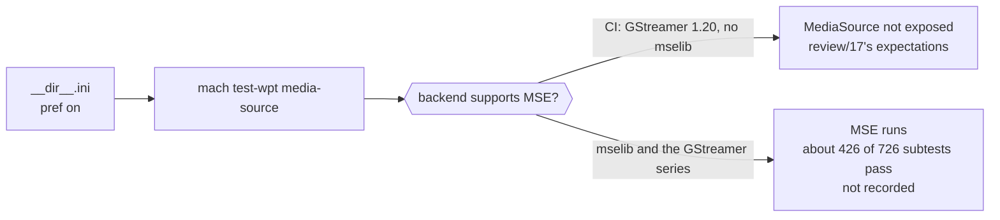

> One change of the Servo fork: `review/23`, 23 of 29 in the stack.
> Below it: [`review/22`](https://github.com/Airodonack/servo/tree/review/22). Above it: [`review/24`](https://github.com/Airodonack/servo/tree/review/24).
> The change itself: [commit 33b1e92a17ff2df437eea1d489961b0d237d858e](https://github.com/Airodonack/servo/commit/33b1e92a17ff2df437eea1d489961b0d237d858e). This README sits in a commit on top of it and is not part of the pull request.
> The whole stack: [overview README](https://github.com/Airodonack/servo/blob/vodscribe/main/README.md).

# Update the Media Source test expectations

Nothing changes for a page. The `media-source` web-platform-tests now run with
the MSE pref on, as CI should run them, and their expectations are those of the
build Servo's CI makes, which has no MSE backend.

## The problem

Nothing turned the pref on for this directory. A run without
`--pref dom_media_source_enabled=true` on the command line saw `MediaSource`
undefined, so none of the MSE code of
[`review/20`](https://github.com/Airodonack/servo/tree/review/20) and
[`review/22`](https://github.com/Airodonack/servo/tree/review/22) ran in CI.

Turning the pref on raises the next question: what does CI see? Servo's CI runs
WPT on Ubuntu 22.04, whose GStreamer 1.20 has no mselib, so `mach` builds
without `media-gstreamer-mse`. Since `review/20`, a build without an MSE
backend does not expose `MediaSource`. CI therefore sees what
[`review/17`](https://github.com/Airodonack/servo/tree/review/17) recorded.

## The change

One line,
[`tests/wpt/meta/media-source/__dir__.ini`](https://github.com/Airodonack/servo/blob/33b1e92a17ff2df437eea1d489961b0d237d858e/tests/wpt/meta/media-source/__dir__.ini):

```ini
prefs: [dom_media_source_enabled: true]
```

as other pref-gated directories do, for example
[`WebCryptoAPI/__dir__.ini`](https://github.com/Airodonack/servo/blob/33b1e92a17ff2df437eea1d489961b0d237d858e/tests/wpt/meta/WebCryptoAPI/__dir__.ini).

The expectation files were recorded afresh, every old file removed first,
from three runs of a build like CI's: `mach`'s mselib check turned off for one
build, run on Debian 13's GStreamer packages. `mach update-wpt` wrote
`review/17`'s files again, so none changes. It wrote
`idlharness.any.js.ini` with its worker and window sections swapped; the
entries are the same, and `review/17`'s file is kept.



| Run | Tests | Subtests |
|---|---|---|
| Each of three recording runs, no mselib | 88: 78 OK, 10 ERROR | 599: 23 PASS, 576 FAIL |
| Two runs with mselib and the GStreamer series | 88: 81-82 OK, 4 ERROR, 2-3 TIMEOUT | 726: 426-427 PASS, 294 FAIL, 4-5 TIMEOUT, 1 PRECONDITION_FAILED |

No result differed between the three recording runs, so nothing is marked
intermittent.

## Options considered

| Option | Why not chosen |
|---|---|
| **Pref on, expectations of CI's build** (this change) | Chosen: CI runs what a page sees on that build, and the results do not depend on machine speed. |
| Expectations of the MSE build, as this commit first recorded | No CI runner has mselib with the GStreamer series, so every run there would be unexpected. Nine playback tests also flipped with machine speed. |
| No `__dir__.ini`, the pref passed by hand | CI does not pass it, so the files would describe a run nobody makes. |
| A CI job with a newer GStreamer | Not this fork's to decide; a question for the maintainers. |

## How it was checked

- **2026-11-05:** three more runs of the build without mselib against these
  files: "Ran 88 tests ... 88 ran as expected" each time.
- Two runs of the build with mselib and the GStreamer series against these
  files: 24 as expected, 5-6 unexpectedly OK, 2-3 unexpected timeouts, 62
  with unexpected subtest results; no expectation recorded from them.

## Questions a reviewer may ask

- **So the MSE code is not tested in CI?** Not by these files, until a CI
  runner has GStreamer 1.24 or newer with mselib. The MSE results of the
  GStreamer series build are in the fork's notes, not here.
- **Why keep this commit, if it adds one line?** It is the line that makes CI
  run the directory as a page would; without it the pref is off.
