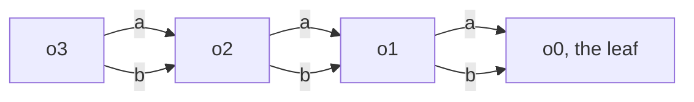

> One change of the Servo fork: `review/06`, 6 of 29 in the stack.
> Below it: [`review/05`](https://github.com/Airodonack/servo/tree/review/05). Above it: [`review/07`](https://github.com/Airodonack/servo/tree/review/07).
> The change itself: [commit ad99eb083a54d3af289521806e4cef58c211adab](https://github.com/Airodonack/servo/commit/ad99eb083a54d3af289521806e4cef58c211adab). This README sits in a commit on top of it and is not part of the pull request.
> The whole stack: [overview README](https://github.com/Airodonack/servo/blob/vodscribe/main/README.md).

# Logging large objects no longer exhausts memory

Twitch's player page grew by about 800 MB a second in Servo and was killed
by the out-of-memory killer within 15 s, with no devtools anywhere. The
cause was `console.log`: every call built the devtools preview of its
arguments, and that preview could cost far more than the object it
describes. This change bounds the preview's walk, and builds it for the
logging methods only when Servo's devtools server is running.

Servo's main branch has the same bug. The 0.7.0 release did not: the
preview of prototypes came after it.

## The problem

Each console method sends its arguments two ways:

- to the **embedder** as a string
  ([`stringify_handle_values`](https://github.com/Airodonack/servo/blob/ad99eb083a54d3af289521806e4cef58c211adab/components/script/dom/console.rs#L918-L925)),
  which stops at depth 10 and at 15 children
  ([`MAX_LOG_DEPTH`, `MAX_LOG_CHILDREN`](https://github.com/Airodonack/servo/blob/ad99eb083a54d3af289521806e4cef58c211adab/components/script/dom/console.rs#L53-L56));
- to **devtools** as a structured preview
  ([`console_argument_from_handle_value`](https://github.com/Airodonack/servo/blob/ad99eb083a54d3af289521806e4cef58c211adab/components/script/dom/console.rs#L262-L340)),
  which follows every own property and the prototype of every object
  ([`object_prototype_debugger_value`](https://github.com/Airodonack/servo/blob/ad99eb083a54d3af289521806e4cef58c211adab/components/script/dom/console.rs#L343-L365)).

Before this change the preview guarded only against cycles, and only on
the current path: it pushed an object on `seen`, walked it, and popped it
again ([the parent commit, lines 248 to 260](https://github.com/Airodonack/servo/blob/b930eb7b84236fd1a18d16a3e58b6dcf78ec2e1a/components/script/dom/console.rs#L248-L260)).
An object reachable by two paths was walked twice, and every walk
serialised its prototype, `Object.prototype`, again. A long chain recursed
once per link.

In a build with the `devtools` feature the preview was built for every
call, whether or not anything would read it. A graph of n + 1 objects, each
holding the next one twice, has 2^n paths:



Four objects, eight walks of `o0`, each with its own walk of
`Object.prototype`. At depth 12 one `console.log` took 2.9 s and 2.3 GB.
Twitch's player logs state objects shaped like this. A chain of 100,000
objects overflowed the script thread's stack, which aborts the whole
process. `console.table` and, with the devtools server on, every logging
method had no check at all.

## The change

Two parts, in [console.rs](https://github.com/Airodonack/servo/blob/ad99eb083a54d3af289521806e4cef58c211adab/components/script/dom/console.rs).

**A bounded walk.** A
[`PreviewWalk`](https://github.com/Airodonack/servo/blob/ad99eb083a54d3af289521806e4cef58c211adab/components/script/dom/console.rs#L229-L260)
replaces the `seen` vector and serves all the arguments of one call. It
holds:

- the path from the argument to the current value, to stop at cycles as
  before;
- a count of values, which stops at 10,000 (`MAX_PREVIEW_VALUES`);
- a depth limit of 20, a prototype counting as a level
  ([lines 296 to 302](https://github.com/Airodonack/servo/blob/ad99eb083a54d3af289521806e4cef58c211adab/components/script/dom/console.rs#L296-L302));
- the set of prototypes already previewed, so `Object.prototype` and the
  others are previewed once per call, not once per object
  ([lines 357 to 359](https://github.com/Airodonack/servo/blob/ad99eb083a54d3af289521806e4cef58c211adab/components/script/dom/console.rs#L357-L359)).

Past a limit a value is shown as "…", as the embedder's string does. The
prototype is now walked before the own properties
([lines 306 to 312](https://github.com/Airodonack/servo/blob/ad99eb083a54d3af289521806e4cef58c211adab/components/script/dom/console.rs#L306-L312)),
so the logged object's own prototype chain is always complete: its
prototypes are met there first, before any shared object elsewhere marks
them as seen.

**No preview nobody reads.**
[`Console::method()`](https://github.com/Airodonack/servo/blob/ad99eb083a54d3af289521806e4cef58c211adab/components/script/dom/console.rs#L85-L158),
which every logging method goes through, asks once whether the global has a
devtools channel
([lines 92 to 97](https://github.com/Airodonack/servo/blob/ad99eb083a54d3af289521806e4cef58c211adab/components/script/dom/console.rs#L92-L97))
and builds the preview, the stack and the devtools message only then. The
global has a devtools channel when the devtools server was started
([`devtools_server_enabled`](https://github.com/Airodonack/servo/blob/ad99eb083a54d3af289521806e4cef58c211adab/components/servo/servo.rs#L1036-L1043)),
whether or not a client is connected.

```mermaid
flowchart TD
    call["console.log args"] --> str["embedder string<br/>depth and child limits"]
    str --> emb["sent to the embedder"]
    call --> qdevtools server running?
    q -->|"no"| skip["no preview"]
    q -->|"yes"| prev["preview, bounded by PreviewWalk<br/>and the stack"] --> dev["sent to devtools"]
```

[`Console::Dir()`](https://github.com/Airodonack/servo/blob/ad99eb083a54d3af289521806e4cef58c211adab/components/script/dom/console.rs#L1301-L1340)
and `console.table`
([lines 1197 to 1203](https://github.com/Airodonack/servo/blob/ad99eb083a54d3af289521806e4cef58c211adab/components/script/dom/console.rs#L1197-L1203))
still build the preview with the server off. `dir()` makes the embedder's
string from the preview, so skipping it would change that string; with the
walk bounded, building it is cheap enough.

## Options considered

| Option | What it would take | Why not chosen |
|---|---|---|
| **Bound the walk, and skip it for logging when the server is off** (this change) | A walk state with three limits; one check in `method()` | Chosen: bounded with devtools on or off, every console method included, and no cost at all for the usual case. The server caches console messages for a client that connects later ([`cached_events`](https://github.com/Airodonack/servo/blob/ad99eb083a54d3af289521806e4cef58c211adab/components/devtools/actors/console.rs#L229)), and that keeps working. |
| Only skip the preview when the server is off | One check in two methods | What this commit first did. The server on (`servoshell --devtools`, or an embedder that sets `devtools_server_enabled`) still ran out of memory, `console.table` did with it off, and the deep chain still overflowed the stack. |
| Build it only while a client is connected | Track connections in script | A client that connects later would miss every earlier message, which the cache exists to give it. |
| Limit the preview like the embedder string, depth 10 and 15 children | Two limits in the walk | Devtools would show cut-off objects of ordinary size. The value count bounds the cost and leaves ordinary objects whole. |
| One set of every object seen, shared objects shown once | Change what the preview shows for shared objects | Would bound the walk too, but changes the preview's format for every shared object; only prototypes, which are shared by nearly everything, are shown once here. |

## What it costs

Objects past 10,000 values or 20 levels show "…" in devtools, and a
prototype met a second time in one call shows "…" too. The embedder's
strings are unchanged, `console.dir` included, as the tests below check.

## Spec

[Console Standard, Printer](https://console.spec.whatwg.org/#printer):

> How the implementation prints args is up to the implementation

## How it was checked

The new tests in
[components/servo/tests/console.rs](https://github.com/Airodonack/servo/blob/ad99eb083a54d3af289521806e4cef58c211adab/components/servo/tests/console.rs#L65-L108)
log the shared graph (31 objects, 2^30 paths) with the devtools server on
and off, the 100,000-object chain with it on, and compare `console.dir`'s
string with the server on and off. From the records of the two fixups
folded into this commit (2026-11-02):

| Case | Before | After |
|---|---|---|
| shared graph, server on and off | killed (exit 137) after 13 s | passed in 0.11 to 0.14 s |
| deep chain, server on | stack overflow at 1 s | passed |
| `console.dir` string, server off | a different string from the server-on one | the same string |
| `host/console_log_shared.html`, server on | FAIL, worst 2191.3 ms at depth 12, 3956 MB peak | PASS, worst 7.3 ms at depth 14, 642 MB peak |
| the same page, server off | FAIL, worst 2898.4 ms at depth 12, 2.3 GB peak | PASS, worst 1.9 ms |
| `host/console_log_bounded.html`, every case on and off | five cases reached the 8 GB cap, one overflowed the stack | PASS, at most 8.9 ms a call |

`./mach test-devtools console`: 33 passed, 1 xfailed, as before the change.
Twitch's player page, from the first version of the commit (the server
check alone): before, 8.3 GB and killed at 12 to 16 s in each of six runs;
after, 0.94 GB after 5 minutes.

The restack's gate (2026-11-05) ran on this change before the day's fixups
to lower refs were folded in (the same patch): `mach fmt` changed nothing,
`test-tidy` passed, and `mach check` exited 0 with no warnings. At the
stack's tip the same checks and `mach clippy` pass. The gate did not run
the tests in `components/servo/tests/console.rs`.

Not yet done: the Twitch page with the bounded walk and the devtools server
on.

## Questions a reviewer may ask

- **Does devtools still see everything?** Everything up to 10,000 values
  and 20 levels per call, with each prototype once. Ordinary objects are
  far below that.
- **Why does the prototype go first?** With prototypes shown once per
  call, whichever path meets a prototype first shows it in full. Walking
  the prototype first makes that the logged object's own chain.
- **Why does `dir()` build the preview with the server off?** Its
  embedder string comes from the preview; building it keeps the string the
  same with the server on or off.
- **Why does 0.7.0 not have the bug?** The prototype preview, which
  multiplies the cost of every visit, landed after 0.7.0.
