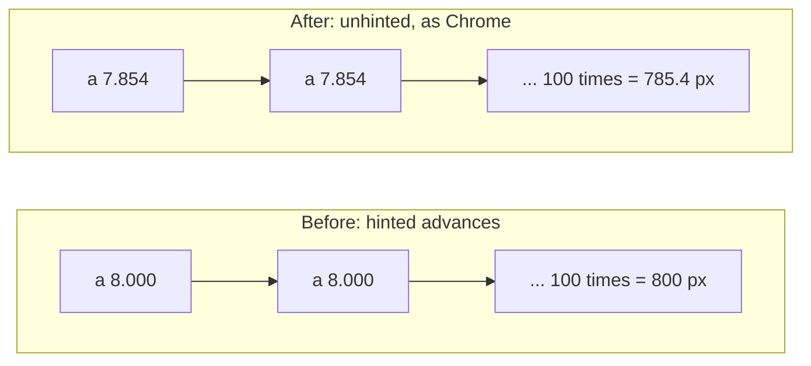
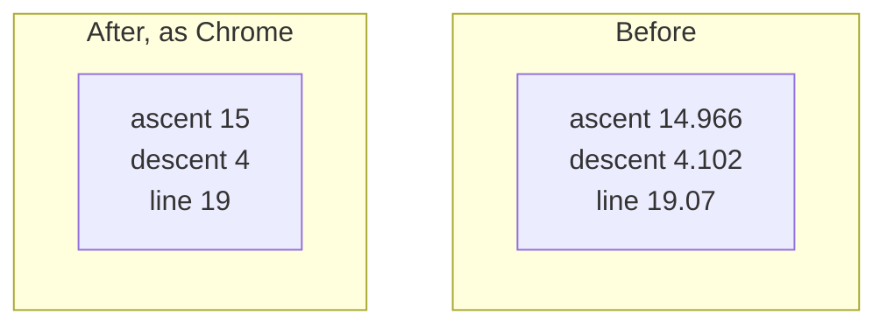

> One change of the Servo fork: `review/16`, 16 of 29 in the stack.
> Below it: [`review/15`](https://github.com/Airodonack/servo/tree/review/15). Above it: [`review/17`](https://github.com/Airodonack/servo/tree/review/17).
> The change itself, two commits:
> - [5db644ae91cd9869bfbde2db6b256e9f3e3b4d62](https://github.com/Airodonack/servo/commit/5db644ae91cd9869bfbde2db6b256e9f3e3b4d62) Text keeps its designed width instead of whole-pixel glyphs
> - [c9243091def2f663aa4613e6ad7597f5ed3574da](https://github.com/Airodonack/servo/commit/c9243091def2f663aa4613e6ad7597f5ed3574da) Line heights and baselines land on whole pixels as in Chrome
> This README sits in a commit on top of them and is not part of the pull request.
> The whole stack: [overview README](https://github.com/Airodonack/servo/blob/vodscribe/main/README.md).

# Text on Linux measures and lines up as in Chrome

Two small changes to the FreeType font backend (Linux and other FreeType
platforms), and a one-line consequence in line layout, about 30 lines:

1. **Text keeps its designed width instead of whole-pixel glyphs.** Glyph
   advances are measured without hinting, and glyphs are drawn at their
   fractional positions.
2. **Line heights and baselines land on whole pixels as in Chrome.** Ascent,
   descent and line gap are rounded.

Both change how every Linux page renders, by fractions of a pixel per glyph or
line. The macOS and Windows backends are not touched. The first also makes
`text-align: center` halve the free space as flex alignment does, on every
platform.

## 1. Glyph advances

### The problem

Servo measured each glyph's advance with the hinting it draws with (FreeType
light hinting). FreeType rounds a hinted advance to a whole pixel, so each
glyph moved by up to half a pixel and a run came out wider or narrower than
the font made it. At 14 px in Noto Sans, `a` is 7.854 px wide by design and
was measured as 8; `i` is 3.612 and was measured as 4.

A brand name or a button label then wraps, truncates or aligns differently
from Chrome.

### The change

- [`FreeTypeFace::glyph_advance_load_flags`](https://github.com/Airodonack/servo/blob/c9243091def2f663aa4613e6ad7597f5ed3574da/components/fonts/platform/freetype/freetype_face.rs#L181-L199)
  (was `glyph_load_flags`) always loads with `FT_LOAD_NO_HINTING`;
  [`glyph_h_advance`](https://github.com/Airodonack/servo/blob/c9243091def2f663aa4613e6ad7597f5ed3574da/components/fonts/platform/freetype/font.rs#L195-L199)
  uses it. The helper that mapped the hinting style to load flags is gone.
- [`webrender_font_instance_flags`](https://github.com/Airodonack/servo/blob/c9243091def2f663aa4613e6ad7597f5ed3574da/components/fonts/platform/freetype/font.rs#L393-L401)
  adds `SUBPIXEL_POSITION`, as the Windows and macOS backends already do, so
  WebRender draws each glyph at its fractional pen position. Without it,
  fractional advances would be snapped back to pixels when drawn and the gaps
  between glyphs would look uneven.
- Drawing keeps the hinting style it had
  ([lines 412 to 419](https://github.com/Airodonack/servo/blob/c9243091def2f663aa4613e6ad7597f5ed3574da/components/fonts/platform/freetype/font.rs#L412-L419)).

### Centering on the same app unit

With fractional advances a box's width is often an odd number of app units
(1/60 px), and so is the free space around it. Flex alignment halved that
space by truncating, `text-align: center` by rounding, so the same content
centered both ways sat 1/60 px apart. With glyphs now drawn at their
fractional positions, that moved glyphs into another subpixel position:
`css/css-flexbox/flexbox-align-self-vert-001` and `-vert-rtl-001`, which
compare the two, failed. Before, every width was whole pixels, an even
number of app units, and the two agreed.

`text-align: center` now halves by truncating too
([flow/inline/mod.rs, lines 1606 to 1612](https://github.com/Airodonack/servo/blob/5db644ae91cd9869bfbde2db6b256e9f3e3b4d62/components/layout/flow/inline/mod.rs#L1606-L1612)),
as Gecko does for both.

## 2. Line metrics

### The problem

The font's ascent, descent and line gap went into layout as fractions. An
inline box in Noto Sans at 14 px was 19.07 px tall (ascent 14.966 + descent
4.102), where Chrome makes it 19. Each line and baseline sat a fraction of a
pixel away from Chrome's, and the error added up down a page.

### The change

[`PlatformFont::metrics`](https://github.com/Airodonack/servo/blob/c9243091def2f663aa4613e6ad7597f5ed3574da/components/fonts/platform/freetype/font.rs#L283-L289)
rounds ascent, descent and line gap, and builds the normal line height from
the rounded values. Underline, strikeout and x-height are unchanged.

## Options considered

| Option | Why not chosen |
|---|---|
| **Unhinted advances, subpixel positions, rounded line metrics** (this change) | Chosen: what Chrome does on Linux, so pages tuned in Chrome lay out the same. |
| Keep hinted advances | Widths off by up to half a pixel per glyph; 100 `i` at 14 px measured 400 px against a designed 361. |
| Read hinting and subpixel settings from Fontconfig | Right in the long run for drawing, but advances should stay unhinted either way, as in Chrome. Not done here. |
| Keep fractional line metrics | Closer to the font's numbers, but every line drifts from other engines. Gecko's choice is not checked. |
| Round only the line height, not ascent and descent | Baselines would still sit a fraction off. |

## Spec

None prescribes either. CSS Text leaves glyph advances to the font and the
user agent; CSS 2 section 10.8.1 and CSS Inline 3 take ascent and descent from
the font without saying how precisely. The target is Chrome 156 on Linux:
HarfBuzz gets unhinted advances from Skia's FreeType scaler, glyphs are drawn
subpixel-positioned, and Blink's `SimpleFontData` rounds ascent, descent and
line gap and sums them for the line spacing.

## How it was checked

From the commits' own runs (servoshell and headless Chrome 156):

| Page | Before | After | Chrome |
|---|---|---|---|
| `host/cmp_glyph_advance.html`, 100 a, i, m, e, 14 px | 800.00, 400.00, 1300.00, 800.00 | 786.67, 361.67, 1310.00, 788.33 | 785.41, 361.20, 1309.00, 789.61 |
| `host/cmp_text_advance.html`, the app's strings, Noto Sans | 136.43, 69.87, 108.00, 82.00, 252.90 | 134.12, 68.73, 105.77, 79.82, 247.48 | 134.13, 68.75, 105.78, 79.83, 247.58 |
| `host/cmp_inline_box_height.html`, span heights at 14, 13, 12.6, 12, 11 px | 19.07, 17.70, 17.15, 16.35, 14.98 | 19.00, 18.00, 17.00, 17.00, 15.00 | the same |

Baselines at 14, 13, 12.6, 12, 11, 16 and 20 px: before 14.97, 13.88, 13.47,
12.83, 11.77, 17.12, 21.37; after and Chrome 15, 14, 13, 13, 12, 17, 21. WPT
`css/css-text`, `css/css-inline`, `css/CSS2/linebox` and `css/css-fonts`:
17,994 results, 0 changed; most of them use the Ahem font, whose advances are
whole pixels. `css/css-flexbox`: `flexbox-align-self-vert-001` and
`-vert-rtl-001` pass only with the centering change (from the fixup's
record, 2026-11-05: both fail without it, pass with it; on
`host/flex-center-subpixel.html` the left edges of the flex and reference
text were 92.133 and 92.150 before, 92.133 and 92.133 after).

Rerun on 2026-11-03, without Servo: Chrome on the same pages gives the Chrome column
above unchanged (`14px 100x[aime] widths=785.41,361.20,1309.00,789.61`,
`span heights ... =19.00,18.00,17.00,17.00,15.00`). Reading Noto Sans's own
tables (`hhea` and `hmtx`, upem 1000, ascender 1069, descender -293) gives the
designed values: 100 x a, i, m, e at 14 px = 785.40, 361.20, 1309.00, 789.60,
and whole-pixel advances = 800, 400, 1300, 800, the "before" row exactly;
ascent plus descent at 14 px = 19.07, rounded 19.

What is left after the change is about 1/100 px per glyph (786.67 against
785.41 per 100 glyphs): FreeType's 26.6 advances and Servo's 1/60 px app units
each round once per glyph.

The restack's gate (2026-11-05) ran on this change before the day's fixups
to lower refs were folded in (the same patch): `mach fmt` changed nothing,
`test-tidy` passed, and `mach check` exited 0 with no warnings. At the
stack's tip the same checks and `mach clippy` pass.

## Questions a reviewer may ask

- **Will reftests change on CI fonts?** Possibly; any reftest that compares
  text against boxes sized in pixels may move. The WPT run above saw none.
- **Why not hint the advances when the user's Fontconfig asks for hinting?**
  Chrome does not either; hinting is a drawing choice, and Servo still draws
  hinted.
- **Blink moves a pixel from ascent to descent on Linux in some cases. Why not
  here?** It did not apply in headless Chrome 156: Noto Sans at 14 px has its
  baseline 15 px below the line top there, which this change matches.
- **Fonts under 3 px?** Blink keeps their fractions; this change rounds them.
  Not handled.
