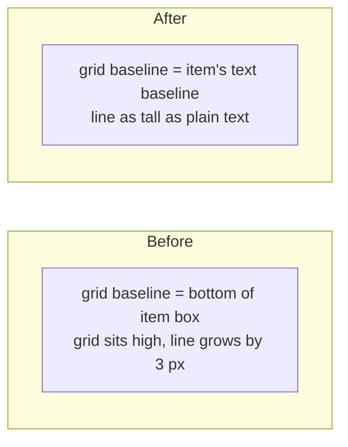

> One change of the Servo fork: `review/15`, 15 of 29 in the stack.
> Below it: [`review/14`](https://github.com/Airodonack/servo/tree/review/14). Above it: [`review/16`](https://github.com/Airodonack/servo/tree/review/16).
> The change itself: [commit a5355ca8482793773911b6fac75fe4fec8941170](https://github.com/Airodonack/servo/commit/a5355ca8482793773911b6fac75fe4fec8941170). This README sits in a commit on top of it and is not part of the pull request.
> The whole stack: [overview README](https://github.com/Airodonack/servo/blob/vodscribe/main/README.md).

# Inline grids sit on the baseline of their first item's text

An `inline-grid` made its line about 3 px taller than in other engines,
because the grid's baseline came from the bottom of its first item's box
instead of that item's text. This change takes the baseline from the item's
own layout, as CSS Grid specifies. It is independent of the rest of the
stack.

## The problem

```html
<p>Uploaded <span style="display: inline-grid">3 days ago</span></p>
```

The line was 18.20 px tall at 13 px text, where Chrome makes it 15. Taffy,
which lays out grids, only knows item baselines from its own baseline
alignment pass. Without one, it synthesized the grid's baseline from the
bottom of the first item's border box, which lifted the grid above the text's
baseline and made the line taller.



## The change

[`TaffyContainer::first_baseline_from_grid_items`](https://github.com/Airodonack/servo/blob/a5355ca8482793773911b6fac75fe4fec8941170/components/layout/taffy/layout.rs#L731-L804)
picks the item the spec names: the first item in the first row that takes
part in baseline alignment, else the first item in row-major order. It uses
that item's baseline from its final layout, which Servo keeps for each child.
Items aligned by `last baseline` do not count. When `order` is used, Taffy's
item order may differ from Servo's, so Taffy's answer is kept
([lines 756 to 769](https://github.com/Airodonack/servo/blob/a5355ca8482793773911b6fac75fe4fec8941170/components/layout/taffy/layout.rs#L756-L769)).
It is called where the grid's layout result is built
([lines 526 to 531](https://github.com/Airodonack/servo/blob/a5355ca8482793773911b6fac75fe4fec8941170/components/layout/taffy/layout.rs#L526-L531)).

## Options considered

| Option | Why not chosen |
|---|---|
| **Compute the baseline in Servo from Taffy's item info** (this change) | Chosen: Servo already has each item's real baseline. |
| Fix Taffy | Taffy does not keep item baselines outside its alignment pass; worth sending there too, but Servo would wait for a release. |
| Handle `order` here | Needs Taffy's item order mapping; rare on inline grids. |

## Spec

[CSS Grid 1, grid container baselines](https://drafts.csswg.org/css-grid/#grid-baselines):

> Otherwise, if the grid container has at least one grid item, the grid
> container's first baseline set is generated from the alignment baseline of
> the first grid item in row-major grid order. If the grid item has no
> alignment baseline in the grid's inline axis, then one is first synthesized
> from its border edges.

## How it was checked

From the commit's own run (servoshell, headless Chrome 156):
`host/atomic-baseline.html`, the inline-grid line is 15.13 px where it was
18.20 (Chrome 15.00); inline-flex and inline-block unchanged.

Rerun on 2026-11-03, Chrome side only (no Servo build): `atomic-baseline.html`
gives `igrid line_height=15.00`.

On Servo main b88af263d1 (the rebase of 2026-11-06), at this commit: `mach
fmt` changed nothing, `test-tidy` passed, and `mach check` exited 0 with no
warnings. At the stack's tip the same checks and `mach clippy` pass, and the
WPT directories run before the rebase give the same results.

## Questions a reviewer may ask

- **Why not fix Taffy?** Worth sending there too, but Taffy does not keep
  item baselines outside its alignment pass, and Servo would wait for a
  release.
- **What happens with `order`?** Taffy's item order may then differ from
  Servo's, so Taffy's own answer is kept.
