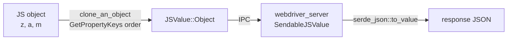

> One change of the Servo fork: `review/09`, 9 of 29 in the stack.
> Below it: [`review/08`](https://github.com/Airodonack/servo/tree/review/08). Above it: [`review/10`](https://github.com/Airodonack/servo/tree/review/10).
> The change itself: [commit 6676e492d32282fadac29d403eb5fbf7e7144fc0](https://github.com/Airodonack/servo/commit/6676e492d32282fadac29d403eb5fbf7e7144fc0). This README sits in a commit on top of it and is not part of the pull request.
> The whole stack: [overview README](https://github.com/Airodonack/servo/blob/vodscribe/main/README.md).

# WebDriver returns objects with their keys in JavaScript's order

A script run through WebDriver that returned `{z:1, a:2, m:3}` came back
with its keys in a different order on almost every call. This change keeps
JavaScript's order from the script to the response, as Chrome's driver
does. It was found while driving an embedding app from its end-to-end
tests, and it changes the embedding API.

## The problem

A script run through WebDriver that returned `{z:1, a:2, m:3}` came back
with its keys in a different order on almost every call: 6 orders in 10
calls. A client comparing the JSON text failed at random. Chrome's driver
keeps JavaScript's order.

The order was lost in two places: `JSValue::Object` held a `HashMap`,
whose iteration order is random per process, and the server collected the
object into another `HashMap` to serialise it.

Every arrow kept the order except the two maps; both are now ordered.

## The change

- [`JSValue::Object`](https://github.com/Airodonack/servo/blob/6676e492d32282fadac29d403eb5fbf7e7144fc0/components/shared/embedder/lib.rs#L1056-L1069)
  holds an `IndexMap`, with indexmap's `serde` feature
  ([Cargo.toml](https://github.com/Airodonack/servo/blob/6676e492d32282fadac29d403eb5fbf7e7144fc0/components/shared/embedder/Cargo.toml#L29)) so
  the order survives IPC.
- [`clone_an_object`](https://github.com/Airodonack/servo/blob/6676e492d32282fadac29d403eb5fbf7e7144fc0/components/script/event_loop/webdriver_handlers.rs#L564-L613)
  fills it in the order `GetPropertyKeys` returns: integer keys ascending,
  then string keys in creation order.
- [`SendableJSValue::serialize`](https://github.com/Airodonack/servo/blob/6676e492d32282fadac29d403eb5fbf7e7144fc0/components/webdriver_server/lib.rs#L270-L301)
  writes the map in order with `collect_map()`. The result goes through
  `serde_json::to_value`, whose `Map` is sorted unless `preserve_order`
  is on; `webdriver_server` now asks for that feature itself
  ([Cargo.toml](https://github.com/Airodonack/servo/blob/6676e492d32282fadac29d403eb5fbf7e7144fc0/components/webdriver_server/Cargo.toml#L28)).
  It was on before only because the script crate enables it.
- A Servo test that took keys out with `remove()` uses `shift_remove()`.

## Options considered

| Option | What it would take | Why not chosen |
|---|---|---|
| **`IndexMap` in `JSValue::Object`** (this change) | A type change in the embedder crate | Chosen: order kept end to end, one map type. `indexmap` is already in the workspace. |
| `Vec<(String, JSValue)>` | The same type change | Loses lookup by key, which embedders use. |
| Sort the keys in the server | No API change | Deterministic, but not JavaScript's order, which Chrome returns and clients compare against. |
| Keep `HashMap`, order only in the server | Impossible | The order is already gone once the map is built. |

## What it costs

An API change for embedders: code that builds `JSValue::Object` from a
`HashMap` builds it from an `IndexMap`. Insertion into an `IndexMap` costs
about what a `HashMap` does.

## Spec

[WebDriver, clone an object](https://w3c.github.io/webdriver/#dfn-clone-an-object):

> Otherwise A new Object. For each enumerable property in value, run the
> following substeps: [...] set a property of result with name name and
> value equal to cloned property result's data.

The properties are visited in [[OwnPropertyKeys]] order
([ECMAScript](https://tc39.es/ecma262/#sec-ordinaryownpropertykeys):
integer keys ascending, then strings in creation order), and the clone is
a new object built in that order. JSON text order is not normative, but
the clone's order is what Chrome's driver returns.

## How it was checked

From the commit message (2026-11-01): a script against headless
servoshell, ten executes per case. Before: `RESULT flat distinct=6`,
`nested distinct=10`, `array distinct=6`, `intkeys distinct=8`,
`RESULT pass=False`. After: `distinct=1` in every case, with the expected
text, for example `{"1":4,"2":2,"b":1,"a":3}`; `RESULT pass=True`. WPT
`webdriver/tests/classic/execute_script`: 10 as expected before and after
(`objects.py` compares parsed values, so it passed before too).

The restack's gate (2026-11-05) ran on this change before the day's fixups
to lower refs were folded in (the same patch): `mach fmt` changed nothing,
`test-tidy` passed, and `mach check` exited 0 with no warnings. At the
stack's tip the same checks and `mach clippy` pass.

Not yet done: a WPT or unit test for key order in the JSON text.

## Questions a reviewer may ask

- **Is the order normative?** The text order is not; the clone is built
  in property order, and Chrome keeps it.
- **Why does webdriver_server need `preserve_order` if script has it?**
  Cargo unifies features in a full build, so it worked by accident; a
  build of webdriver_server alone would sort the keys.
