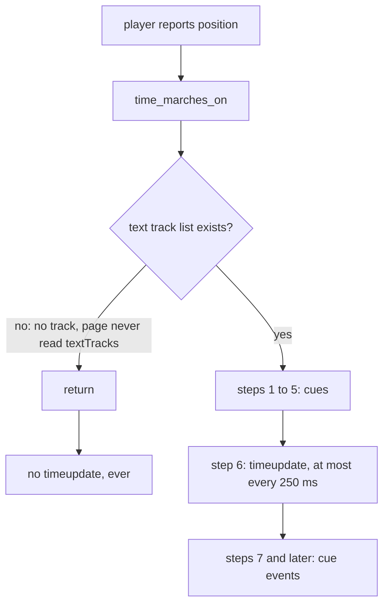

> One change of the Servo fork: `review/02`, 2 of 29 in the stack.
> Below it: [`review/01`](https://github.com/Airodonack/servo/tree/review/01). Above it: [`review/03`](https://github.com/Airodonack/servo/tree/review/03).
> The change itself: [commit 6ecc8a042e27800f23115858b4bad126b5b80ae3](https://github.com/Airodonack/servo/commit/6ecc8a042e27800f23115858b4bad126b5b80ae3). This README sits in a commit on top of it and is not part of the pull request.
> The whole stack: [overview README](https://github.com/Airodonack/servo/blob/vodscribe/main/README.md).

# Videos without text tracks fire timeupdate again during playback

A playing video with no captions or other text tracks never fired
`timeupdate`. Pages that follow playback through that event, such as custom
players' progress bars and the Media Source seek tests, saw time stand still.
This change fires it again. One step of one function moves into a helper.

## The problem

During playback the player reports its position about every 500 ms, and
[`playback_position_changed`](https://github.com/Airodonack/servo/blob/6ecc8a042e27800f23115858b4bad126b5b80ae3/components/script/dom/html/embedded_content/htmlmediaelement.rs#L2918-L2940)
runs the spec's "time marches on" steps. Step 6 of those steps queues the
periodic `timeupdate`.

[`time_marches_on`](https://github.com/Airodonack/servo/blob/6ecc8a042e27800f23115858b4bad126b5b80ae3/components/script/dom/html/embedded_content/htmlmediaelement.rs#L631-L650)
first needs the element's text track list, to collect cues. That list is
created lazily, by the
[`textTracks` getter](https://github.com/Airodonack/servo/blob/6ecc8a042e27800f23115858b4bad126b5b80ae3/components/script/dom/html/embedded_content/htmlmediaelement.rs#L3647-L3656),
`addTextTrack()` or a `<track>` child. Before this change, without the list
the function returned at once, and step 6 never ran:



So whether a page got `timeupdate` depended on whether anything had ever
touched `textTracks`. A plain `<video src>` with no `<track>` got none.

## The change

Step 6 moves into its own function,
[`queue_timeupdate_for_normal_playback`](https://github.com/Airodonack/servo/blob/6ecc8a042e27800f23115858b4bad126b5b80ae3/components/script/dom/html/embedded_content/htmlmediaelement.rs#L615-L629),
unchanged. `time_marches_on` calls it in both places:

- where step 6 was, after the cue lists
  ([lines 699 to 700](https://github.com/Airodonack/servo/blob/6ecc8a042e27800f23115858b4bad126b5b80ae3/components/script/dom/html/embedded_content/htmlmediaelement.rs#L699-L700));
- in the early return when there is no list
  ([lines 643 to 650](https://github.com/Airodonack/servo/blob/6ecc8a042e27800f23115858b4bad126b5b80ae3/components/script/dom/html/embedded_content/htmlmediaelement.rs#L643-L650)).

```rust
let Some(text_tracks_list) = self.text_tracks_list.get() else {
    // No text tracks, so no cues to update, but the timeupdate of step 6
    // still applies.
    self.position_when_time_marches_on_ran
        .set(Some(self.current_playback_position.get()));
    self.queue_timeupdate_for_normal_playback(playback_was_moved_monotonic_increase);
    return;
};
```

The early return also records the position, as step 3 does on the full path.
Step 4 uses that position as "last time" to find missed cues, so a track
added later starts from the right place instead of from the first run.

## Options considered

| Option | Why not chosen |
|---|---|
| **Run step 6 on the early return too** (this change) | Chosen: no behaviour change for elements with text tracks, and no new object. |
| Create the text track list on first playback | Allocates a DOM object for every playing element only to find it empty. |
| Fire `timeupdate` from `playback_position_changed` instead | Moves a step of "time marches on" out of the function that implements it, and the other callers would need it too. |

## Spec

[HTML, time marches on](https://html.spec.whatwg.org/multipage/media.html#time-marches-on),
step 6, which does not depend on cues:

> If the time was reached through the usual monotonic increase of the current
> playback position during normal playback, and if the user agent has not
> fired a timeupdate event at the element in the past 15 to 250ms and is not
> still running event handlers for such an event, then the user agent must
> queue a media element task given the media element to fire an event named
> timeupdate at the element.

With no text tracks, steps 1 and 2 give empty cue lists. The spec has no
early exit before step 6.

## How it was checked

From the runs of `host/timeupdate.html` (a progressive MP4 played for 5 s,
`timeupdate` events counted) on 2026-10-22, with the fork then on the 0.7.0
base:

| Build | Events in 5 s | `currentTime` at 5 s |
|---|---|---|
| upstream 0.7.0 release (`tu-prog-070`) | 0 | 3.95 |
| fork without the fix (`tu-prog`) | 0 | 3.95 |
| fork with the fix (`tu-prog2`) | 8 | 3.55 |

The same page on the rebased stack (2026-11-01) counts 9 events by 4.45 s.
At this commit, the restack's gate (2026-11-05): `mach fmt` changed nothing,
`test-tidy` passed, and `mach check` exited 0 with no warnings.

Not yet done: a run without the fix on the current upstream base, and a
web-platform-test for `timeupdate` on a video with no text tracks.

## Questions a reviewer may ask

- **Why 8 events in 3.5 s and not 14?** The player reports the position
  about every 500 ms, and step 6 runs once per report. The 250 ms floor
  never applies at that rate.
- **Does this change anything for elements with text tracks?** No. The full
  path calls the same helper at the same step.
- **Why record the position on the early return?** So that step 4's "last
  time" is right when a text track appears later. Without it the first full
  run would treat everything since playback started as missed.
