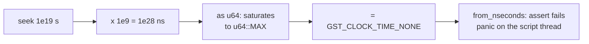

> One change of the Servo fork: `review/04`, 4 of 29 in the stack.
> Below it: [`review/03`](https://github.com/Airodonack/servo/tree/review/03). Above it: [`review/05`](https://github.com/Airodonack/servo/tree/review/05).
> The change itself: [commit e11af1aef96762a0f96594c5891e02e23f30e053](https://github.com/Airodonack/servo/commit/e11af1aef96762a0f96594c5891e02e23f30e053). This README sits in a commit on top of it and is not part of the pull request.
> The whole stack: [overview README](https://github.com/Airodonack/servo/blob/vodscribe/main/README.md).

# Seeking past 584 years into media no longer crashes the page

The GStreamer player turned a seek time in seconds into nanoseconds with a
plain cast. Past about 584 years the cast gives GStreamer's "no time" value,
and building a `ClockTime` from that value panics, in release builds too,
which takes the page's script thread down. This change adds one conversion
function, `clock_time()`, that never panics, uses it for seeks, and tests it.
The Media Source backend higher in the stack
([`review/19`](https://github.com/Airodonack/servo/tree/review/19)) uses the
same function for every time a page passes in.

## The problem

[`GStreamerPlayer::seek`](https://github.com/Airodonack/servo/blob/e11af1aef96762a0f96594c5891e02e23f30e053/components/media/backends/gstreamer/player.rs#L276-L290)
did:

```rust
let time = time * 1_000_000_000.;
self.player.seek(gstreamer::ClockTime::from_nseconds(time as u64));
```

Rust's float to integer cast saturates: anything at or above 2^64 becomes
`u64::MAX`. That value is `GST_CLOCK_TIME_NONE`, and gstreamer-rs 0.25
refuses it:

```rust
// gstreamer-0.25.4, src/format/clock_time.rs
pub const fn from_nseconds(nseconds: u64) -> Self {
    assert!(
        nseconds != ffi::GST_CLOCK_TIME_NONE,
        "Attempt to build a `ClockTime` with value `GST_CLOCK_TIME_NONE`",
    );
```



The boundary, computed for this README (`clock_bound.py`):

| Seconds | `(s * 1e9) as u64` | Result |
|---|---|---|
| 1.8e10 | 18000000000000000000 | fine |
| 1.8446744073e10 | 18446744072999999488 | fine |
| 1.9e10 | 18446744073709551615 | `GST_CLOCK_TIME_NONE`, panic |
| 1e19, 1e20 | 18446744073709551615 | `GST_CLOCK_TIME_NONE`, panic |

The threshold is 2^64 ns, 1.8447e10 s, 584.5 years.

### Who can reach it

At this commit, through plain `src` playback, hardly anyone. The element's
[seek algorithm](https://github.com/Airodonack/servo/blob/e11af1aef96762a0f96594c5891e02e23f30e053/components/script/dom/html/embedded_content/htmlmediaelement.rs#L2150-L2198)
clamps the time to the duration (step 6) and then to the `seekable` ranges
(step 8). For a file, `seekable` is `[0, duration]`; for a stream of unknown
duration it is the buffered ranges. Only a file whose own header claims a
duration beyond 584 years would get through. That was not tried.

With Media Source Extensions (`review/19` and `review/20`) the page sets the
duration itself, and the backend skips the player's duration check. A page
that sets `mediaSource.duration = 1e20` and then `currentTime = 1e19` reached
the panic. The same cast also turned every MSE time (duration, timestamp
offset, append window, removal range, live seekable range) into a
`ClockTime`. A run of the MSE web-platform-tests on the fork before the fix
logged the panic from the media source code: "Attempt to build a `ClockTime`
with value `GST_CLOCK_TIME_NONE` (thread Script#4, at
components/media/backends/gstreamer/media_source.rs:39)".

The fix sits here, well below the MSE code (`review/18` to `review/20`),
because the conversion belongs to the existing player, and `review/19` reuses
it.

## The change

[`clock_time()`, lines 119 to 132](https://github.com/Airodonack/servo/blob/e11af1aef96762a0f96594c5891e02e23f30e053/components/media/backends/gstreamer/player.rs#L119-L132):

```rust
pub(crate) fn clock_time(seconds: f64) -> gstreamer::ClockTime {
    let nanoseconds = seconds * 1_000_000_000.0;
    if nanoseconds.is_nan() || nanoseconds <= 0.0 {
        gstreamer::ClockTime::ZERO
    } else if nanoseconds >= gstreamer::ClockTime::MAX.nseconds() as f64 {
        gstreamer::ClockTime::MAX
    } else {
        gstreamer::ClockTime::from_nseconds(nanoseconds as u64)
    }
}
```

and `seek` calls `self.player.seek(clock_time(time))`
([line 288](https://github.com/Airodonack/servo/blob/e11af1aef96762a0f96594c5891e02e23f30e053/components/media/backends/gstreamer/player.rs#L288)).

- `ClockTime::MAX` is `GST_CLOCK_TIME_NONE - 1`. As an `f64` it rounds to
  exactly 2^64, so the comparison catches every value the cast would
  saturate. The largest `f64` below 2^64 is 18446744073709549568, under
  `MAX`, so the last branch never builds `NONE`.
- NaN and negative times become zero. The element never sends them for a
  seek; the MSE setters can.

The unit tests at the end of the same file
([lines 1082 to 1118](https://github.com/Airodonack/servo/blob/e11af1aef96762a0f96594c5891e02e23f30e053/components/media/backends/gstreamer/player.rs#L1082-L1118))
cover NaN, negative times, -0, 0, minus infinity, ordinary times,
`ClockTime::MAX`, just past it, 1e20 and infinity. For them to run,
`servo-media-gstreamer` joins the crates that `./mach test-unit` tests
([testing_commands.py, line 205](https://github.com/Airodonack/servo/blob/e11af1aef96762a0f96594c5891e02e23f30e053/python/servo/testing_commands.py#L205)),
which CI's unit-test step runs too.

What GStreamer does with `MAX`, measured with a GstPlay probe (`seek_max.py`,
GStreamer 1.28.7, a 90 s MP4, playing, then `seek(G_MAXUINT64 - 1)`):
`SEEK_DONE 90000000000`, then `END_OF_STREAM`, no error. The seek lands at
the end.

## Options considered

| Option | Why not chosen |
|---|---|
| **Clamp to `ClockTime::MAX` in one helper** (this change) | Chosen: never panics, keeps the order of times, one place for every caller. |
| Refuse the seek with `SeekOutOfRange` | The element has already set `seeking`, and a refused seek is a separate bug higher in the stack. For MSE setters a refusal would throw where the spec allows the value. |
| `ClockTime::try_from_nseconds` and log | Same refusal problem, at each call site. |
| Clamp in the element | Every backend would inherit a GStreamer limit, and the MSE setters do not go through the seek algorithm. |

## Spec

[HTML, `duration`](https://html.spec.whatwg.org/multipage/media.html#dom-media-duration):

> If the media resource is not known to be bounded (e.g. streaming radio, or a
> live event with no announced end time), then the attribute must return the
> positive Infinity value.

`currentTime` takes any finite double, and an MSE page may set any finite
duration. No spec limit stops a time past 584 years before it reaches the
backend.

## How it was checked

- Fresh for this README: `clock_bound.py` (the table above) and `seek_max.py`
  (GStreamer's answer to `MAX`).
- `host/mse_huge_times.html` sets duration 1e20, a timestamp offset of 1e20,
  an append window of [1e19, 1e20], a live seekable range to 1e20, removes
  [1e19, 1e20) and seeks to 1e19. On the fixed stack (2026-10-22 and
  2026-11-01) every step prints "ok" and the page ends with
  `final alive, t=10000000000000000000 seeking=true`: the seek waits for data
  that never comes, as it should.
- At this commit, the restack's gate (2026-11-05): `mach fmt` changed
  nothing, `test-tidy` passed, `mach check` exited 0 with no warnings, and
  `./mach test-unit -p servo-media-gstreamer` ran the three tests:
  `Summary [   0.005s] 3 tests run: 3 passed, 0 skipped`.
- The commit message reports that with the plain cast in place of
  `clock_time()`, the test past the largest clock time panics. That run is
  not in the restack's logs.

Not yet done: a run of that page at this commit's parent with the MSE layers
on top, to show the panic and the fix as one before/after pair. The page
needs MSE, which only exists from `review/20` up.

## Questions a reviewer may ask

- **Why not `u64::try_from`?** Float to integer conversion has no `TryFrom`
  in std. The explicit comparison is the usual way.
- **Is clamping silently correct?** A target past 584 years is past the end
  of any real media. GStreamer lands at the end, which is what the element's
  own clamp would have done with a real duration.
- **Why is the function `pub(crate)`?** `media_source.rs` in `review/19` uses
  it for every MSE time.
