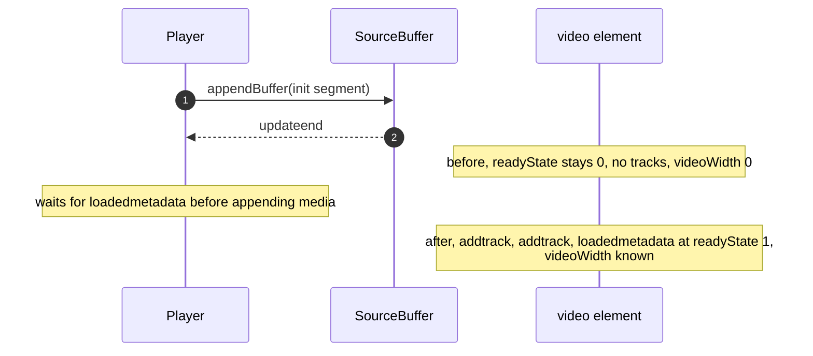
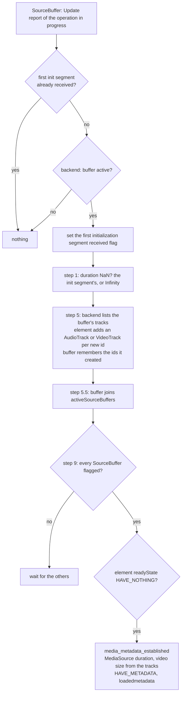
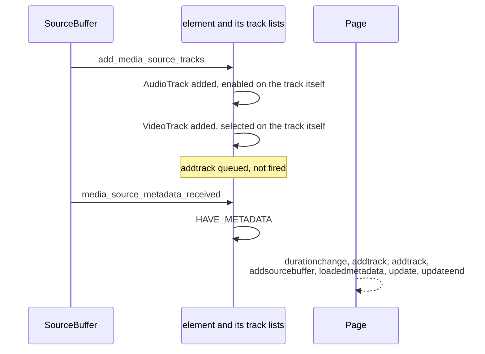
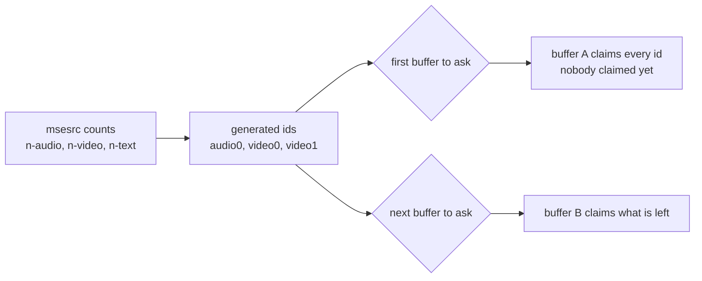

> One change of the Servo fork: `review/22`, 22 of 29 in the stack.
> Below it: [`review/21`](https://github.com/Airodonack/servo/tree/review/21). Above it: [`review/23`](https://github.com/Airodonack/servo/tree/review/23).
> The change itself: [commit 02a524907927bf084171efa82081aac5c0c4c466](https://github.com/Airodonack/servo/commit/02a524907927bf084171efa82081aac5c0c4c466). This README sits in a commit on top of it and is not part of the pull request.
> The whole stack: [overview README](https://github.com/Airodonack/servo/blob/vodscribe/main/README.md).

# Media Source videos get tracks and metadata from the init segment

A Media Source video now fires `loadedmetadata`, lists its audio and video
tracks and knows its size once every SourceBuffer has received its
initialization segment, before any media is appended. Removing a
SourceBuffer removes the tracks it created.

## The problem

An MSE stream starts with an initialization segment per SourceBuffer: the
container's header (MP4 `ftyp` and `moov`, WebM's EBML header and `Tracks`),
which names the tracks and codecs and holds no frames. Media segments follow.

Many players append the initialization segment, wait for `loadedmetadata`,
and only then choose what media to fetch. So do several web-platform-tests
(`mediasource-buffered-seek`, `mediasource-seek-during-pending-seek`).

Before this change the element reached `HAVE_METADATA` only when the
GStreamer player prerolled, and preroll needs a decoded frame, so a media
segment. Such a player waits for an event that waits for it:

## The change

The steps run when a buffer's first initialization segment has been
processed, from the `Update` report of the append that delivered it:

By layer:

- **Seam.** [`MediaSourceTrack`](https://github.com/Airodonack/servo/blob/02a524907927bf084171efa82081aac5c0c4c466/components/media/player/media_source.rs#L111-L128)
  (id, kind, and a video track's size when the segment gives it) and
  [`SourceBufferHandle::tracks()`](https://github.com/Airodonack/servo/blob/02a524907927bf084171efa82081aac5c0c4c466/components/media/player/media_source.rs#L173-L179).
- **GStreamer backend.**
  [`tracks()`](https://github.com/Airodonack/servo/blob/02a524907927bf084171efa82081aac5c0c4c466/components/media/backends/gstreamer/media_source.rs#L371-L390)
  reads the buffer's `tracks` property, a `GstStreamCollection` that mselib
  fills from the initialization segment. The property is new in the
  GStreamer series. Ids are mselib's stream ids, unique within the media
  source, and a video track's size comes from its caps
  ([`stream_track`](https://github.com/Airodonack/servo/blob/02a524907927bf084171efa82081aac5c0c4c466/components/media/backends/gstreamer/media_source.rs#L177-L233)).
  Without the property it falls back to the fallback below.
- **DOM.** [`first_initialization_segment_received`](https://github.com/Airodonack/servo/blob/02a524907927bf084171efa82081aac5c0c4c466/components/script/dom/media/mediasource.rs#L472-L513)
  gains steps 5 and 9. The SourceBuffer keeps the
  [ids of the tracks it created](https://github.com/Airodonack/servo/blob/02a524907927bf084171efa82081aac5c0c4c466/components/script/dom/media/sourcebuffer.rs#L57-L59),
  and `removeSourceBuffer()`
  [removes them](https://github.com/Airodonack/servo/blob/02a524907927bf084171efa82081aac5c0c4c466/components/script/dom/media/mediasource.rs#L847-L851)
  (steps 3 to 5) through new
  [`AudioTrackList::remove`](https://github.com/Airodonack/servo/blob/02a524907927bf084171efa82081aac5c0c4c466/components/script/dom/audio/audiotracklist.rs#L110-L142)
  and [`VideoTrackList::remove`](https://github.com/Airodonack/servo/blob/02a524907927bf084171efa82081aac5c0c4c466/components/script/dom/media/videotracklist.rs#L118-L150),
  which queue `removetrack`, then `change` for an enabled or selected track.
- **Element.**
  [`add_media_source_tracks`](https://github.com/Airodonack/servo/blob/02a524907927bf084171efa82081aac5c0c4c466/components/script/dom/html/embedded_content/htmlmediaelement.rs#L2927-L2970)
  and [`media_source_metadata_received`](https://github.com/Airodonack/servo/blob/02a524907927bf084171efa82081aac5c0c4c466/components/script/dom/html/embedded_content/htmlmediaelement.rs#L2995-L3017)
  call the helpers of [`review/21`](https://github.com/Airodonack/servo/tree/review/21).
  The player's metadata path
  [does nothing](https://github.com/Airodonack/servo/blob/02a524907927bf084171efa82081aac5c0c4c466/components/script/dom/html/embedded_content/htmlmediaelement.rs#L2688-L2693)
  while a MediaSource is attached, so tracks and `HAVE_METADATA` come once.

### Track events, in the order a page sees them

A track of a MediaSource
([`TrackOrigin::MediaSource`](https://github.com/Airodonack/servo/blob/02a524907927bf084171efa82081aac5c0c4c466/components/script/dom/html/embedded_content/htmlmediaelement.rs#L350-L359))
differs from a track of a plain file in two ways
([audio](https://github.com/Airodonack/servo/blob/02a524907927bf084171efa82081aac5c0c4c466/components/script/dom/html/embedded_content/htmlmediaelement.rs#L2776-L2812)):

- It is enabled or selected on the track, before it is announced, as the
  spec's steps do. Going through the list would fire `change` and ask
  GStreamer to switch tracks, which fails before the player has streams.
- `addtrack` is queued, with a check that the element has not reloaded
  since, as the spec's note says ("queue a task to fire an event named
  addtrack"). A page's handler then runs after the algorithm, not in the
  middle of it.

`media_metadata_established`
[fires `durationchange` only if the duration changed](https://github.com/Airodonack/servo/blob/02a524907927bf084171efa82081aac5c0c4c466/components/script/dom/html/embedded_content/htmlmediaelement.rs#L3050-L3056):
step 1 has already set it through the MediaSource. It takes the video size
[as an `Option`](https://github.com/Airodonack/servo/blob/02a524907927bf084171efa82081aac5c0c4c466/components/script/dom/html/embedded_content/htmlmediaelement.rs#L3061-L3067);
without one the first frame sets it.

### The fallback for a stock mselib

Stock mselib keeps its tracks private. The only synchronous view is
`msesrc`'s count of tracks by type, over all buffers. Each buffer claims the
counted tracks no other buffer has claimed
([`counted_tracks` and `ClaimedTracks`](https://github.com/Airodonack/servo/blob/02a524907927bf084171efa82081aac5c0c4c466/components/media/backends/gstreamer/media_source.rs#L177-L233)).
The ids are generated, as the spec has the user agent do anyway, and there is
no size. When two buffers' initialization segments are parsed before either
append ends, the first to ask claims both buffers' tracks.

The counts are read on the script thread. In mselib 1.28.6,
`n_streams_by_type` walks the streams table without a lock while
`gst_mse_src_emit_streams` inserts into it under `STREAMS_LOCK` on the append
thread, so a read during another buffer's initialization segment can trip
GLib's iterator check. The GStreamer series takes the lock there.

## Options considered

| Option | Why not chosen |
|---|---|
| **Per-buffer tracks from a new mselib property, with a fallback** (this change) | Chosen: the spec's crediting and the size at `loadedmetadata` with the GStreamer series; something that works on a stock mselib. |
| Keep waiting for the player's metadata | That is the stall above. |
| `msesrc`'s pads | They have no stream or caps until data flows. |
| `msesrc`'s stream-collection message | It is posted on its parent bin's bus, which already has a sync handler, so nothing outside can read it synchronously. |
| Only the counts, no new mselib API | Tracks credited to the wrong buffer when two initialization segments arrive together, and no size until the first frame. |
| Fire `addtrack` at once, as the plain-file path does | Page code would run in the middle of the algorithm and see half-finished state. |
| Implement the step that drops `readyState` to `HAVE_METADATA` when a buffer added during playback gets its first initialization segment | Nothing would raise `readyState` again afterwards, so playback would stop. Left out. |

## Spec

[Media Source Extensions, 5.5.7 Initialization Segment Received](https://w3c.github.io/media-source/#sourcebuffer-init-segment-received).
Step 5 creates the tracks: "Add new audio track to the audioTracks attribute
on media element", with the note "This should trigger AudioTrackList [HTML]
logic to queue a task to fire an event named addtrack". Step 9:

> If each object in sourceBuffers of the parent media source has [[first
> initialization segment received flag]] equal to true, then [...] If the
> HTMLMediaElement's readyState attribute is HAVE_NOTHING, then set the
> HTMLMediaElement's readyState attribute to HAVE_METADATA.

[removeSourceBuffer](https://w3c.github.io/media-source/#dom-mediasource-removesourcebuffer),
steps 3 to 5, remove the buffer's audio, video and text tracks from the media
element.

Not implemented: step 8 (the drop to `HAVE_METADATA` above), text tracks,
track kinds (mselib gives none), `SourceBuffer.audioTracks` and
`videoTracks`, and the per-SourceBuffer "audio track added" flag: a second
audio SourceBuffer's track is not enabled, because the element enables only
its first audio track.

## How it was checked

- **Stock mselib, measured fresh (2026-11-03):** a GstMse probe over
  playbin3 on GStreamer 1.28.7 from nixpkgs, appending the `ftyp` and `moov`
  of `host/media/tracks_video.mp4`, then its first `moof` and `mdat`. In 3 of
  3 runs:

  | Moment | buffer active | `msesrc` n-video | `tracks` property | `msesrc` ready state |
  |---|---|---|---|---|
  | update-end of the init segment | no | 0 | absent | nothing |
  | update-end of the first media segment | no | 0 | absent | nothing |
  | 300 ms later | yes | 1 | absent | metadata |

  So on a stock mselib the buffer turns active only after the first media
  segment has been appended, and the DOM, which looks at `Update`, sees it at
  the following append. The probe process crashed on exit after printing, in
  all three runs; that was not looked into.
- **Source read, fresh:** the unlocked `n_streams_by_type` and the locked
  insert in `gst_mse_src_emit_streams` in GStreamer 1.28.6's `gstmsesrc.c`;
  no `tracks` property in 1.28.6's `gstsourcebuffer.c`.
- **Pages, on the build of the ported series (2026-11-02):**
  - `host/mse_init_only.html`: `durationchange rs=1 d=Infinity size=1280x720`,
    `addtrack` for one audio and one video track, `loadedmetadata rs=1`, from
    the initialization segment alone.
  - `host/mse_addtrack.html`: the event order shown above.
  - `host/mse_addtrack.html?remove` (the `addtrack` handler calls
    `removeSourceBuffer()`): `removetrack` and `change` for both tracks, both
    lists empty.
- **Older fork run (2026-11-01, `host/mse_tracks.html`):** `videoWidth` and
  `videoHeight` at `loadedmetadata` went from 0x0 to 1280x720, and removing
  the audio buffer removed only the audio track, 8 of 8 runs each.
- **Builds:** the restack's gate (2026-11-05) ran on this change before the
  day's fixups to lower refs were folded in (the same patch): `mach fmt`
  changed nothing, `test-tidy` passed, and `mach check` exited 0 with no
  warnings. At the stack's tip the same checks and `mach clippy` pass.

Not yet done: the probe against the GStreamer series' mselib, and the pages
on this commit alone.

## Questions a reviewer may ask

- **Why a fallback at all?** So the change works on the GStreamer releases
  people have. It is worse there (crediting, no size, one append late) and
  says so in the code.
- **Are mselib's stream ids valid track ids?** The spec has the user agent
  generate unique ids. Stream ids are unique within the media source and
  stable, and the buffer needs a stable key to remove its tracks.
- **What if the page reloads between the algorithm and the queued
  `addtrack`?** The task compares the element's generation and does nothing.
