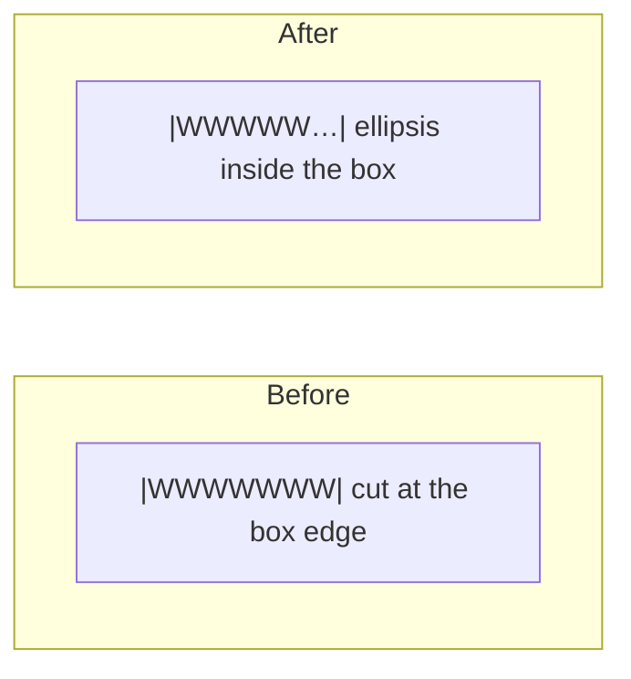

> One change of the Servo fork: `review/14`, 14 of 29 in the stack.
> Below it: [`review/13`](https://github.com/Airodonack/servo/tree/review/13). Above it: [`review/15`](https://github.com/Airodonack/servo/tree/review/15).
> The change itself: [commit 1b6724823a584a2d7dfed94cac4b5364a32d25f9](https://github.com/Airodonack/servo/commit/1b6724823a584a2d7dfed94cac4b5364a32d25f9). This README sits in a commit on top of it and is not part of the pull request.
> The whole stack: [overview README](https://github.com/Airodonack/servo/blob/vodscribe/main/README.md).

# Text that overflows a clipped box can end in an ellipsis

`text-overflow: ellipsis` did nothing in Servo: a clipped title was cut
mid-letter with no "…". Stylo compiled the property for Servo behind a
preference that was off. This change turns it on and implements the
ellipsis in line layout. It is independent of the rest of the stack.

## Suggested reading order

| Step | File | What to look for |
|---|---|---|
| 1 | [flow/inline/mod.rs, lines 1441 to 1536](https://github.com/Airodonack/servo/blob/1b6724823a584a2d7dfed94cac4b5364a32d25f9/components/layout/flow/inline/mod.rs#L1441-L1536) | when a line gets an ellipsis |
| 2 | [flow/inline/line.rs, lines 732 to 783](https://github.com/Airodonack/servo/blob/1b6724823a584a2d7dfed94cac4b5364a32d25f9/components/layout/flow/inline/line.rs#L732-L783) | how the text is cut to make room |

## The problem

```css
.title { width: 100px; white-space: nowrap; overflow: hidden; text-overflow: ellipsis; }
```

The title was cut mid-letter with no "…": stylo compiled `text-overflow` for
Servo behind a preference that was off, so the declaration was dropped.



## The change

- [prefs.rs, lines 43 to 47](https://github.com/Airodonack/servo/blob/1b6724823a584a2d7dfed94cac4b5364a32d25f9/components/config/prefs.rs#L43-L47) turns
  stylo's `layout.css.text-overflow.enabled` on, before the early return that
  skips unchanged preferences (they are unchanged at startup).
- [`ellipsis_for_current_line`](https://github.com/Airodonack/servo/blob/1b6724823a584a2d7dfed94cac4b5364a32d25f9/components/layout/flow/inline/mod.rs#L1441-L1536)
  decides per line: the block container (also through an anonymous block) has
  `overflow` other than `visible` in the inline axis, `text-overflow` at the
  end side is `ellipsis` or a string, and the content ends past the line box.
  Hanging white space does not count. The ellipsis is shaped with the block's
  first font. Single-line text inputs are left alone.
- [`truncate_text_run_for_ellipsis`](https://github.com/Airodonack/servo/blob/1b6724823a584a2d7dfed94cac4b5364a32d25f9/components/layout/flow/inline/line.rs#L732-L783)
  keeps the glyph clusters that fit before the ellipsis, using
  [`ShapedTextSlice::leading_part_fitting_in`](https://github.com/Airodonack/servo/blob/1b6724823a584a2d7dfed94cac4b5364a32d25f9/components/fonts/glyph.rs#L747-L818),
  which also handles right-to-left runs. Atomic inlines that do not fit are
  hidden. The ellipsis is placed right after what remains
  ([line.rs, lines 451 to 458](https://github.com/Airodonack/servo/blob/1b6724823a584a2d7dfed94cac4b5364a32d25f9/components/layout/flow/inline/line.rs#L451-L458)).
- Hidden text keeps a fragment with no glyphs, so positions and `scrollWidth`
  do not change.

## Options considered

| Option | Why not chosen |
|---|---|
| **Cut at line layout, after line breaking** (this change) | Chosen: the line's content is final there, and fragments keep their positions, so scrolling still reveals the hidden text. |
| Draw the ellipsis over the content at paint time | The spec says to hide characters so the ellipsis sits right after the remaining content, not over a half glyph. |
| Leave the preference off | The property is common and every other engine ships it. |

## Spec

[CSS Overflow 3, text-overflow](https://drafts.csswg.org/css-overflow-3/#text-overflow):

> For the ellipsis value implementations must hide characters and atomic
> inline-level elements at the end edge of the line as necessary to fit the
> ellipsis, and place the ellipsis immediately adjacent to the end edge of the
> remaining inline content. The first character or atomic inline-level element
> on a line must be clipped rather than ellipsed.

## How it was checked

From the commit's own run (servoshell, headless Chrome 156):
`host/text-overflow.html`, the ink at the end of ten cases matches Chrome
except the `<string>` value, which Chrome does not support; `scrollWidth`
unchanged. WPT `text-overflow-in-anonymous-block` passes.

Rerun on 2026-11-03, Chrome side only (no Servo build): `text-overflow.html`
gives `supports ellipsis=true string=false`.

The restack's gate (2026-11-05) ran on this change before the day's fixups
to lower refs were folded in (the same patch): `mach fmt` changed nothing,
`test-tidy` passed, and `mach check` exited 0 with no warnings. At the
stack's tip the same checks and `mach clippy` pass.

## Questions a reviewer may ask

- **Why is the `<string>` value of `text-overflow` supported when Chrome does
  not?** Stylo parses it and the spec defines it; Firefox supports it.
- **Does scrolling still reveal the hidden text?** Yes: hidden text keeps a
  fragment with no glyphs, so positions and `scrollWidth` do not change.
