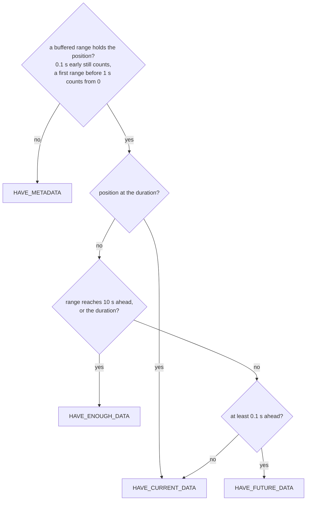
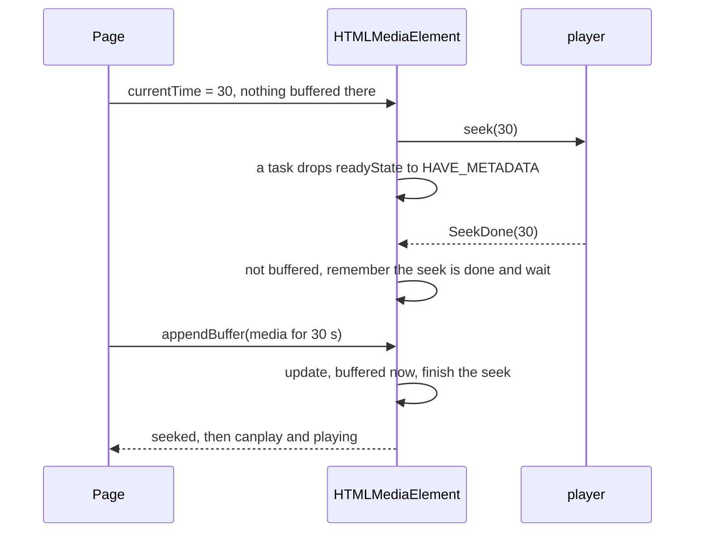
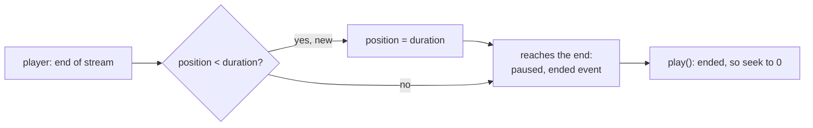

> One change of the Servo fork: `review/24`, 24 of 29 in the stack.
> Below it: [`review/23`](https://github.com/Airodonack/servo/tree/review/23). Above it: [`review/25`](https://github.com/Airodonack/servo/tree/review/25).
> The change itself, six commits:
> - [3631f0eab11b853a046b650a26e6a2c5c5a59ed1](https://github.com/Airodonack/servo/commit/3631f0eab11b853a046b650a26e6a2c5c5a59ed1) Video fires waiting when playback runs out of media
> - [57a97d491d682622bf8bf805e34ba718177feac5](https://github.com/Airodonack/servo/commit/57a97d491d682622bf8bf805e34ba718177feac5) A video's ready state follows the player's buffering
> - [9083bb8e446fea9e56d631b5b71b17659d4d3771](https://github.com/Airodonack/servo/commit/9083bb8e446fea9e56d631b5b71b17659d4d3771) Video with a MediaSource waits for media it lacks
> - [f8009e63d516946dddee3e7996b6eb1901e21c6b](https://github.com/Airodonack/servo/commit/f8009e63d516946dddee3e7996b6eb1901e21c6b) Video plays on after a MediaSource that ended gets more media
> - [232a4f94c6bb3a883bb2fd3df095f0364f701053](https://github.com/Airodonack/servo/commit/232a4f94c6bb3a883bb2fd3df095f0364f701053) A seek the player refuses now ends instead of leaving seeking stuck
> - [eecdf4abea35537c145a8542b118ae42f5b6a485](https://github.com/Airodonack/servo/commit/eecdf4abea35537c145a8542b118ae42f5b6a485) A video that played to its end starts again when played
> This README sits in a commit on top of them and is not part of the pull request.
> The whole stack: [overview README](https://github.com/Airodonack/servo/blob/vodscribe/main/README.md).

# Ready states that follow the media, refused seeks, and replay after the end

Six fixes to the media element's state machine, in `HTMLMediaElement`, the
MSE objects and the player API. Pages could not tell when media ran out, a
refused seek left `seeking` true for good, and `play()` after `ended` often
did nothing.

| Commit | What a page sees |
|---|---|
| 1. "Video fires waiting when playback runs out of media" | `waiting` can fire at all: its condition was inverted. |
| 2. "A video's ready state follows the player's buffering" | readyState drops while the player buffers and rises again, so `play()` after the end of a file plays. |
| 3. "Video with a MediaSource waits for media it lacks" | With a MediaSource, `waiting` when playback runs out of appended media, `canplay` and `playing` when more arrives; a seek to unbuffered media waits for it. |
| 4. "Video plays on after a MediaSource that ended gets more media" | A MediaSource reopened after `ended` plays on from where it stopped, not from zero. |
| 5. "A seek the player refuses now ends instead of leaving seeking stuck" | `seeked` fires even when the player refuses the seek, or merges it into a rewind of its own. |
| 6. "A video that played to its end starts again when played" | At `ended`, `ended` is true, `paused` is true, and `play()` starts over. |

It needs the MSE series below it (`review/18` to `review/22`). Commit 3 is
the large one, about 240 lines. Commits 1 to 4 were one change, split in
four for review; the runs they cite were made on the four together. All
links below point at the last commit of the ref.

## Suggested reading order

| Step | File and lines | What to look for |
|---|---|---|
| 1 | [the `waiting` condition](https://github.com/Airodonack/servo/blob/eecdf4abea35537c145a8542b118ae42f5b6a485/components/script/dom/html/embedded_content/htmlmediaelement.rs#L1196-L1204) | Commit 1, one character. |
| 2 | [Buffering](https://github.com/Airodonack/servo/blob/eecdf4abea35537c145a8542b118ae42f5b6a485/components/script/dom/html/embedded_content/htmlmediaelement.rs#L3643-L3652), [`player_has_data`](https://github.com/Airodonack/servo/blob/eecdf4abea35537c145a8542b118ae42f5b6a485/components/script/dom/html/embedded_content/htmlmediaelement.rs#L3670-L3683) and [`playback_seek_done`](https://github.com/Airodonack/servo/blob/eecdf4abea35537c145a8542b118ae42f5b6a485/components/script/dom/html/embedded_content/htmlmediaelement.rs#L3459-L3493) | Commit 2: the player's state drives readyState for a plain file. |
| 3 | [constants](https://github.com/Airodonack/servo/blob/eecdf4abea35537c145a8542b118ae42f5b6a485/components/script/dom/html/embedded_content/htmlmediaelement.rs#L129-L155) | Commit 3: the four user-agent numbers and where each comes from. |
| 4 | [`media_source_ready_state`](https://github.com/Airodonack/servo/blob/eecdf4abea35537c145a8542b118ae42f5b6a485/components/script/dom/html/embedded_content/htmlmediaelement.rs#L3506-L3556) | MSE "SourceBuffer Monitoring" as one function of the buffered ranges and the position. |
| 5 | [`update_media_source_ready_state`](https://github.com/Airodonack/servo/blob/eecdf4abea35537c145a8542b118ae42f5b6a485/components/script/dom/html/embedded_content/htmlmediaelement.rs#L3558-L3599) | Applies it; while seeking it only lowers readyState or finishes the seek. |
| 6 | [callers](https://github.com/Airodonack/servo/blob/eecdf4abea35537c145a8542b118ae42f5b6a485/components/script/dom/media/sourcebuffer.rs#L282-L284): SourceBuffer update, [abort](https://github.com/Airodonack/servo/blob/eecdf4abea35537c145a8542b118ae42f5b6a485/components/script/dom/media/sourcebuffer.rs#L543-L550), [end of stream](https://github.com/Airodonack/servo/blob/eecdf4abea35537c145a8542b118ae42f5b6a485/components/script/dom/media/mediasource.rs#L570-L572), [duration change](https://github.com/Airodonack/servo/blob/eecdf4abea35537c145a8542b118ae42f5b6a485/components/script/dom/html/embedded_content/htmlmediaelement.rs#L3273-L3275), [position update](https://github.com/Airodonack/servo/blob/eecdf4abea35537c145a8542b118ae42f5b6a485/components/script/dom/html/embedded_content/htmlmediaelement.rs#L3438-L3440), [seek](https://github.com/Airodonack/servo/blob/eecdf4abea35537c145a8542b118ae42f5b6a485/components/script/dom/html/embedded_content/htmlmediaelement.rs#L2380-L2387) | When readyState is re-evaluated. |
| 7 | [resume after the player's end](https://github.com/Airodonack/servo/blob/eecdf4abea35537c145a8542b118ae42f5b6a485/components/script/dom/html/embedded_content/htmlmediaelement.rs#L571-L580), [`Player::at_end_of_media`](https://github.com/Airodonack/servo/blob/eecdf4abea35537c145a8542b118ae42f5b6a485/components/media/player/lib.rs#L132-L136) | Commit 4. |
| 8 | [refused seek in `seek()`](https://github.com/Airodonack/servo/blob/eecdf4abea35537c145a8542b118ae42f5b6a485/components/script/dom/html/embedded_content/htmlmediaelement.rs#L2354-L2375), [`queue_seek_end_after_refused_seek`](https://github.com/Airodonack/servo/blob/eecdf4abea35537c145a8542b118ae42f5b6a485/components/script/dom/html/embedded_content/htmlmediaelement.rs#L2396-L2418), [a seek-done elsewhere](https://github.com/Airodonack/servo/blob/eecdf4abea35537c145a8542b118ae42f5b6a485/components/script/dom/html/embedded_content/htmlmediaelement.rs#L3388-L3399), [`Player::position`](https://github.com/Airodonack/servo/blob/eecdf4abea35537c145a8542b118ae42f5b6a485/components/media/player/lib.rs#L113-L117) | Commit 5. |
| 9 | [`playback_end`](https://github.com/Airodonack/servo/blob/eecdf4abea35537c145a8542b118ae42f5b6a485/components/script/dom/html/embedded_content/htmlmediaelement.rs#L2758-L2772) | Commit 6. |

## 1. `waiting` could not fire

The HTML step that fires `waiting` when readyState drops below
HAVE_FUTURE_DATA during playback tests "playback has not stopped due to
errors". `change_ready_state` tested it the wrong way round
(`!self.error.get().is_none()`), so `waiting` fired only for an element with
an error, which never plays
([fixed here](https://github.com/Airodonack/servo/blob/eecdf4abea35537c145a8542b118ae42f5b6a485/components/script/dom/html/embedded_content/htmlmediaelement.rs#L1196-L1204)). Nothing shows it on its own: before commit
2 a plain file's readyState never drops during playback.

## 2. readyState follows the player

Before, readyState jumped from HAVE_METADATA to HAVE_ENOUGH_DATA on the
player's first Paused or Playing report and never came down. After
`ended` (HAVE_CURRENT_DATA) nothing raised it again, so `play()` after the
end of a video, which seeks to the start, never played.

Now the player drives readyState both ways:

- Buffering, the player waiting for media at the current position, drops
  HAVE_FUTURE_DATA or more to HAVE_CURRENT_DATA, so `waiting` fires
  ([Buffering](https://github.com/Airodonack/servo/blob/eecdf4abea35537c145a8542b118ae42f5b6a485/components/script/dom/html/embedded_content/htmlmediaelement.rs#L3643-L3652)).
- Paused and Playing raise HAVE_METADATA, or HAVE_CURRENT_DATA unless
  playback has ended, to HAVE_ENOUGH_DATA
  ([`player_has_data`](https://github.com/Airodonack/servo/blob/eecdf4abea35537c145a8542b118ae42f5b6a485/components/script/dom/html/embedded_content/htmlmediaelement.rs#L3670-L3683)).
- A completed seek raises HAVE_METADATA or HAVE_CURRENT_DATA to
  HAVE_ENOUGH_DATA: the player reports it once it has decoded the media at
  the new position
  ([`playback_seek_done`](https://github.com/Airodonack/servo/blob/eecdf4abea35537c145a8542b118ae42f5b6a485/components/script/dom/html/embedded_content/htmlmediaelement.rs#L3459-L3493)). The seek's step 13 onwards
  moves into `await_seeked()`, which commit 5 also calls.

GStreamer's buffering percentage is all there is for a plain file.

## 3. readyState follows the buffered ranges, with a MediaSource

With a MediaSource, playback could run past the end of what the page had
appended and the page never saw `waiting`; a seek to a time not yet
appended finished at once, with no media there.
[`media_source_ready_state`](https://github.com/Airodonack/servo/blob/eecdf4abea35537c145a8542b118ae42f5b6a485/components/script/dom/html/embedded_content/htmlmediaelement.rs#L3506-L3556) reads the buffered ranges at
the current position:

It runs after every append and removal, after an `abort()` that ended an
append (the frames that append processed stay buffered), after
`endOfStream()`, when the duration changes, and on each position update, so
playback stops at the end of the buffered media and resumes when more is
appended. A position at the duration runs the end-of-playback steps. The
player-driven readyState of commit 2 does not apply with a MediaSource.

A seek works with it as MSE "Seeking" describes:

While seeking, readyState only drops; `seek_end()` raises it, so `seeked`
comes before `canplay`, the order the WPT
`mediasource-seek-during-pending-seek` expects. An initialization segment
that activates new tracks drops readyState above HAVE_CURRENT_DATA to
HAVE_METADATA
([`media_source_tracks_activated`](https://github.com/Airodonack/servo/blob/eecdf4abea35537c145a8542b118ae42f5b6a485/components/script/dom/html/embedded_content/htmlmediaelement.rs#L3620-L3630), called from
[MediaSource](https://github.com/Airodonack/servo/blob/eecdf4abea35537c145a8542b118ae42f5b6a485/components/script/dom/media/mediasource.rs#L496-L500)).

## 4. Playing on after the end of a MediaSource

GStreamer's player starts over from zero when played after it reached its
end. A MediaSource that ended, reopened and got more media resumes there
without a seek, so playback jumped back to the start. Before resuming,
`update_media_state()` now seeks the player to the current position when
the player says it is at its end
([lines 571 to 580](https://github.com/Airodonack/servo/blob/eecdf4abea35537c145a8542b118ae42f5b6a485/components/script/dom/html/embedded_content/htmlmediaelement.rs#L571-L580)).

The player answers for itself: `Player::at_end_of_media()`
([lib.rs](https://github.com/Airodonack/servo/blob/eecdf4abea35537c145a8542b118ae42f5b6a485/components/media/player/lib.rs#L132-L136)), false by
default, is set by the GStreamer backend's end-of-stream handler and
cleared in `seek()`
([player.rs, line 392](https://github.com/Airodonack/servo/blob/eecdf4abea35537c145a8542b118ae42f5b6a485/components/media/backends/gstreamer/player.rs#L392),
[line 815](https://github.com/Airodonack/servo/blob/eecdf4abea35537c145a8542b118ae42f5b6a485/components/media/backends/gstreamer/player.rs#L815)). A flag
kept by the element from the end-of-stream report would be wrong: that
report waits in the task queue and can arrive after a seek or a `play()`
made since.

## 5. A seek that does not end

**A refused seek.** When the player's `seek()` returned an error, the
element logged it and waited for media at the target that never came:
`seeking` stayed true and `seeked` never fired. Now
([`seek()`](https://github.com/Airodonack/servo/blob/eecdf4abea35537c145a8542b118ae42f5b6a485/components/script/dom/html/embedded_content/htmlmediaelement.rs#L2354-L2375)) the current playback position becomes the
player's own position (from the new
[`Player::position()`](https://github.com/Airodonack/servo/blob/eecdf4abea35537c145a8542b118ae42f5b6a485/components/media/player/lib.rs#L113-L117),
[GStreamer's](https://github.com/Airodonack/servo/blob/eecdf4abea35537c145a8542b118ae42f5b6a485/components/media/backends/gstreamer/player.rs#L397-L401)),
or the position before the seek when the player cannot tell; a warning is
logged; and a task runs the rest of the seek from "await a stable state"
([`queue_seek_end_after_refused_seek`](https://github.com/Airodonack/servo/blob/eecdf4abea35537c145a8542b118ae42f5b6a485/components/script/dom/html/embedded_content/htmlmediaelement.rs#L2396-L2418)). The task does
nothing if a load or another seek replaced this one, even a seek to the
same time: `seek()` counts its instances
([`seek_count`, line 2282](https://github.com/Airodonack/servo/blob/eecdf4abea35537c145a8542b118ae42f5b6a485/components/script/dom/html/embedded_content/htmlmediaelement.rs#L2282)) and the task compares the count. The
page gets `seeked`, with `currentTime` where playback really is. No error
event: the player still plays.

No natural refusal is known today. The GStreamer backend refuses only
seeks on a MediaStream, whose `seekable` is empty so the element never
asks, and out-of-range seeks, which the element clamps first. This part is
a safety net.

**A seek merged into the player's own.** After the end of a file the
element pauses the player, and GstPlay, paused after its end of stream,
seeks back to 0 on its own. A page seek sent in the short window before
GstPlay has handled that rewind merges into it: one seek-done arrives, at
the position from before the rewind (5.33 s on the MP3), and none for the
page's seek. The element ignored it, being more than 0.5 s from the target,
and `seeking` stayed true. Now a seek-done away from the target is
remembered
([`playback_seek_done`](https://github.com/Airodonack/servo/blob/eecdf4abea35537c145a8542b118ae42f5b6a485/components/script/dom/html/embedded_content/htmlmediaelement.rs#L3459-L3469)), and while it is, the player's
next position report within 0.5 s of the target ends the seek
([`playback_position_changed`](https://github.com/Airodonack/servo/blob/eecdf4abea35537c145a8542b118ae42f5b6a485/components/script/dom/html/embedded_content/htmlmediaelement.rs#L3388-L3399)). Seeks the player reports
normally are unchanged.

## 6. The end is the end

At end of stream the position stayed at the player's last report, which
can fall short of the container's duration. Measured on 2026-11-03 with
GstPlay configured as Servo's backend configures it, playing the test
files to the end:

| File | GStreamer | Duration | Last position reported |
|---|---|---|---|
| 5 s MP4 | 1.28.7 | 5.000 | 5.000000000 |
| 5 s MP4 | 1.26.2 | 5.000 | 4.999999999 |
| 5.36 s MP3 | 1.28.7 | 5.364 | 5.330937500 |
| 5.36 s MP3 | 1.26.2 | 5.364 | 5.330937500 |

Short of the duration, the element has not "ended playback": `ended`
fired while the `ended` attribute was false and `paused` stayed false, and
`play()` skipped its step 2, the seek back to the start.
[`playback_end`](https://github.com/Airodonack/servo/blob/eecdf4abea35537c145a8542b118ae42f5b6a485/components/script/dom/html/embedded_content/htmlmediaelement.rs#L2758-L2772) now moves the position to the duration
(through `playback_position_changed`, so played ranges and time marches on
see it) before the reaches-the-end steps, for a source without a
MediaSource, played forwards, with a finite duration.

## Options considered

| Option | What it would take | Why not chosen |
|---|---|---|
| **MSE readyState from the buffered ranges, with Firefox's 10 s and Chrome's tolerances** (commit 3) | One function and its call sites | Chosen: what MSE "SourceBuffer Monitoring" describes. |
| HAVE_ENOUGH_DATA with any media ahead, as Chrome | A smaller function | Fires `canplaythrough` before `endOfStream()` where WPT `mediasource-endofstream` expects it after. |
| Buffered ranges for plain files too | Ranges from GStreamer's queues | GStreamer reports a percentage, not ranges, for a plain file; a separate change. |
| **The player says whether it is at its end** (commit 4) | `Player::at_end_of_media()` | Chosen: the player knows at once; a flag from the queued end-of-stream report can be stale. |
| **End a refused seek at the player's position** (commit 5) | A task and `Player::position()` | Chosen: the page gets `seeked` and a true `currentTime`. |
| Fire `error` on a refused seek | An error path | The player still plays; an error would stop a page for no reason. |
| Stop pausing the player after its end | Change the end-of-playback path | Would remove the merged-seek window itself, but changes what a paused replay does; an open choice. |
| **Move the position to the duration at the end** (commit 6) | Ten lines | Chosen: matches Chrome 156 on the test page. |
| Lower the duration to the last position, with `durationchange` | Change the duration at the end | The duration the container gives is right; the shortfall is the player's last tick. |

## What it costs

- A seek of a plain file now fires `canplay` again, and `waiting` and
  `playing` when it plays, as GstPlay rebuffers; this includes the loop
  seek. WPT `autoplay-hidden.optional.html` goes from TIMEOUT to FAIL for
  that reason (its expectation is updated in commit 2).
- readyState is re-evaluated on every position update with a MediaSource:
  a walk over the buffered ranges, a few entries.

## Spec

- [MSE, SourceBuffer Monitoring](https://w3c.github.io/media-source/#buffer-monitoring),
  as quoted in the code: "If HTMLMediaElement.buffered does not contain a
  TimeRanges for the current playback position: Set the
  HTMLMediaElement.readyState attribute to HAVE_METADATA."
- [MSE, Seeking](https://w3c.github.io/media-source/#mediasource-seeking),
  step 1: "If new playback position is not in any TimeRanges of
  HTMLMediaElement.buffered", readyState drops to HAVE_METADATA and the
  element waits for an append.
- [HTML, seeking](https://html.spec.whatwg.org/multipage/media.html#dom-media-seek),
  step 12: "Wait until the user agent has established whether or not the
  media data for the new playback position is available". A refused seek
  has established that it is not.
- [HTML, ended playback](https://html.spec.whatwg.org/multipage/media.html#ended-playback):
  "The current playback position is the end of the media resource, and
  The direction of playback is forwards". And the
  [internal play steps](https://html.spec.whatwg.org/multipage/media.html#internal-play-steps),
  step 2: "If the playback has ended and the direction of playback is
  forwards, seek to the earliest possible position of the media resource."

## How it was checked

From the commit messages and the records of the fixups folded into them
(2026-11-01 to 2026-11-04), each with a test page that prints RESULT lines,
before and after:

- Commits 1 to 3: MSE playback that runs dry (`host/mse_run_dry.html`), a
  seek to unbuffered MSE media, and a plain file replayed after `ended`
  (`host/file_replay.html`): FAIL before, PASS after. `host/mse_seek_abort.html?dry`
  (an append aborted after its frames are buffered, while playback waits
  for them), with a temporary delay of the append's update report: FAIL
  before the abort change (`t=3.95 rs=2`), PASS after (`t=5.42 rs=3`, two
  runs). WPT media-source subset unchanged (184 PASS, 12 FAIL); in html
  media-elements one expectation changes (above).
- Commit 4: `host/mse_eos_reopen.html` `?seek`, `?extend` and `?replay` with
  the mselib reopen fix: FAIL before, PASS after. `host/media_eos_stale.html`
  and `mse_eos_reopen.html?extend&resume`, with a temporary delay in the
  end-of-stream handler: with a flag kept by the element, `player-seeks=2
  (1 expected)` and `player-seeks-after-resume=1 (0 expected)`; with the
  player's, both as expected, two runs each.
- Commit 5, refused seeks: `host/seek_refused.html` seeking a file paused, a
  file playing and a MediaSource, run with the backend made to refuse every
  seek by a temporary switch not in the change: FAIL before (no `seeked` in
  5 s), PASS after; without the switch it passes on both builds.
  `?twice` and `?play&twice` (two seeks to 3 s in one task, only the first
  refused): with a check of the target time `seeked` came before the
  player's seek-done for the accepted seek, with the count after it, two
  runs each.
- Commit 5, merged seeks (patch-plan entry 35, 2026-11-02):
  `host/media_replay_after_end.html` variants B and C on the MP3, with
  GstPlay's thread held for 200 ms right after its rewind to make the race
  deterministic: FAIL 3 of 3 before, PASS 3 of 3 after; the MP4 fails the
  same way under the hold and passes with the fix. Without the hold, B 19
  of 19 and C 17 of 18.
- Commit 6: a page that plays to `ended` and then calls `play()`, or
  sets `currentTime` to 0 or 0.5 and plays, or uses `loop`, on the MP4
  and the MP3, under GStreamer 1.28.6 and 1.26.2: 7 of 12 FAIL before, 12
  of 12 PASS after; Chrome 156 passes all. WPT `played-loop.html` now
  passes (expectation removed).
- 2026-11-03, the end-of-stream positions above, fresh, with a GstPlay
  probe.

The restack's gate (2026-11-05) ran on each of the six commits before the
day's fixups to lower refs were folded in (the same patches): `mach fmt`
changed nothing, `test-tidy` passed, and `mach check` exited 0 with no
warnings. At the stack's tip the same checks and `mach clippy` pass.

**Known open:** the one C failure above has another shape: `seeked`
fired, then a position past the duration (5.84 s) and an early end. It was
not seen again in 31 runs with logging on, and is not named.

## Questions a reviewer may ask

- **Why ten seconds?** It is Firefox's estimate of "enough data to ensure
  uninterrupted playback"; the page fetches the media, so the browser
  cannot measure a rate.
- **Why count 0.1 s before a range as inside it?** The first frame of a
  range rarely sits exactly on a seek target. Chrome allows about two
  frame durations; the 1 s rule for the first range is Chrome's too.
- **When does a seek get refused?** No case is known today; that part of
  commit 5 is a safety net, tested with a temporary switch.
- **Why accept a position report as the end of a seek?** Only after a
  seek-done away from the target, and only within the same 0.5 s the
  element accepts for a seek-done. It covers the one case where the player
  sends no seek-done for the page's seek.
- **Not covered:** `removeSourceBuffer()` does not re-check readyState.
