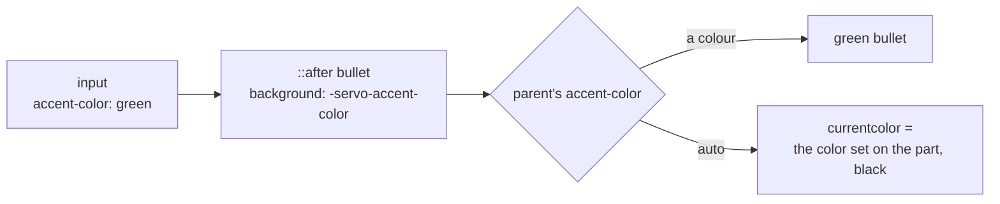

> One change of the Servo fork: `review/28`, 28 of 29 in the stack.
> Below it: [`review/27`](https://github.com/Airodonack/servo/tree/review/27). Above it: [`review/29`](https://github.com/Airodonack/servo/tree/review/29).
> The change itself: [commit 290f75c4dde5865bf2a74b021b80a3b0fe95d2f3](https://github.com/Airodonack/servo/commit/290f75c4dde5865bf2a74b021b80a3b0fe95d2f3). This README sits in a commit on top of it and is not part of the pull request.
> The whole stack: [overview README](https://github.com/Airodonack/servo/blob/vodscribe/main/README.md).

# Radio buttons, checkboxes and sliders follow accent-color

```css
form { accent-color: rgb(0, 160, 0); }
```

In other engines this turns checked radio buttons, checkboxes and sliders
green. Servo ignored it: stylo did not build `accent-color` for Servo, and
Servo's controls are drawn by user agent CSS with fixed colours.

This change is 15 lines of servo.css. The work is in its stylo counterpart,
[stylo `review/01`](https://github.com/Airodonack/stylo/tree/review/01), which
is already in the stylo revision that [`review/27`](https://github.com/Airodonack/servo/tree/review/27)
pins. So this pull request needs review/27's pin, or the stylo change upstream
and a stylo bump.

## The problem

Servo builds a checkbox's check, a radio's bullet and a slider's fill and
thumb from pseudo-elements styled in servo.css. A style sheet cannot say
"the background is my element's `accent-color`, or blue when that is
`auto`": CSS has no way to read another property's value.

## The change

The stylo commit adds a colour keyword, `-servo-accent-color`, parsed only
outside page style sheets
([color.rs, lines 518 to 524](https://github.com/Airodonack/stylo/blob/ef2431c0a8465d6cfe4ab98cdac52e44ae89a153/style/values/specified/color.rs#L518-L524)).
It computes to the parent element's `accent-color`, or to `currentcolor` when
that is `auto` ([lines 530 to 561](https://github.com/Airodonack/stylo/blob/ef2431c0a8465d6cfe4ab98cdac52e44ae89a153/style/values/specified/color.rs#L530-L561)).
The parent of each pseudo-element is the input.

servo.css then sets the old colour as `color` on each part and the keyword as
its fill, so `auto` falls back to today's colour:

```css
input[type="radio"]:checked::after {
  color: black;                       /* used when accent-color is auto */
  background: -servo-accent-color;
}
```

| Part | Old colour | Lines |
|---|---|---|
| range fill and thumb | `rgb(0, 122, 255)`, written in hex | [246 to 260](https://github.com/Airodonack/servo/blob/290f75c4dde5865bf2a74b021b80a3b0fe95d2f3/components/layout/stylesheets/servo.css#L246-L260) |
| checkbox check, enabled only | the input's `color` | [328 to 331](https://github.com/Airodonack/servo/blob/290f75c4dde5865bf2a74b021b80a3b0fe95d2f3/components/layout/stylesheets/servo.css#L328-L331) |
| radio bullet | black | [391 to 395](https://github.com/Airodonack/servo/blob/290f75c4dde5865bf2a74b021b80a3b0fe95d2f3/components/layout/stylesheets/servo.css#L391-L395) |

Disabled controls keep their grey: their rules come later and are not
changed.



A translucent accent is laid over the canvas colour of the used colour scheme
([lines 533 to 557](https://github.com/Airodonack/stylo/blob/ef2431c0a8465d6cfe4ab98cdac52e44ae89a153/style/values/specified/color.rs#L533-L557)), as the
WPT reference images expect.

## Options considered

| Option | Why not chosen |
|---|---|
| **A user-agent-only colour keyword** (this change) | Chosen: the controls stay plain CSS, and the keyword is invisible to pages. |
| Paint the control parts natively in layout | The right end state for form controls, but a rewrite of how Servo draws them. |
| Inline the accent into each part's style from script | Script would have to follow every `accent-color` change and inheritance; the style system already does. |
| Expose `accent-color` only, without using it | Pages could set and read it, but nothing would change on screen. |

## Spec

[CSS UI 4, accent-color](https://drafts.csswg.org/css-ui-4/#widget-accent):

> The accent-color CSS property allows the author to specify the accent color
> for user-interface controls generated by the element.

Which parts take the accent is left to the user agent; these are the parts
Chrome colours.

## How it was checked

From the commit's own run (servoshell, headless Chrome 156): on
`host/accent-color.html`, accent pixels appear in the accented radio,
checkbox, range and inherited radio, and not in the `auto`, unchecked and
disabled controls, as in Chrome. `getComputedStyle` reports the colour or
`auto`, and `CSS.supports("color", "-servo-accent-color")` is false for pages.
Seven WPT expectation files go, among them `accent-color-parsing`,
`-computed`, `-interpolation` and the checkbox and radio reftests.

Rerun on 2026-11-03, Chrome side only (no Servo build), the same page:

```
RESULT computed radio accent-color=rgb(0, 160, 0)
RESULT computed radio_auto accent-color=auto
RESULT supports accent-color=true auto=true internal-keyword=false
```

The restack's gate (2026-11-05) ran on this change before the day's fixups
to lower refs were folded in (the same patch): `mach fmt` changed nothing
and `mach check` exited 0 with no warnings. `test-tidy` fails at this
commit: cargo-deny does not allow the stylo fork as a git source until
the velocity layer's "mach test-tidy accepts the stylo fork as a git
source". At the stack's tip `test-tidy` and `mach clippy` pass.

## Questions a reviewer may ask

- **Why a private keyword instead of `AccentColor`?** `AccentColor` is the
  system's accent, the same for every element; the part needs its own
  element's `accent-color`.
- **Can a page use `-servo-accent-color`?** No. It parses only where
  `ParserContext::chrome_rules_enabled` holds, which is user agent and user
  style sheets, never author ones.
- **Why does the unchecked checkbox not change?** Chrome colours only the
  checked state; the unchecked box keeps its border.
