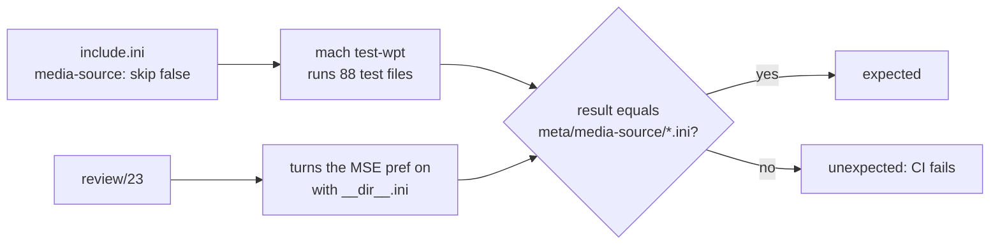

> One change of the Servo fork: `review/17`, 17 of 29 in the stack.
> Below it: [`review/16`](https://github.com/Airodonack/servo/tree/review/16). Above it: [`review/18`](https://github.com/Airodonack/servo/tree/review/18).
> The change itself: [commit b6cc711beceaeabdd8cb21080ad57cc8c7e5bf93](https://github.com/Airodonack/servo/commit/b6cc711beceaeabdd8cb21080ad57cc8c7e5bf93). This README sits in a commit on top of it and is not part of the pull request.
> The whole stack: [overview README](https://github.com/Airodonack/servo/blob/vodscribe/main/README.md).

# Run the Media Source web-platform-tests

Servo's test runs skipped the `media-source` directory of the
web-platform-tests (WPT), so nothing recorded how far Servo is from Media
Source Extensions (MSE), and nothing would notice when later work changed
that. This change turns the directory on, with expectations for a build that
has no MSE at all. It changes no code.

## The problem

[`tests/wpt/include.ini`](https://github.com/Airodonack/servo/blob/b6cc711beceaeabdd8cb21080ad57cc8c7e5bf93/tests/wpt/include.ini#L1)
starts with `skip: true` and opts directories back in one by one.
`media-source` was never listed, so its 88 test files never ran, locally or
in CI.

Every MSE change above it in this stack would then have to turn the directory on
in the same commit as its code. The reviewer of that commit would see a few
hundred new expectation lines and could not tell which ones the code changed
and which ones were simply never run before.

## The change

Two lines in `include.ini`
([lines 219 to 220](https://github.com/Airodonack/servo/blob/b6cc711beceaeabdd8cb21080ad57cc8c7e5bf93/tests/wpt/include.ini#L219-L220)):

```ini
[media-source]
  skip: false
```

and 86 files under
[`tests/wpt/meta/media-source/`](https://github.com/Airodonack/servo/tree/b6cc711beceaeabdd8cb21080ad57cc8c7e5bf93/tests/wpt/meta/media-source),
written by `mach update-wpt` from raw logs, with no hand edits. Two test
files pass completely and need no file.



83 of the files were recorded with the upstream 0.7.0 release binary, which
has no `MediaSource` interface:

| What | Count |
|---|---|
| Test files | 85: 75 OK, 10 ERROR |
| Subtests | 591: 22 PASS, 569 FAIL |
| Most common failure | "MediaSource is not defined" (329), then the IDL tests' "self does not have own property" (164) |

The 22 passes are IDL checks that hold without the interface, and
`URL-createObjectURL-null.html`.

Three test files had no expectations: two that upstream's WPT sync of
2026-11-01 added (`mediasource-remove-preserves-currentTime.html`,
`mediasource-seek-unbuffered-readystate.html`) and one the 0.7.0 run did not
count (`mediasource-worker-handle-transfer-to-shared-and-service-workers`).
A run here on 2026-11-05 failed their 7 subtests unexpectedly. Their files
were written from a run of a build without MSE at the stack's tip, whose 599
results all match the run here.

## Options considered

| Option | Why not chosen |
|---|---|
| **Turn the directory on first, with no-MSE expectations** (this change) | Chosen: lands on its own, touches no code, and every later MSE commit shows its effect as FAIL to PASS lines in its own diff. |
| Turn it on in the commit that adds the MSE DOM | That commit is already large. Its diff would mix "now runs" with "now passes". |
| Keep it skipped and run it by hand | Nothing in CI would catch a regression. |
| Turn on only the tests MSE work passes today | Hides how much is missing, and each new pass would need an `include.ini` edit. |

## What it costs

86 small files (1,748 lines). The run takes 14 s on this machine for the
first, all-unexpected run and 4.9 s for the run against these files, headless,
release build.

## How it was checked

From the logs in `notes/runs/wpt-enable-070*`, re-read for this README:

- The recording run of the 0.7.0 binary: "Ran 85 tests finished in 14.1
  seconds", 75 OK, 10 ERROR, 22 PASS and 569 FAIL subtests.
- A second run of the same binary against these files: "Ran 85 tests finished
  in 4.9 seconds. 85 ran as expected."
- The committed files hold exactly 10 `expected: ERROR` and 576
  `expected: FAIL` entries, counted from the commit.
- A run at this commit on 2026-11-05, with a build of its code and before
  the three new files: "Ran 88 tests ... 85 ran as expected. 3 tests had
  unexpected subtest results", the 7 subtests the new files now expect.

Higher in the stack, `review/23` turns the MSE pref on for the directory.
Servo's CI has no MSE backend, so the results stay these, and the files
there are these again.

The restack's gate (2026-11-05) ran on this change before the day's fixups
to lower refs were folded in (the same patch): `mach fmt` changed nothing,
`test-tidy` passed, and `mach check` exited 0 with no warnings. At the
stack's tip the same checks and `mach clippy` pass.

Not yet done: a run at this commit with the three new files in it.

## Questions a reviewer may ask

- **Why 0.7.0 and not `main`?** It was the binary at hand when the series
  started. Without MSE the results are almost all "MediaSource is not
  defined", which does not depend on the version: the run on this commit's
  code matched them in every test the 0.7.0 run had.
- **Why are 10 tests ERROR and not FAIL?** They throw before their first
  subtest: an unknown `MediaSource`, `SourceBuffer` or shared memory being
  off.
- **Is anything here specific to this fork?** No. Without the MSE pref or
  code, these are upstream Servo's own results.
