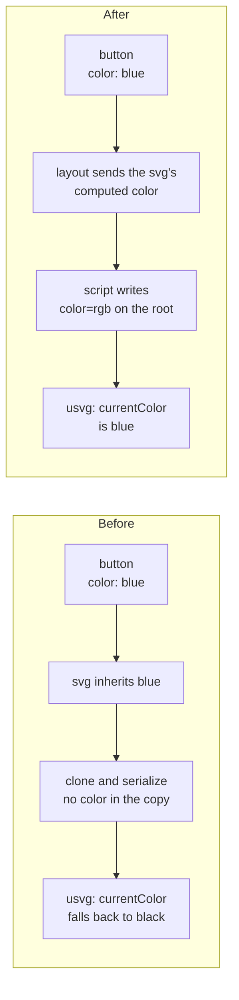

> One change of the Servo fork: `review/10`, 10 of 29 in the stack.
> Below it: [`review/09`](https://github.com/Airodonack/servo/tree/review/09). Above it: [`review/11`](https://github.com/Airodonack/servo/tree/review/11).
> The change itself: [commit 80bb814c0df3bbf627c100876554255f94938997](https://github.com/Airodonack/servo/commit/80bb814c0df3bbf627c100876554255f94938997). This README sits in a commit on top of it and is not part of the pull request.
> The whole stack: [overview README](https://github.com/Airodonack/servo/blob/vodscribe/main/README.md).

# Icons drawn with currentColor take the colour of the text around them

Inline SVG icons were black whatever the colour of the text around them.
This change passes the colour an inline `<svg>` inherits to the copy of it
that Servo draws, so `currentColor` resolves as in other browsers. It is
independent of the rest of the stack.

## The problem

```html
<button style="color: rgb(0, 128, 255)">
  <svg width="16" height="16"><path stroke="currentColor" d="..."/></svg> Save
</button>
```

The icon should be blue, like the text. In Servo it was black.

Servo does not paint an inline `<svg>` itself. Script clones the subtree,
serializes it to a `data:` URL, and layout draws that as an image with usvg.
The serialized document has no HTML ancestors, so the `color` the `<svg>`
inherits is lost, and usvg resolves `currentColor` to its default, black.



## The change

- Layout reads the `<svg>`'s computed `color` and asks script for a
  serialization made with it, when there is none yet or the colour differs
  ([replaced.rs, lines 299 to 314](https://github.com/Airodonack/servo/blob/80bb814c0df3bbf627c100876554255f94938997/components/layout/replaced.rs#L299-L314)).
  The request now carries the colour
  ([`PendingSVGElementSerialization`](https://github.com/Airodonack/servo/blob/80bb814c0df3bbf627c100876554255f94938997/components/shared/layout/lib.rs#L669-L676)).
- `SVGSVGElement::serialize_and_cache_subtree` keeps the colour it serialized
  with, does nothing if asked again with the same one, and writes it as the
  `color` attribute of the cloned root, where usvg looks for it
  ([svgsvgelement.rs, lines 84 to 149](https://github.com/Airodonack/servo/blob/80bb814c0df3bbf627c100876554255f94938997/components/script/dom/svg/svgsvgelement.rs#L84-L149),
  the attribute at
  [lines 121 to 134](https://github.com/Airodonack/servo/blob/80bb814c0df3bbf627c100876554255f94938997/components/script/dom/svg/svgsvgelement.rs#L121-L134)).
  A `color` set inside the SVG still wins, since usvg uses the nearest one.
- A later change of `color` alone is only repaint damage, which keeps the old
  image. The damage pass compares the colour and asks for a new serialization
  ([traversal.rs, lines 207 to 221](https://github.com/Airodonack/servo/blob/80bb814c0df3bbf627c100876554255f94938997/components/layout/traversal.rs#L207-L221)).
  Script marks the node dirty only when the cache really changed
  ([window.rs, lines 4024 to 4030](https://github.com/Airodonack/servo/blob/80bb814c0df3bbf627c100876554255f94938997/components/script/dom/window/window.rs#L4024-L4030)).
- Dropping a stale image also drops the image cache's listeners for its
  rasterization, so the window would wait for it forever and reftest
  screenshots never settled.
  [`forget_pending_rasterizations_for_node`](https://github.com/Airodonack/servo/blob/80bb814c0df3bbf627c100876554255f94938997/components/script/dom/window/window.rs#L833-L845)
  clears that wait.
- `color` becomes an SVG presentation attribute, so `<svg color="red">` works
  as it does elsewhere
  ([svgelement.rs, lines 300 to 307](https://github.com/Airodonack/servo/blob/80bb814c0df3bbf627c100876554255f94938997/components/script/dom/svg/svgelement.rs#L300-L307)).

## Options considered

| Option | Why not chosen |
|---|---|
| **Write the computed `color` on the serialized root** (this change) | Chosen: one attribute, uses usvg's own `currentColor` rule, keeps inner overrides. |
| Replace every `currentColor` in the copy with the colour | Must walk every paint attribute and style; misses `color` set lower in the SVG. |
| Pass the colour to the renderer beside the image | The image cache keys and decodes a `data:` URL like any other image; a side channel would reach through it for one case. |
| Paint inline SVG natively | The right end state, but a new SVG renderer, far beyond this fix. |

## Spec

[CSS Color 4, currentcolor](https://drafts.csswg.org/css-color-4/#currentcolor-color):

> The keyword currentcolor represents value of the color property on the same element.

The `<svg>` element's `color` is inherited from the HTML around it, so its
shapes paint in that colour.

## How it was checked

From the commit's own runs (servoshell and headless Chrome 156):
`host/svg-currentcolor.html`, eight cells read from screenshot pixels: 3 of
8 right before, 7 of 8 after. The one left is a page style sheet rule
inside the SVG, which Servo does not apply to inline SVG at all (a separate
bug). WPT `/svg` (1369 tests) and `/css/css-color` (765) ran as expected;
three `color` presentation-attribute subtests now pass; `color-svg-visited`
now fails, because the SVG really draws `currentColor` and Servo has no
`:visited`.

The restack's gate (2026-11-05) ran on this change before the day's fixups
to lower refs were folded in (the same patch): `mach fmt` changed nothing,
`test-tidy` passed, and `mach check` exited 0 with no warnings. At the
stack's tip the same checks and `mach clippy` pass.

## Questions a reviewer may ask

- **Does a colour change re-serialize the SVG every frame during a colour
  animation?** Yes, once per distinct colour. Each serialization is a clone
  and an image decode. Not measured; the common case is a static colour.
- **Why not make page style sheets reach inline SVG too?** A separate, larger
  bug; this change only restores what the SVG inherits.
