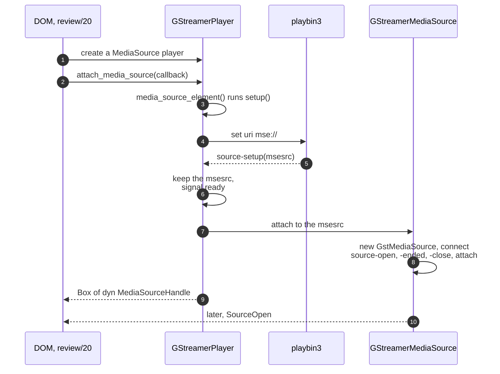
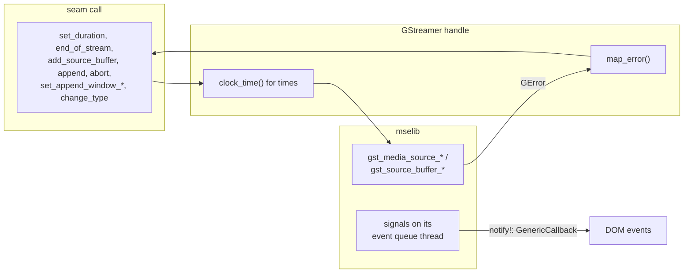
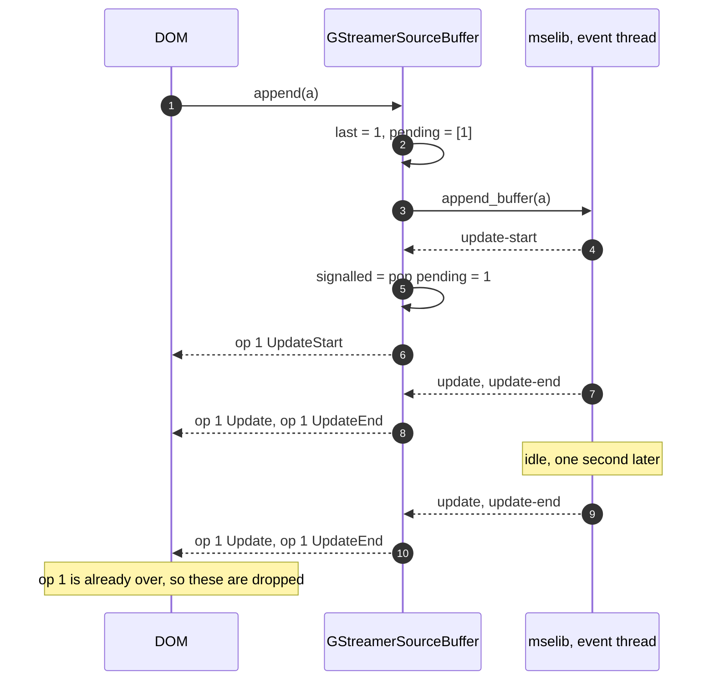
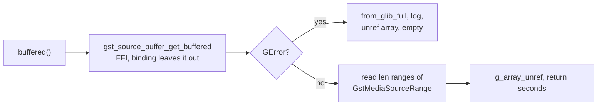
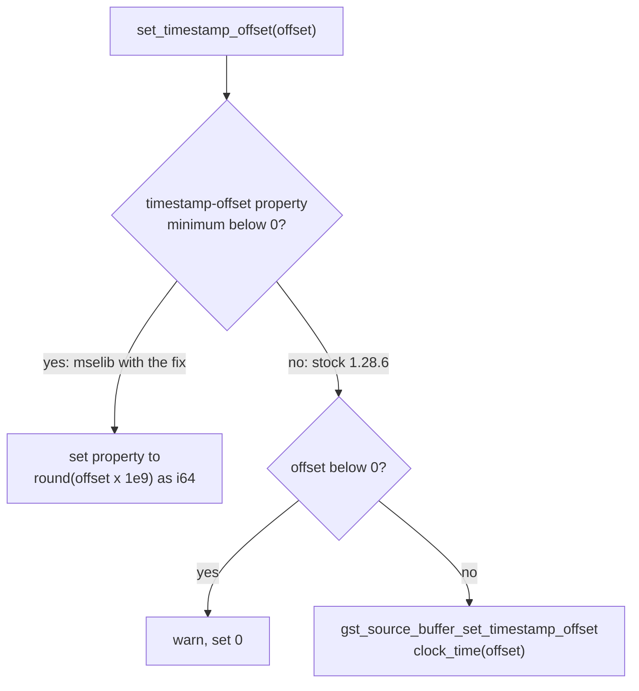
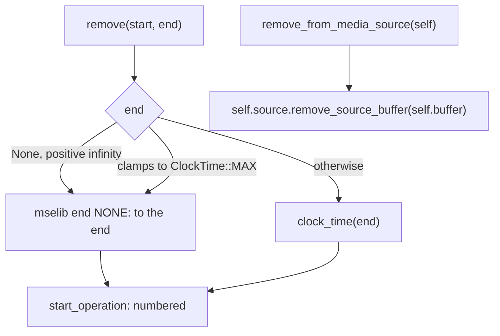
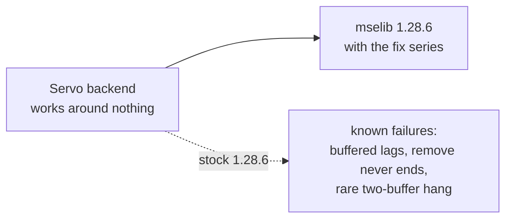
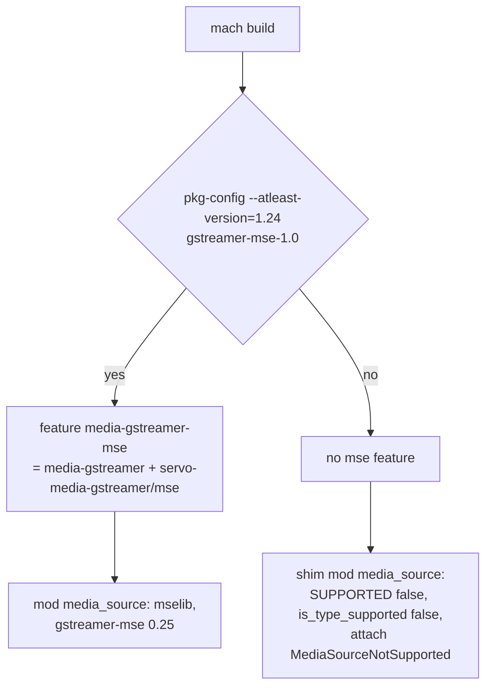

> One change of the Servo fork: `review/19`, 19 of 29 in the stack.
> Below it: [`review/18`](https://github.com/Airodonack/servo/tree/review/18). Above it: [`review/20`](https://github.com/Airodonack/servo/tree/review/20).
> The change itself: [commit a402f7b0cc3890d20c00f4375fef16fd9bac4bea](https://github.com/Airodonack/servo/commit/a402f7b0cc3890d20c00f4375fef16fd9bac4bea). This README sits in a commit on top of it and is not part of the pull request.
> The whole stack: [overview README](https://github.com/Airodonack/servo/blob/vodscribe/main/README.md).

# GStreamer backend: Media Source Extensions through mselib

GStreamer 1.24 added mselib to gst-plugins-bad: `GstMediaSource` and
`GstSourceBuffer` parse appended data, keep the buffered media, and feed it to
a `GstMseSrc` element, which playbin3 creates for an `mse://` URI. This change
implements the seam from `review/18` on top of it, so the GStreamer backend
can play a Media Source. No page can use it yet: the DOM comes in `review/20`.

519 lines added in 10 files: a new 408-line `media_source.rs`, about 40
changed lines in `player.rs`, and the build switch. It is behind a Cargo feature, off
unless GStreamer 1.24 or newer is found.

## Suggested reading order

| # | File | What to look for |
|---|---|---|
| 1 | [`player.rs`: `mse://` and `source-setup`](https://github.com/Airodonack/servo/blob/a402f7b0cc3890d20c00f4375fef16fd9bac4bea/components/media/backends/gstreamer/player.rs#L1071-L1077), [`media_source_element`](https://github.com/Airodonack/servo/blob/a402f7b0cc3890d20c00f4375fef16fd9bac4bea/components/media/backends/gstreamer/player.rs#L599-L610) | How a Media Source player gets its `msesrc`. |
| 2 | [`media_source.rs`, lines 1 to 162](https://github.com/Airodonack/servo/blob/a402f7b0cc3890d20c00f4375fef16fd9bac4bea/components/media/backends/gstreamer/media_source.rs#L1-L162) | `GStreamerMediaSource`: one mselib call per method, signals relayed as events, errors mapped. |
| 3 | [`Operations` and `start_operation`, lines 179 to 271](https://github.com/Airodonack/servo/blob/a402f7b0cc3890d20c00f4375fef16fd9bac4bea/components/media/backends/gstreamer/media_source.rs#L179-L271) | The core: how mselib's untagged signals get operation numbers. |
| 4 | [`buffered()`, lines 282 to 323](https://github.com/Airodonack/servo/blob/a402f7b0cc3890d20c00f4375fef16fd9bac4bea/components/media/backends/gstreamer/media_source.rs#L282-L323) | The one `unsafe` block, and the known lag on stock mselib. |
| 5 | [`timestampOffset`, lines 340 to 365](https://github.com/Airodonack/servo/blob/a402f7b0cc3890d20c00f4375fef16fd9bac4bea/components/media/backends/gstreamer/media_source.rs#L340-L365) | Signed offsets where mselib takes them, a clamp to 0 where it does not. |
| 6 | [`remove` and removal, lines 390 to 410](https://github.com/Airodonack/servo/blob/a402f7b0cc3890d20c00f4375fef16fd9bac4bea/components/media/backends/gstreamer/media_source.rs#L390-L410) | Range ends, and removal through the buffer's own handle. |
| 7 | [`lib.rs`, lines 11 to 36](https://github.com/Airodonack/servo/blob/a402f7b0cc3890d20c00f4375fef16fd9bac4bea/components/media/backends/gstreamer/lib.rs#L11-L36), the Cargo files, [`base.py`](https://github.com/Airodonack/servo/blob/a402f7b0cc3890d20c00f4375fef16fd9bac4bea/python/servo/platform/base.py#L55-L63) | The `mse` feature and how `mach` turns it on. |

## 1. A pipeline with an msesrc



- A Media Source player's URI is `mse://`
  ([lines 757 to 759](https://github.com/Airodonack/servo/blob/a402f7b0cc3890d20c00f4375fef16fd9bac4bea/components/media/backends/gstreamer/player.rs#L757-L759)),
  for which playbin3 creates mselib's `msesrc` (the `mse` plugin registers
  it for that protocol).
- The `source-setup` handler keeps the element and signals "ready", the same
  handshake the other source kinds use
  ([lines 1071 to 1077](https://github.com/Airodonack/servo/blob/a402f7b0cc3890d20c00f4375fef16fd9bac4bea/components/media/backends/gstreamer/player.rs#L1071-L1077)).
  `setup()` returns once that has happened, so
  [`media_source_element()`](https://github.com/Airodonack/servo/blob/a402f7b0cc3890d20c00f4375fef16fd9bac4bea/components/media/backends/gstreamer/player.rs#L599-L610)
  always finds the `msesrc`.
- [`attach_media_source`](https://github.com/Airodonack/servo/blob/a402f7b0cc3890d20c00f4375fef16fd9bac4bea/components/media/backends/gstreamer/player.rs#L1172-L1177)
  is one call into `media_source::attach`.
- Seeks and rate changes are allowed for these players
  ([lines 286 to 288](https://github.com/Airodonack/servo/blob/a402f7b0cc3890d20c00f4375fef16fd9bac4bea/components/media/backends/gstreamer/player.rs#L286-L288)).
  A seek skips the check against the pipeline's duration
  ([lines 366 to 384](https://github.com/Airodonack/servo/blob/a402f7b0cc3890d20c00f4375fef16fd9bac4bea/components/media/backends/gstreamer/player.rs#L366-L384)):
  that duration lags behind the appended data, and the element has already
  clamped the time to the MediaSource's duration.

## 2. The handles forward



Each method is one mselib call. Times go through `clock_time()` from
`review/04`, so a page's huge times cannot panic. Positive infinity as a
duration becomes `GST_CLOCK_TIME_NONE`, mselib's "unknown"
([lines 112 to 117](https://github.com/Airodonack/servo/blob/a402f7b0cc3890d20c00f4375fef16fd9bac4bea/components/media/backends/gstreamer/media_source.rs#L112-L117)).
[`map_error`](https://github.com/Airodonack/servo/blob/a402f7b0cc3890d20c00f4375fef16fd9bac4bea/components/media/backends/gstreamer/media_source.rs#L48-L57)
turns mselib's `GstMediaSourceError` codes into the seam's variants and
passes the GError's message into `MediaSourceError::Type`, so a `TypeError`
reaches the page with mselib's own words. Signals are relayed by the
[`notify!` macro](https://github.com/Airodonack/servo/blob/a402f7b0cc3890d20c00f4375fef16fd9bac4bea/components/media/backends/gstreamer/media_source.rs#L63-L71);
the callback sits behind a mutex because signal closures must be `Sync`.
Dropping the media source handle detaches it
([lines 101 to 105](https://github.com/Airodonack/servo/blob/a402f7b0cc3890d20c00f4375fef16fd9bac4bea/components/media/backends/gstreamer/media_source.rs#L101-L105)).

## 3. Numbering mselib's signals

The seam wants every `SourceBufferEvent` tagged with its operation. mselib's
signals carry nothing. Two facts of mselib make numbering possible:
`update-start` is signalled once for every append it accepts, and with the
fork's mselib series for every removal too, in order; every later signal
belongs to that operation until the next `update-start`. Stock 1.28.6
signals nothing for `remove()`, so a removal there never ends (section 7).

```rust
struct Operations {
    last: OperationId,               // last number handed out
    pending: VecDeque<OperationId>,  // accepted, update-start not seen yet
    signalled: OperationId,          // the one whose update-start came last
}
```



[`start_operation`](https://github.com/Airodonack/servo/blob/a402f7b0cc3890d20c00f4375fef16fd9bac4bea/components/media/backends/gstreamer/media_source.rs#L247-L271)
queues the number before calling mselib, because mselib can signal
`update-start` on its own thread before the call returns. If mselib refuses
the call, no `update-start` will come, and the number is taken out again.
The signal handlers
([lines 206 to 230](https://github.com/Airodonack/servo/blob/a402f7b0cc3890d20c00f4375fef16fd9bac4bea/components/media/backends/gstreamer/media_source.rs#L206-L230))
pop a number on `update-start` and stamp every signal with `signalled`.

Why the numbers matter, measured fresh on stock mselib (GStreamer 1.28.7,
`mselib_signals.py`: playbin3 on `mse://`, a source buffer, the fork's test
init segment and one media segment):

```
 0.008 append init.mp4
 0.008 on-update-start updating=False
 0.008 on-update updating=False
 0.008 on-update-end updating=False buffered=[]
 1.008 on-update updating=False
 1.008 on-update-end updating=False buffered=[]
 2.008 on-update updating=False
 ...
```

An idle buffer signals `update` and `update-end` every second
([the append task waits one second](https://github.com/Airodonack/gstreamer/blob/1.28.6/subprojects/gst-plugins-bad/gst-libs/gst/mse/gstsourcebuffer.c#L1688-L1696)
and then [reports success with no data](https://github.com/Airodonack/gstreamer/blob/1.28.6/subprojects/gst-plugins-bad/gst-libs/gst/mse/gstsourcebuffer.c#L1763-L1767)).
These carry the number of the operation that has already ended, so the DOM
drops them. The probe also shows that by the time a handler runs, mselib's
own `updating` is already false, even in `update-start`: the backend cannot
read mselib's state to tell which operation a signal belongs to.

## 4. buffered() through FFI



The Rust binding does not generate `gst_source_buffer_get_buffered`, which
returns a `GArray` of `GstMediaSourceRange`, so the code calls it directly
([lines 291 to 322](https://github.com/Airodonack/servo/blob/a402f7b0cc3890d20c00f4375fef16fd9bac4bea/components/media/backends/gstreamer/media_source.rs#L291-L322)).
It is the one `unsafe` block in the file: it reads the array within its
length, takes ownership of any GError, and frees the array on both paths.

`buffered()` returns what mselib holds when it is called. On stock mselib that
can lag the `update-end` it follows. From the same probe:

```
 3.508 append fmp4_000.m4s
 3.520 on-update-start updating=False
 3.520 on-update updating=False
 3.521 on-update-end updating=False buffered=[]
 4.520 on-update updating=False
 4.521 on-update-end updating=False buffered=[(0.066666666, 3.970612244)]
```

At `update-end` the media segment just appended is not in `buffered` yet; it
appears a moment later. Players read `buffered` in their `updateend` handler
to decide what to fetch next. The comment at
[lines 283 to 290](https://github.com/Airodonack/servo/blob/a402f7b0cc3890d20c00f4375fef16fd9bac4bea/components/media/backends/gstreamer/media_source.rs#L283-L290)
says so. The backend does not work around it: the fix belongs in mselib (see
section 7).

## 5. timestampOffset



The spec allows a negative `timestampOffset`. Stock mselib holds it as an
`int64` property with a minimum of 0
([gstsourcebuffer.c, lines 568 to 572](https://github.com/Airodonack/gstreamer/blob/1.28.6/subprojects/gst-plugins-bad/gst-libs/gst/mse/gstsourcebuffer.c#L568-L572)),
and its setter function takes an unsigned `GstClockTime`. The GStreamer
series lowers the property's minimum to `G_MININT64`. The handle checks the
property's range once, when it is created
([lines 231 to 238](https://github.com/Airodonack/servo/blob/a402f7b0cc3890d20c00f4375fef16fd9bac4bea/components/media/backends/gstreamer/media_source.rs#L231-L238)),
and sets the property directly where negative values are allowed. The value
is rounded so that an offset such as -10.4 s reads back as set, and kept
above `GST_CLOCK_STIME_NONE`. On stock mselib a negative offset is clamped
to 0 with a warning.

## 6. Range removal and buffer removal



[`remove`](https://github.com/Airodonack/servo/blob/a402f7b0cc3890d20c00f4375fef16fd9bac4bea/components/media/backends/gstreamer/media_source.rs#L390-L398)
is a numbered operation like `append`. An end of `None` (positive infinity)
goes to mselib as "to the end". So does an end that clamps to
`ClockTime::MAX`: with a start that far out, both would clamp to the same
time, and mselib refuses an empty range.

[`remove_from_media_source`](https://github.com/Airodonack/servo/blob/a402f7b0cc3890d20c00f4375fef16fd9bac4bea/components/media/backends/gstreamer/media_source.rs#L406-L410)
uses the seam's consuming method from `review/18`. `GStreamerSourceBuffer`
owns its `gst_mse::SourceBuffer` and a clone of the `gst_mse::MediaSource`,
so it calls `gst_media_source_remove_source_buffer` itself. It needs no id,
counter or GObject data to be found again.

## 7. What this needs from GStreamer



Stock mselib 1.28.6 has bugs this backend hits. The fixes are proposed to
GStreamer as one series, explained in the
[GStreamer fork's README](https://github.com/Airodonack/gstreamer/blob/mse-fixes/README.md).
This backend works around none of them and was tested with the series
applied. On stock 1.28:

- `buffered()` lags `update-end` (section 4, measured above).
- `remove()` never finishes. Stock
  [`gst_source_buffer_remove`](https://github.com/Airodonack/gstreamer/blob/1.28.6/subprojects/gst-plugins-bad/gst-libs/gst/mse/gstsourcebuffer.c#L1484-L1490)
  returns `TRUE` and does nothing. The probe: `remove(0, 1 s) returned True`,
  no `update-start`, and `buffered` still `[(0.067, 3.971)]` 2.5 s later.
  The removal's number stays pending, the idle signals carry the previous
  number, and the DOM's `updating` never goes false.
- With two source buffers a page can hang after an initialization segment (a
  lock order inversion fixed in the series). Rare, not reproduced here.

## Build switch



`gstreamer-mse-sys` needs `gstreamer-mse-1.0` 1.24 from pkg-config at build
time, and Servo builds against GStreamer 1.18 and newer. So the backend's
[`mse` feature](https://github.com/Airodonack/servo/blob/a402f7b0cc3890d20c00f4375fef16fd9bac4bea/components/media/backends/gstreamer/Cargo.toml#L20-L24)
is off by default. Without it, a
[shim module of the same name](https://github.com/Airodonack/servo/blob/a402f7b0cc3890d20c00f4375fef16fd9bac4bea/components/media/backends/gstreamer/lib.rs#L11-L36)
supplies the three entry points with the seam's defaults, so `player.rs` and
the `Backend` impl carry no `cfg`. Its `SUPPORTED` is false, so such a build
tells the DOM it has no MSE. The `servo` crate's
[`media-gstreamer-mse`](https://github.com/Airodonack/servo/blob/a402f7b0cc3890d20c00f4375fef16fd9bac4bea/components/servo/Cargo.toml#L73-L74)
turns it on, servoshell passes it through, and `mach` adds it when the
pkg-config check succeeds
([command_base.py, lines 800 to 803](https://github.com/Airodonack/servo/blob/a402f7b0cc3890d20c00f4375fef16fd9bac4bea/python/servo/command_base.py#L800-L803)).

## Options considered

| Option | Why not chosen |
|---|---|
| **mselib under playbin3, through gstreamer-mse** (this change) | Chosen: GStreamer's own MSE engine, the pipeline and renderer Servo already uses, and the bugs fixed where they are. |
| A Servo-side MSE engine (own demuxing into appsrc) | Reimplements the coded frame processing, eviction and track buffers that mselib already has. |
| Work around mselib's bugs in the backend | Each workaround (polling `buffered`, emulating `remove`, timers) would hide the bug from GStreamer and stay forever in Servo. |
| Number operations by reading mselib's `updating` | The probe shows it is already false when the signal runs. |
| Make MSE a hard dependency | Builds on GStreamer 1.22 and older would break. |
| `#[cfg]` at each call site instead of a shim | Spreads the feature through `player.rs` and `lib.rs`. |

## Spec

[MSE, buffer append](https://w3c.github.io/media-source/#sourcebuffer-buffer-append):

> Run the segment parser loop algorithm. ... Set the updating attribute to
> false. Queue a task to fire an event named update at this SourceBuffer
> object. Queue a task to fire an event named updateend at this SourceBuffer
> object.

The segment parser loop adds the coded frames to the track buffers, so by
`updateend` the appended media must be in `buffered`: the lag in section 4 is
mselib's bug. And
[`timestampOffset`](https://w3c.github.io/media-source/#dom-sourcebuffer-timestampoffset)
is a plain `double`, negative values included.

## How it was checked

Fresh for this README, on stock GStreamer 1.28.7 (Nix), with the probe in the
scratch folder (`mselib_signals.py`): the idle signals, the `buffered` lag
and the stock `remove()`, quoted above. A run of the same probe against the
patched library did not load it (the output was identical to stock), so it
says nothing about the series.

From earlier runs, with the patched mselib 1.28.6:

- the MSE web-platform-tests subset at the stack tip (2026-11-02, 23 test
  files): 186 subtests pass, 10 fail;
- the commit's own checks: a page that adds, appends to and removes two
  source buffers; a release servoshell without the feature plays that page
  with "Could not attach the media source:
  NotSupported(Some("MediaSourceNotSupported"))" and no crash;
  `cargo check -p servo-media-gstreamer` with no features, no warnings;
- the restack's gate (2026-11-05), on this change before the day's fixups
  to lower refs were folded in (the same patch): `mach fmt` changed
  nothing, `test-tidy` passed, and `mach check` exited 0 with no warnings;
  at the stack's tip the same checks and `mach clippy` pass.

Not yet done: a test for the operation numbering on its own (an abort
followed at once by a new append, with the backend's late reports).

## Questions a reviewer may ask

- **Why not wait for the fixed mselib?** The backend is written against
  mselib's documented behaviour and needs no change when the fixes land. On
  stock 1.28 it fails in the ways listed above.
- **What if mselib refuses an append after signalling `update-start`?** It
  does not: `update-start` is scheduled only after every check has passed.
- **Is the `unsafe` block needed?** Only until the binding generates
  `gst_source_buffer_get_buffered`.
- **Why `ClockTime::MAX` as "to the end" in `remove`?** Because start and end
  would otherwise clamp to the same value, and mselib refuses an empty range.
