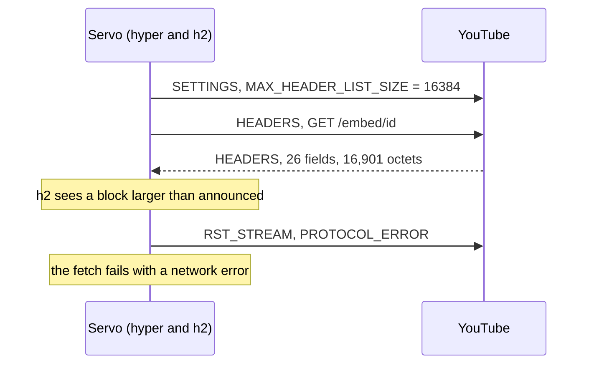

> One change of the Servo fork: `review/05`, 5 of 29 in the stack.
> Below it: [`review/04`](https://github.com/Airodonack/servo/tree/review/04). Above it: [`review/06`](https://github.com/Airodonack/servo/tree/review/06).
> The change itself: [commit b930eb7b84236fd1a18d16a3e58b6dcf78ec2e1a](https://github.com/Airodonack/servo/commit/b930eb7b84236fd1a18d16a3e58b6dcf78ec2e1a). This README sits in a commit on top of it and is not part of the pull request.
> The whole stack: [overview README](https://github.com/Airodonack/servo/blob/vodscribe/main/README.md).

# YouTube pages load instead of failing with a network error

YouTube's embed page failed to load in Servo with a network error, while
curl fetched it fine. Servo's HTTP/2 client told the server it would accept
at most 16 KiB of response headers, and YouTube sends Servo more than that.
This change raises the limit to 256 KiB, the value Chromium uses.

It is one setting in one file.

## The problem

In HTTP/2 the client announces `SETTINGS_MAX_HEADER_LIST_SIZE`, the largest
header block it is prepared to accept. hyper, Servo's HTTP client,
announces 16 KiB unless told otherwise
([hyper 1.12.0, `client.rs` line 52](https://github.com/hyperium/hyper/blob/v1.12.0/src/proto/h2/client.rs#L52)).
When a response's headers are larger, the h2 crate under hyper does not
deliver them: it resets the stream itself with `PROTOCOL_ERROR`
([h2 0.4.20, `streams.rs` lines 555 to 580](https://github.com/hyperium/h2/blob/v0.4.20/src/proto/streams/streams.rs#L555-L580)).
The server did nothing wrong, and the fetch fails with
"client error (SendRequest)".

YouTube's pages carry two large report-only policy headers. Measured on
2026-11-03 with curl over HTTP/2, counting each field as RFC 9113 does
(name + value + 32 octets):

| Page | User agent | Fields | Octets |
|---|---|---|---|
| embed (`youtube-nocookie.com/embed/<id>`) | Servo's own | 26 | 16,901 |
| embed | Chrome's | 25 | 9,673 |
| embed | curl's | 24 | 10,079 |
| watch (`youtube.com/watch?v=<id>`) | Servo's own | 36 | 19,928 to 19,990 |

With Servo's user agent YouTube sends both
`connection-allowlist-report-only` (7,509 octets) and
`content-security-policy-report-only` (6,100), so the block passes
16,384. Other user agents get one of the two, which is why curl got a 200.



## The change

[`create_http_client()`](https://github.com/Airodonack/servo/blob/b930eb7b84236fd1a18d16a3e58b6dcf78ec2e1a/components/net/connector.rs#L661-L689)
builds the one hyper client that every HTTP fetch goes through (two
instances, for normal and private browsing). It now sets:

```rust
const HTTP2_MAX_HEADER_LIST_SIZE: u32 = 256 * 1024;
// ...
    .http2_max_header_list_size(HTTP2_MAX_HEADER_LIST_SIZE)
```

The server then knows it may send up to 256 KiB, and h2 accepts what
YouTube sends. HTTP/1.1 responses do not go through this setting.

## Options considered

| Option | What it would take | Why not chosen |
|---|---|---|
| **256 KiB** (this change) | One builder call | Chosen: Chromium's value (see the last question), so a server tuned for Chrome works here too. Still a bound. |
| A smaller raise, 32 or 64 KiB | The same call | Fixes YouTube today. The headers already grew to about 20 KB on the watch page; a value below the main browsers' leaves Servo the first to break. |
| No limit | The same call with `u32::MAX` | A server could make the client decode an unbounded header block into memory. |
| Retry the request over HTTP/1.1 after the reset | A fallback path in the net crate | Slower, doubles the request, and hides a reset that is the client's own choice. |
| A preference | A new pref and plumbing | No user needs to tune it; it can be added later if one does. |

## What it costs

A response's headers can now take up to 256 KiB of memory while they are
decoded, against 16 KiB before. Nothing was measured; ordinary responses
send a few kilobytes, so the setting changes nothing for them.

## Spec

[RFC 9113, section 6.5.2](https://www.rfc-editor.org/rfc/rfc9113#section-6.5.2):

> SETTINGS_MAX_HEADER_LIST_SIZE (0x06): This advisory setting informs a peer
> of the maximum field section size that the sender is prepared to accept,
> in units of octets. The value is based on the uncompressed size of field
> lines, including the length of the name and value in units of octets plus
> an overhead of 32 octets for each field line.

The value is the client's to choose; the RFC sets no minimum or default.

## How it was checked

- 2026-11-01, a release servoshell against the embed URL the VODscribe app
  builds (`youtube-nocookie.com/embed/<id>?enablejsapi=1&origin=...`), five
  loads top-level and five in a sandboxed iframe: before, 10 of 10 reset and
  the framed page never got the player's `onReady`; after, 0 of 10 reset,
  the top-level page fetched 21 resources, and `onReady` came in 1.2 to
  2.5 s on all five framed loads. The watch page reset before and loaded
  274 resources after (from the commit message).
- 2026-11-02, a build of the whole stack: the framed embed page printed
  `RESULT onReady t=1629` and `RESULT summary ready=true`.
- 2026-11-03, the header sizes in the table above, fresh, with curl.

The restack's gate (2026-11-05) ran on this change before the day's fixups
to lower refs were folded in (the same patch): `mach fmt` changed nothing,
`test-tidy` passed, and `mach check` exited 0 with no warnings. At the
stack's tip the same checks and `mach clippy` pass.

Not yet done: a test in `components/net/tests` that serves an HTTP/2
response with more than 16 KiB of headers. No WPT covers the announced size.

## Questions a reviewer may ask

- **Why did curl work?** YouTube sends curl, and Chrome, a smaller header
  set (table above). Servo's user agent gets both report-only policies.
- **Is 256 KiB really what Chromium sends?** That is the value the commit
  gives; it was not re-checked against Chromium's source for this README.
- **Is the server allowed to send more than 16 KiB?** The setting is
  advisory, but h2 enforces it as a limit on what it accepts. Raising what
  the client announces is the standard way to accept more.
