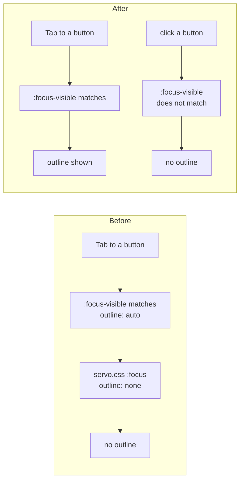

> One change of the Servo fork: `review/12`, 12 of 29 in the stack.
> Below it: [`review/11`](https://github.com/Airodonack/servo/tree/review/11). Above it: [`review/13`](https://github.com/Airodonack/servo/tree/review/13).
> The change itself: [commit 83b0d8bae5865bb701072b8038d45b1bd20d82be](https://github.com/Airodonack/servo/commit/83b0d8bae5865bb701072b8038d45b1bd20d82be). This README sits in a commit on top of it and is not part of the pull request.
> The whole stack: [overview README](https://github.com/Airodonack/servo/blob/vodscribe/main/README.md).

# Keyboard focus shows an outline on buttons and other controls

A button, select, slider or radio button focused from the keyboard showed
no outline in Servo, so a keyboard user could not see where focus was.
This change removes the rule in Servo's own style sheet that took those
outlines away. It is a deletion of twelve lines of CSS and one test
expectation, independent of the rest of the stack.

## The problem

Servo's user agent sheet draws focus outlines on `:focus-visible`
([user-agent.css, line 130](https://github.com/Airodonack/servo/blob/83b0d8bae5865bb701072b8038d45b1bd20d82be/components/layout/stylesheets/user-agent.css#L130)),
a rule upstream Servo added in
[57615e3371](https://github.com/Airodonack/servo/commit/57615e3371a2d16c4aeca138bb916847b2cfd5f5),
just before this stack's base. Servo matches `:focus-visible` with the
heuristics of Selectors 4: focus by the keyboard, or on an element that
takes text input, matches; focus by a pointer on anything else does not.

But servo.css, the sheet for Servo's own form controls, still set
`outline: none` on `:focus` for buttons, selects and the button-like,
range, radio, colour and file inputs
([the parent commit, lines 165 to 175](https://github.com/Airodonack/servo/blob/17a1076bb85af1164f086871753d25c1193bb3c2/components/layout/stylesheets/servo.css#L165-L175)).
That rule wins over the user agent sheet's, so those controls never showed
an outline, not even for keyboard users.

## The change

- servo.css: the `outline: none` rule for controls is gone.
- `tests/wpt/meta/css/selectors/focus-visible-018-2.html.ini` is removed:
  Servo main expects that test to time out, and it passes with this change
  and on Servo main alike.

A clicked button still shows no outline, since `:focus-visible` does not
match after a pointer focus. A text input shows its outline after a click,
since `:focus-visible` matches elements that take keyboard input.

## Options considered

| Option | Why not chosen |
|---|---|
| **Remove the `outline: none` rule** (this change) | Chosen: the user agent sheet's `:focus-visible` rule already decides when to show an outline, as in other engines. |
| Change the rule to `:focus:not(:focus-visible)` | Same result with more CSS; the user agent rule already covers it. |
| Keep the rule | Keyboard users see no focus on these controls. |

## Spec

[Selectors 4, :focus-visible](https://drafts.csswg.org/selectors-4/#the-focus-visible-pseudo), the suggested heuristics:

> If the element supports keyboard input (such as an input element, or any
> other element that would triggers a virtual keyboard to be shown on focus if
> a physical keyboard were not present), indicate focus.

> If the user interacts with the page via a pointing device (mouse,
> touchscreen, etc.) and the focused element does not support keyboard input,
> don't indicate focus.

## How it was checked

From the commit message: `host/focus-visible.html` in servoshell and
headless Chrome 156, driven by real input through WebDriver actions:
clicks, Tab, Shift, a, Escape, Control and Alt give the same matches and
outlines as Chrome. WPT `css/selectors/focus-visible-*`: the same results
as Servo main; `focus-visible-018-2` passes on both, so its expectation
file goes.

On Servo main b88af263d1 (the rebase of 2026-11-06), at this commit: `mach
fmt` changed nothing, `test-tidy` passed, and `mach check` exited 0 with no
warnings. At the stack's tip the same checks and `mach clippy` pass, and the
WPT directories run before the rebase give the same results.

## Questions a reviewer may ask

- **Why was the rule there?** It predates the `:focus-visible` rule in the
  user agent sheet; with outlines on `:focus`, removing them from controls
  hid rings after a click. Now it only hides them from keyboard users.
- **Does a focused select now show a ring after a click?** No. A select does
  not take text input, so `:focus-visible` does not match after a click.
