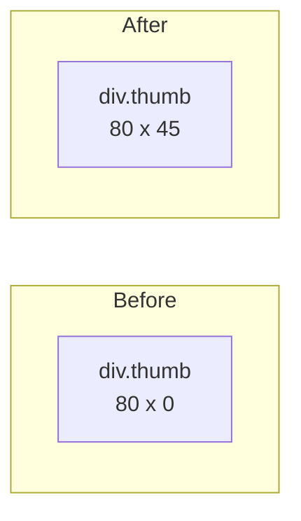
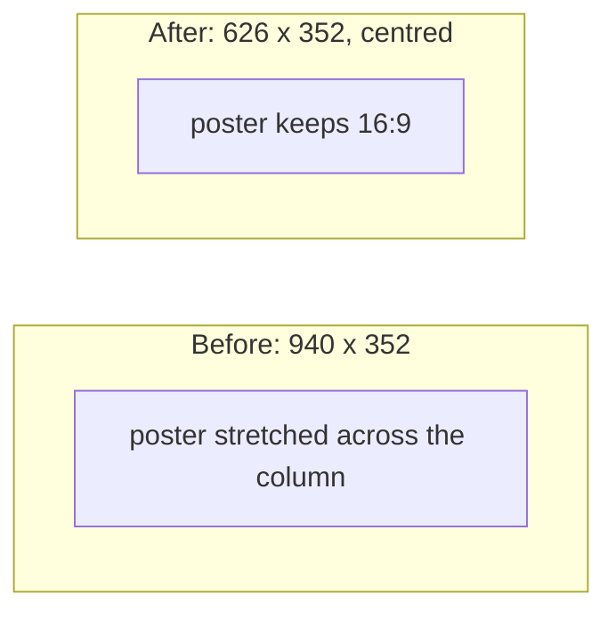

> One change of the Servo fork: `review/13`, 13 of 29 in the stack.
> Below it: [`review/12`](https://github.com/Airodonack/servo/tree/review/12). Above it: [`review/14`](https://github.com/Airodonack/servo/tree/review/14).
> The change itself, two commits:
> - [2438e556eb9839fce4707efb2c5722b59ea7a5af](https://github.com/Airodonack/servo/commit/2438e556eb9839fce4707efb2c5722b59ea7a5af) Boxes with aspect-ratio get their height from their width, and back
> - [6a24e01b6c88659c413e3c4d2e38fa59d8ca4eb3](https://github.com/Airodonack/servo/commit/6a24e01b6c88659c413e3c4d2e38fa59d8ca4eb3) Boxes with aspect-ratio and a max-height narrow to keep their shape
> This README sits in a commit on top of them and is not part of the pull request.
> The whole stack: [overview README](https://github.com/Airodonack/servo/blob/vodscribe/main/README.md).

# Boxes with aspect-ratio get their height from their width, and keep their shape

Two layout fixes for `aspect-ratio` on boxes that are not images or
videos, one commit each:

1. **Boxes with aspect-ratio get their height from their width, and back.**
   A non-replaced box with `aspect-ratio` and an automatic height was 0 px tall.
2. **Boxes with aspect-ratio and a max-height narrow to keep their shape.**
   A capped box kept its full width and lost its ratio.

The second builds on the first. Both are independent of the rest of the
stack.

## Suggested reading order

| Step | File | What to look for |
|---|---|---|
| 1 | [sizing.rs, lines 690 to 762](https://github.com/Airodonack/servo/blob/6a24e01b6c88659c413e3c4d2e38fa59d8ca4eb3/components/layout/sizing.rs#L690-L762) | `TransferredSize`: the size given by the ratio, floored by the contents when `min-height` is `auto` |
| 2 | [formatting_contexts.rs, lines 551 to 642](https://github.com/Airodonack/servo/blob/6a24e01b6c88659c413e3c4d2e38fa59d8ca4eb3/components/layout/formatting_contexts.rs#L551-L642) | where an independent formatting context gets its block size from the ratio |
| 3 | [flow/mod.rs, lines 1738 to 1771](https://github.com/Airodonack/servo/blob/6a24e01b6c88659c413e3c4d2e38fa59d8ca4eb3/components/layout/flow/mod.rs#L1738-L1771) | the same for an in-flow block, and the min/max transfer of commit 2 |
| 4 | [sizing.rs, lines 765 to 816](https://github.com/Airodonack/servo/blob/6a24e01b6c88659c413e3c4d2e38fa59d8ca4eb3/components/layout/sizing.rs#L765-L816) | `TransferredMinMax`, commit 2 |

## The ratio as a content size

### The problem

```css
.thumb { width: 80px; aspect-ratio: 16 / 9; }
```

An `` with this style is 80x45. A `<div>` with it was 80x0 in Servo:
layout used the ratio only for replaced elements. Cards, video thumbnails and
poster frames are built this way.



### The change

css-sizing-4 says to size such a box "the same as for a replaced element with a
natural aspect ratio and no natural size in that axis". The change does that:
the size transferred through the ratio stands in for the content size in the
axis that depends on the ratio.

- [`TransferredSize`](https://github.com/Airodonack/servo/blob/6a24e01b6c88659c413e3c4d2e38fa59d8ca4eb3/components/layout/sizing.rs#L690-L762) holds that
  size. When `min-height` is `auto` and the box does not scroll in that axis,
  its contents can still make it taller (the spec's automatic minimum size).
  With `box-sizing: border-box` the size is clamped at zero.
- [`SizeConstraint::or_transferred`](https://github.com/Airodonack/servo/blob/6a24e01b6c88659c413e3c4d2e38fa59d8ca4eb3/components/layout/sizing.rs#L672-L687)
  turns an indefinite block size into the transferred one, clamped by min and max.
- [`IndependentFormattingContext::layout_and_is_cached`](https://github.com/Airodonack/servo/blob/6a24e01b6c88659c413e3c4d2e38fa59d8ca4eb3/components/layout/formatting_contexts.rs#L551-L642)
  applies it to flow-root, flex and grid boxes. For a block container the
  height becomes definite, so percentages inside resolve against it; flex and
  grid containers keep it indefinite, since their contents may still grow them.
- [`preferred_aspect_ratio`](https://github.com/Airodonack/servo/blob/6a24e01b6c88659c413e3c4d2e38fa59d8ca4eb3/components/layout/formatting_contexts.rs#L710-L727)
  now returns the ratio for non-replaced boxes, except tables and table cells.
- An in-flow block gets the transferred size in the same place. Servo main
  keeps the box's own block size apart from the one its contents resolve
  percentages against (`block_size_for_children`, used by the percentage
  height quirk); the transferred size goes into both
  ([flow/mod.rs, lines 1771 to 1773](https://github.com/Airodonack/servo/blob/6a24e01b6c88659c413e3c4d2e38fa59d8ca4eb3/components/layout/flow/mod.rs#L1771-L1773)).
  Without the second, seven css-sizing tests fail, among them
  `aspect-ratio/percentage-resolution-001` to `004`. In quirks mode the
  box's own width now follows its block size before the quirk, so a block
  with a ratio no longer shrinks to fit there.
- With a definite height and an automatic width, the width comes from the
  ratio and the box fits it instead of stretching
  ([`automatic_inline_size_for_non_replaced`](https://github.com/Airodonack/servo/blob/6a24e01b6c88659c413e3c4d2e38fa59d8ca4eb3/components/layout/flow/mod.rs#L1925-L1939)).
- Flex items: the content size suggestion of a non-replaced item uses its own
  min-content size, not the transferred flex base size
  ([flexbox/layout.rs, lines 2439 to 2468](https://github.com/Airodonack/servo/blob/6a24e01b6c88659c413e3c4d2e38fa59d8ca4eb3/components/layout/flexbox/layout.rs#L2439-L2468)).
- Quirks mode: a root or body with a ratio is not stretched to the viewport
  ([`automatic_block_size`](https://github.com/Airodonack/servo/blob/6a24e01b6c88659c413e3c4d2e38fa59d8ca4eb3/components/layout/flow/mod.rs#L1894-L1922)),
  as `css-sizing/aspect-ratio/quirks-mode-001` expects, and a block size
  the ratio made definite no longer counts as the indefinite height that
  the percentage height quirk replaces
  ([formatting_contexts.rs, lines 602 to 607](https://github.com/Airodonack/servo/blob/6a24e01b6c88659c413e3c4d2e38fa59d8ca4eb3/components/layout/formatting_contexts.rs#L602-L607)).

## The ratio and max-height

### The problem

```css
.poster { aspect-ratio: 16 / 9; max-height: 44vh; margin: 0 auto; } /* in a 940px column */
```

After commit 1 the height was capped at 352 px, but the width stayed at the
column's 940 px. The poster was stretched instead of narrowing to 626 px.



### The change

css-sizing-4 section 4.4 transfers min and max sizes through the ratio to the
other axis when that axis is indefinite.
[`TransferredMinMax`](https://github.com/Airodonack/servo/blob/6a24e01b6c88659c413e3c4d2e38fa59d8ca4eb3/components/layout/sizing.rs#L765-L816) computes them,
in the spec's order (the transferred minimum capped by the box's maximum, the
transferred maximum floored by its minimum).
[`Sizes::resolve_with_transferred_min_max`](https://github.com/Airodonack/servo/blob/6a24e01b6c88659c413e3c4d2e38fa59d8ca4eb3/components/layout/sizing.rs#L913-L950)
applies them to an automatic width only, before the box's own min and max. Call
sites: same-formatting-context blocks
([flow/mod.rs, lines 292 to 308](https://github.com/Airodonack/servo/blob/6a24e01b6c88659c413e3c4d2e38fa59d8ca4eb3/components/layout/flow/mod.rs#L292-L308)),
in-flow independent boxes
([lines 1738 to 1756](https://github.com/Airodonack/servo/blob/6a24e01b6c88659c413e3c4d2e38fa59d8ca4eb3/components/layout/flow/mod.rs#L1738-L1756)) and
boxes beside floats
([lines 1357 to 1373](https://github.com/Airodonack/servo/blob/6a24e01b6c88659c413e3c4d2e38fa59d8ca4eb3/components/layout/flow/mod.rs#L1357-L1373)).

## Options considered

| Option | Why not chosen |
|---|---|
| **Treat the transferred size as a content size** (this change) | Chosen: the spec defines it that way, and replaced elements already go through the same path, so min, max, `fit-content` and flex all apply after. |
| Set the block size from the ratio once, after layout | Percentages inside would resolve against nothing, and flex and grid would size their tracks wrong. |
| Leave grid and flex containers definite too | Their content could not grow them past the ratio, which the automatic minimum size requires. |

## How it was checked

From the commits' own runs (servoshell, headless Chrome 156):

- aspect-ratio: a six-box page from `a=80x0 b=80x0 c=1264x45 rowa=80x0
  cold=600x0 inline=80x0` to `a=80x45 b=80x40 c=80x45 rowa=80x45
  cold=600x338 inline=80x45`. WPT `css/css-sizing/aspect-ratio`: 97 tests and
  8 subtest groups newly pass, 287 of 289 as expected; css-sizing and
  css-flexbox gain 8 and 18 more. On the current Servo main base, the commit
  message adds, three aspect-ratio tests added to WPT since also pass.
- max-height: `host/aspect-ratio-max.html`, 14 boxes, 7 of 14 to 14 of 14
  matching Chrome; `block-aspect-ratio-020/023/026/027` newly pass.

Rerun on 2026-11-03, Chrome side only (no Servo build): `aspect-ratio-max.html`
gives `RESULT done 14/14 match` against the page's own expected rects, among
them `vod rect=157.11,0.00,625.77,351.98`.

On Servo main b88af263d1 (the rebase of 2026-11-06), at this commit: `mach
fmt` changed nothing, `test-tidy` passed, and `mach check` exited 0 with no
warnings. At the stack's tip the same checks and `mach clippy` pass, and the
WPT directories run before the rebase give the same results.

## Questions a reviewer may ask

- **Two subtests of `aspect-ratio-minimum-size-single-axis-scroll-container`
  now fail?** `overflow-x: clip` computes to `hidden` there, so both axes count
  as scrolling and the contents no longer floor the size. They passed before
  only because the ratio was ignored.
- **Is the overflow axis check right for a box that scrolls only in the other
  axis?** The ratio-dependent axis alone decides, as other engines do; see the
  comment on `TransferredSize`.
- **Can the two commits go as separate pull requests?** Yes, in this order;
  the second needs the first.
