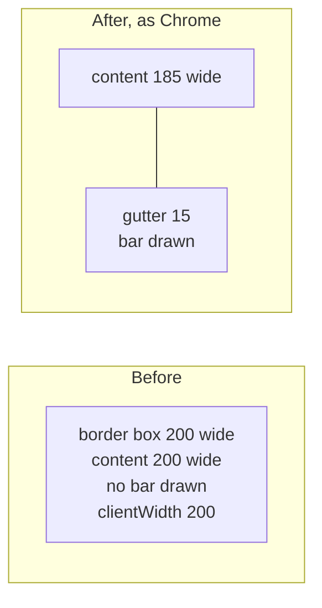
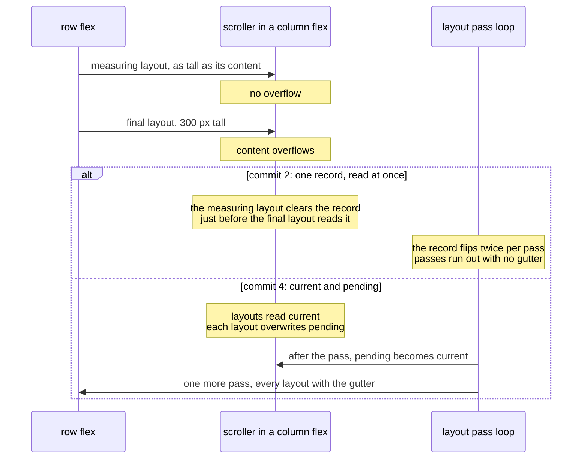
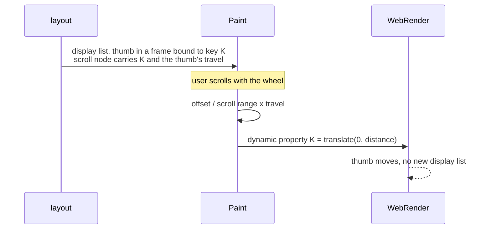

> One change of the Servo fork: `review/27`, 27 of 29 in the stack.
> Below it: [`review/26`](https://github.com/Airodonack/servo/tree/review/26). Above it: [`review/28`](https://github.com/Airodonack/servo/tree/review/28).
> The change itself, four commits:
> - [35a1a3e6981e828b938b3a6cf9830741b1f04097](https://github.com/Airodonack/servo/commit/35a1a3e6981e828b938b3a6cf9830741b1f04097) Pages can set scrollbar-width, scrollbar-color and scrollbar-gutter
> - [f296a9df9c035d851e7a3fa392098cbd60cccaa1](https://github.com/Airodonack/servo/commit/f296a9df9c035d851e7a3fa392098cbd60cccaa1) Scroll containers make room for their scrollbars
> - [d332a35be9841656c926adbd5a3698b26a69e325](https://github.com/Airodonack/servo/commit/d332a35be9841656c926adbd5a3698b26a69e325) Scroll containers draw a scrollbar that follows scrolling
> - [38844dd28e0c0b6eb25818a8eea254e485b7b8bc](https://github.com/Airodonack/servo/commit/38844dd28e0c0b6eb25818a8eea254e485b7b8bc) Scrollbars appear in scroll containers inside nested flex layouts
> This README sits in a commit on top of them and is not part of the pull request.
> The whole stack: [overview README](https://github.com/Airodonack/servo/blob/vodscribe/main/README.md).

# Scroll containers get classic scrollbars

Before this change Servo drew no scrollbar anywhere inside a page, and laid a
scroll container's content out across its whole padding box. A box with
`overflow: auto` and overflowing content reported a `clientWidth` 15 px wider
than other engines, and everything in it was laid out 15 px wider.

Four commits:

1. **Pages can set scrollbar-width, scrollbar-color and scrollbar-gutter.**
   Turns the properties on; needs the stylo fork.
2. **Scroll containers make room for their scrollbars.** The gutter comes out
   of the content box; `overflow: auto` decides after layout whether it shows one.
3. **Scroll containers draw a scrollbar that follows scrolling.** Track, thumb
   and corner, moved by the compositor without a new layout.
4. **Scrollbars appear in scroll containers inside nested flex layouts.** Fixes
   commit 2's bookkeeping when a box is laid out twice in one pass.

Viewport scrollbars and overlay scrollbars are not part of this change.

## Depends on the stylo fork

`scrollbar-gutter` was compiled for Gecko only. The Cargo.toml
`[patch."https://github.com/servo/stylo"]` entries pin all eleven stylo crates
to the fork's revision ef2431c0a8
([Cargo.toml, lines 506 to 521](https://github.com/Airodonack/servo/blob/38844dd28e0c0b6eb25818a8eea254e485b7b8bc/Cargo.toml#L506-L521)). That revision is
two stylo commits on stylo main:

- [stylo `review/01`](https://github.com/Airodonack/stylo/tree/review/01):
  `accent-color` for Servo, used by [`review/28`](https://github.com/Airodonack/servo/tree/review/28);
- [stylo `review/02`](https://github.com/Airodonack/stylo/tree/review/02):
  `scrollbar-gutter` for Servo, used here.

Upstream, the stylo change lands first and this pull request then bumps stylo
normally; the `[patch]` block goes. `scrollbar-width` and `scrollbar-color`
need no stylo change: they sit behind the stylo preference
`layout.css.scrollbar-styling.enabled`, which
[prefs.rs, lines 43 to 47](https://github.com/Airodonack/servo/blob/38844dd28e0c0b6eb25818a8eea254e485b7b8bc/components/config/prefs.rs#L43-L47) turns on.

## Suggested reading order

| Step | File | What to look for |
|---|---|---|
| 1 | [scrollbars.rs, lines 34 to 205](https://github.com/Airodonack/servo/blob/38844dd28e0c0b6eb25818a8eea254e485b7b8bc/components/layout/scrollbars.rs#L34-L205) | thickness, which bars show, the gutter per side |
| 2 | [style_ext.rs, lines 1386 to 1400](https://github.com/Airodonack/servo/blob/38844dd28e0c0b6eb25818a8eea254e485b7b8bc/components/layout/style_ext.rs#L1386-L1400) | the gutter folded into padding for sizing |
| 3 | [box_fragment.rs, lines 196 to 202](https://github.com/Airodonack/servo/blob/38844dd28e0c0b6eb25818a8eea254e485b7b8bc/components/layout/fragment_tree/box_fragment.rs#L196-L202) and [386 to 394](https://github.com/Airodonack/servo/blob/38844dd28e0c0b6eb25818a8eea254e485b7b8bc/components/layout/fragment_tree/box_fragment.rs#L386-L394) | the gutter kept apart from CSS padding in the fragment |
| 4 | [layout_box_base.rs, lines 131 to 152](https://github.com/Airodonack/servo/blob/38844dd28e0c0b6eb25818a8eea254e485b7b8bc/components/layout/layout_box_base.rs#L131-L152) and [scrollbars.rs, lines 57 to 93](https://github.com/Airodonack/servo/blob/38844dd28e0c0b6eb25818a8eea254e485b7b8bc/components/layout/scrollbars.rs#L57-L93) | what each layout records about overflow |
| 5 | [layout_impl.rs, lines 1509 to 1525](https://github.com/Airodonack/servo/blob/38844dd28e0c0b6eb25818a8eea254e485b7b8bc/components/layout/layout_impl.rs#L1509-L1525) | the extra layout passes |
| 6 | [display_list/mod.rs, lines 1114 to 1179](https://github.com/Airodonack/servo/blob/38844dd28e0c0b6eb25818a8eea254e485b7b8bc/components/layout/display_list/mod.rs#L1114-L1179) | painting track, thumb and corner |
| 7 | [display_list.rs, lines 259 to 295](https://github.com/Airodonack/servo/blob/38844dd28e0c0b6eb25818a8eea254e485b7b8bc/components/shared/paint/display_list.rs#L259-L295) and [painter.rs, lines 648 to 680](https://github.com/Airodonack/servo/blob/38844dd28e0c0b6eb25818a8eea254e485b7b8bc/components/paint/painter.rs#L648-L680) | the thumb following compositor scrolls |

## The gutter

```css
.list { width: 200px; height: 100px; overflow: auto; }   /* content 300px tall */
```



[`scrollbar_gutter`](https://github.com/Airodonack/servo/blob/38844dd28e0c0b6eb25818a8eea254e485b7b8bc/components/layout/scrollbars.rs#L153-L205) gives the
space per physical side: 15 px for `scrollbar-width: auto`, 10 px for `thin`,
0 for `none` (Chromium's classic sizes); `overflow: scroll` always shows a bar,
`auto` only in an overflowing axis; `scrollbar-gutter: stable` reserves it
anyway, `both-edges` on both sides. A right-to-left horizontal box puts the
vertical bar on the left, as other engines do.

Every scroll container is an independent formatting context, so its layout
style becomes [`LayoutStyle::ScrollContainer`](https://github.com/Airodonack/servo/blob/38844dd28e0c0b6eb25818a8eea254e485b7b8bc/components/layout/style_ext.rs#L1213-L1215),
which adds the gutter to the padding used for sizing
([lines 1386 to 1400](https://github.com/Airodonack/servo/blob/38844dd28e0c0b6eb25818a8eea254e485b7b8bc/components/layout/style_ext.rs#L1386-L1400)). A
`width` keeps the border box and the content shrinks. The fragment keeps CSS
padding and gutter apart, so `padding_rect` is the scrollport and
`clientLeft` counts a left gutter
([box_fragment.rs](https://github.com/Airodonack/servo/blob/38844dd28e0c0b6eb25818a8eea254e485b7b8bc/components/layout/fragment_tree/box_fragment.rs#L386-L394)).

A box sized smaller than its scrollbar keeps its size, as in other engines:
CSS 2.1 section 11.1.1 takes the scrollbar's space "out of" the box's
dimensions. The gutter is fitted, per axis, into the room the size
properties give, the preferred size clamped by the min and max sizes, or
the max size alone
([style_ext.rs, lines 1302 to 1340](https://github.com/Airodonack/servo/blob/38844dd28e0c0b6eb25818a8eea254e485b7b8bc/components/layout/style_ext.rs#L1302-L1340),
[`fit_scrollbar_gutter`](https://github.com/Airodonack/servo/blob/38844dd28e0c0b6eb25818a8eea254e485b7b8bc/components/layout/style_ext.rs#L193-L217)),
and the block, float and inline-block, absolute and flex item fragments
take their gutter from that. Without it, a 20x10 modal dialog with
overflowing text grew to 15 px tall and was centered 2.5 px too high.

## `overflow: auto` and the extra pass

Whether an `auto` box overflows is known only after laying it out, and the
gutter then changes its content width. Layout records the overflowing axes
when a box's fragment is stored, and runs again if they changed, at most twice
([`MAX_EXTRA_LAYOUT_PASSES_FOR_SCROLLBARS`](https://github.com/Airodonack/servo/blob/38844dd28e0c0b6eb25818a8eea254e485b7b8bc/components/layout/layout_impl.rs#L114-L118),
[the loop](https://github.com/Airodonack/servo/blob/38844dd28e0c0b6eb25818a8eea254e485b7b8bc/components/layout/layout_impl.rs#L1509-L1525)). An extra pass
uses a fresh cache epoch, so every box drops the layout and intrinsic sizes
cached before it ([context.rs, lines 77 to 99](https://github.com/Airodonack/servo/blob/38844dd28e0c0b6eb25818a8eea254e485b7b8bc/components/layout/context.rs#L77-L99)).
Later layouts start from the recorded axes and need one pass.

Commit 4 fixes the case where a box is laid out more than once in a pass: a
row flex lays a column flex out with an indefinite height to measure it, then
at its final height. Commit 2 kept one record per box, read at once.



[`AutoScrollbarState`](https://github.com/Airodonack/servo/blob/38844dd28e0c0b6eb25818a8eea254e485b7b8bc/components/layout/scrollbars.rs#L57-L93) holds
`current` (what every layout in this pass uses) and `pending` (what the last
layout found). [`update_overflowing_auto_axes`](https://github.com/Airodonack/servo/blob/38844dd28e0c0b6eb25818a8eea254e485b7b8bc/components/layout/layout_box_base.rs#L131-L152)
registers the state with the layout context only when `pending` differs from
`current`, and [`apply_scrollbar_observations`](https://github.com/Airodonack/servo/blob/38844dd28e0c0b6eb25818a8eea254e485b7b8bc/components/layout/context.rs#L108-L119)
moves `pending` to `current` between passes.

## Painting and scrolling

[`visit_box_for_scrollbars`](https://github.com/Airodonack/servo/blob/38844dd28e0c0b6eb25818a8eea254e485b7b8bc/components/layout/display_list/mod.rs#L1114-L1179)
paints a track, a thumb sized by the visible fraction (never shorter than the
bar is thick) and a corner square, in `scrollbar-color` or light grey
defaults. They are painted after the stacking context's content, like
outlines ([`paint_scrollbars_since`](https://github.com/Airodonack/servo/blob/38844dd28e0c0b6eb25818a8eea254e485b7b8bc/components/layout/display_list/paint_traversal.rs#L543-L553)),
so the scrolled content cannot cover them.

Wheel, touch and key scrolling happen in the compositor without a new layout,
so the thumb cannot be placed at layout time. Each thumb sits in a WebRender
reference frame whose transform is a property binding:



[`ScrollbarThumb`](https://github.com/Airodonack/servo/blob/38844dd28e0c0b6eb25818a8eea254e485b7b8bc/components/shared/paint/display_list.rs#L259-L295)
carries the key and travel;
[`scrollbar_thumb_transform`](https://github.com/Airodonack/servo/blob/38844dd28e0c0b6eb25818a8eea254e485b7b8bc/components/shared/paint/display_list.rs#L373-L398)
turns the node's offset into the translation;
[`add_dynamic_properties_to_transaction`](https://github.com/Airodonack/servo/blob/38844dd28e0c0b6eb25818a8eea254e485b7b8bc/components/paint/painter.rs#L648-L680)
sends every thumb transform with the other dynamic properties, since
WebRender replaces them as a set.

## Options considered

| Option | Why not chosen |
|---|---|
| **Classic bars that take space, sized as Chromium** (this change) | Chosen: what pages are laid out against on Linux and Windows; `clientWidth` then matches. |
| Overlay bars that take no space | Keeps layout unchanged, but `clientWidth` stays 15 px off desktop Chrome and pages that reserve room for bars misalign. A later option per platform. |
| Lay out twice up front, with and without bars | Doubles the cost of every scroll container; the recorded state usually makes one pass enough. |
| Repaint the display list on every scroll to move the thumb | Defeats compositor scrolling; property bindings are WebRender's tool for this. |
| Commit 4's alternative: keep the first record of a pass | The measuring layout comes first and is the wrong one; the last layout of a box in a pass is its final one. |

## What it costs

At most two extra layout passes in a reflow where an `auto` bar appears or
goes, with caches dropped. Not timed; later reflows start from the recorded
state.

## Spec

[CSS Overflow 3, scrollbar-gutter](https://drafts.csswg.org/css-overflow-3/#scrollbar-gutter-property):

> The space between the inner border edge and the outer padding edge which
> user agents may reserve to display the scrollbar is called the scrollbar
> gutter.

> Scrollbars which are always placed in a scrollbar gutter, consuming space
> when present, are called classic scrollbars.

[CSS Scrollbars 1, scrollbar-width](https://drafts.csswg.org/css-scrollbars-1/#scrollbar-width):
`thin` "should use thinner scrollbars than auto"; the pixel sizes are left to
the user agent.

## How it was checked

From the commits' own runs (servoshell, headless Chrome 156):

- `host/scrollbars.html`: 17 of 17 RESULT lines equal Chrome's (client,
  offset and scroll sizes, `clientLeft`, computed values, `CSS.supports`), for
  auto, scroll, overflow-y only, thin, none, border-box, shrink-to-fit, rtl and
  the app's 940 px list, now 925. With `?noscroll`, WebDriver wheel actions
  scroll two boxes by 60 px and their thumbs move without a new display list.
- `host/scrollbars-flex.html`: 13 of 13 equal Chrome's after commit 4 (before:
  `nested` and `nested_plain` at 500, Chrome 485).
- Boxes smaller than a scrollbar, from the record of the fixup folded into
  commit 2 (2026-11-05): `host/scrollbar-small-box.html`, 12 boxes, and
  `host/dialog-centering.html` against headless Chrome 157. Before, for
  example `d 24x19, g 19x19` and the dialog at `top=-2.5 height=15`; after,
  `d 24x14, g 14x14` and `top=0 height=10`, the offset sizes all as in
  Chrome; the client sizes too, except one box where Chrome reports
  `clientHeight` 1. `host/scrollbars.html` is unchanged by it. With it,
  `css-flexbox/overflow-auto-001` and
  `css-overflow/overflow-body-propagation-016` pass again: a box set to
  0px keeps its zero size and shows no bar.
- WPT before and after: css-scrollbars subtests PASS 39 to 73, tests 13 to 23;
  css-overflow subtests PASS 590 to 611; cssom-view 1484 to 1486. After commit
  4, css-overflow, css-flexbox and css-scrollbars: 2355 to 2357 of 2366 as
  expected, nothing newly failing.

Rerun on 2026-11-03, Chrome side only (no Servo build), `host/scrollbars.html`:

```
RESULT main client=925x120 offset=940x120 scroll=925x300 clientLeft=0
RESULT auto_overflow client=195x110 offset=214x114 scroll=195x310 clientLeft=2
RESULT rtl client=195x110 offset=214x114 scroll=195x110 clientLeft=17
RESULT thin_overflow client=200x110 offset=214x114 scroll=200x310 clientLeft=2
```

The restack's gate (2026-11-05) ran on this change before the day's fixups
to lower refs were folded in (the same patch): `mach fmt` changed nothing
and `mach check` exited 0 with no warnings. `test-tidy` fails at this
commit: cargo-deny does not allow the stylo fork as a git source until
the velocity layer's "mach test-tidy accepts the stylo fork as a git
source". At the stack's tip `test-tidy` and `mach clippy` pass.

## Questions a reviewer may ask

- **Thirteen css-overflow reftests now fail?** Bars now take space and are
  painted. Chrome fails three of them too (viewport scrollbars:
  `scrollbar-gutter-root`, `-vertical-lr-002`, `-vertical-rl-002`). The other
  ten are real gaps the bars expose, mostly in scrollable-overflow
  accuracy; commit 3 lists them, and three css-flexbox tests that change
  with bars.
- **`white-space-pre-wrap-trailing-spaces-021` fails now?** Its
  `overflow: auto` box ends a line with eight pre-wrap spaces. Servo
  already counted hanging spaces as scrollable overflow before this change
  (`clientWidth` 304, `scrollWidth` 380 on Servo main; Chrome 157 308 and
  308); the test passed only because no bar was shown. Now the box gets a
  horizontal bar. The fix belongs in inline layout's scrollable overflow.
- **`block-aspect-ratio-011` fails again?** With `overflow: auto` and a 1/1
  ratio the height comes from the content width left beside the bar (100x85);
  Chrome keeps 100x100. Servo main fails it too.
- **Why 15 px?** Chromium's classic bar on Linux and Windows. A platform theme
  could supply it later.
- **Can the extra passes loop?** No: at most two, then the last state is kept
  for the next reflow.
