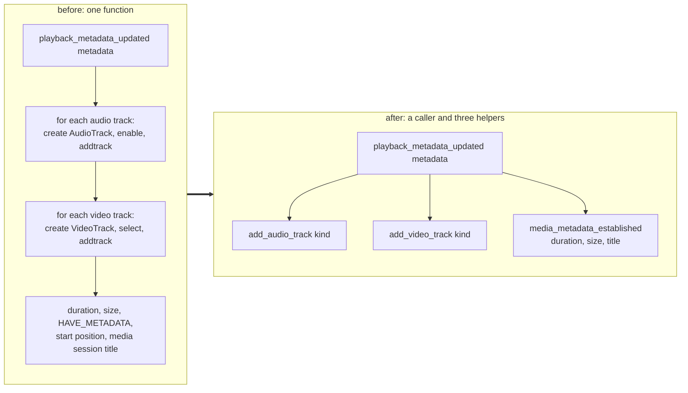

> One change of the Servo fork: `review/21`, 21 of 29 in the stack.
> Below it: [`review/20`](https://github.com/Airodonack/servo/tree/review/20). Above it: [`review/22`](https://github.com/Airodonack/servo/tree/review/22).
> The change itself: [commit 5960a79067011157489d34ada56a488f3ae57caa](https://github.com/Airodonack/servo/commit/5960a79067011157489d34ada56a488f3ae57caa). This README sits in a commit on top of it and is not part of the pull request.
> The whole stack: [overview README](https://github.com/Airodonack/servo/blob/vodscribe/main/README.md).

# Split the media element's metadata steps into helpers

No change in behaviour. One long function of the media element becomes a
caller and three helpers, so that
[`review/22`](https://github.com/Airodonack/servo/tree/review/22) can run the
same steps for a MediaSource and its own diff shows only the Media Source
change.

Read it with `git show --color-moved --color-moved-ws=allow-indentation-change`:
GitHub shows a rewrite, but almost every line only moved.

## The problem

`playback_metadata_updated` runs when the GStreamer player first reports
metadata. It held three blocks of HTML's
[media data processing steps](https://html.spec.whatwg.org/multipage/media.html#media-data-processing-steps-list)
inline, all reading the backend's `Metadata` struct: an `AudioTrack` per
audio track, a `VideoTrack` per video track, then the steps for once the
duration and dimensions are known (`HAVE_METADATA`, `loadedmetadata`).

With a MediaSource, the same steps must run from another trigger: the first
initialization segment of every SourceBuffer, which has no `Metadata` struct
behind it. As one function, they cannot be called from there.

## The change

| Helper | HTML steps it holds | Takes |
|---|---|---|
| [`add_audio_track`](https://github.com/Airodonack/servo/blob/5960a79067011157489d34ada56a488f3ae57caa/components/script/dom/html/embedded_content/htmlmediaelement.rs#L2712-L2773) | "If the media resource is found to have an audio track", steps 1 to 7 | `kind`: `"main"` for the first track, as before |
| [`add_video_track`](https://github.com/Airodonack/servo/blob/5960a79067011157489d34ada56a488f3ae57caa/components/script/dom/html/embedded_content/htmlmediaelement.rs#L2775-L2837) | "If the media resource is found to have a video track", steps 1 to 7 | the same |
| [`media_metadata_established`](https://github.com/Airodonack/servo/blob/5960a79067011157489d34ada56a488f3ae57caa/components/script/dom/html/embedded_content/htmlmediaelement.rs#L2839-L2933) | "Once enough of the media data has been fetched to determine the duration of the media resource, its dimensions, and other metadata", steps 1 to 13, and the media session title | the duration, the video size and the title |

The [caller](https://github.com/Airodonack/servo/blob/5960a79067011157489d34ada56a488f3ae57caa/components/script/dom/html/embedded_content/htmlmediaelement.rs#L2665-L2710)
keeps the "run once, from `HAVE_NOTHING`" check and does the only new work:

- it computes the duration first, with the rule
  [`review/20`](https://github.com/Airodonack/servo/tree/review/20) had
  inline at step 4 (the MediaSource's duration while one is attached,
  otherwise the backend's, or Infinity);
- it passes `(metadata.width, metadata.height)` and `metadata.title.clone()`
  instead of letting the steps read `metadata`.

The duration is now read before steps 1 to 3 instead of at step 4. Those
steps only set the playback positions, so the value is the same.

## Options considered

| Option | Why not chosen |
|---|---|
| **Split in its own commit** (this change) | Chosen: `review/22` then reads as the Media Source change only, and this commit can be checked as a pure move. |
| Do the split inside `review/22` | The moved lines would hide the behaviour change among 300 lines of re-indentation. |
| Copy the steps into a Media Source version | Two copies of the HTML steps to keep in step. |
| Build a `Metadata` struct from the initialization segment and call the old function | `Metadata` is the player's report (it has a title and a single size), and `review/22` turns the player's metadata path off while a MediaSource is attached. |

## How it was checked

- **A pure move, measured on this commit:** with
  `git show --color-moved=plain --color-moved-ws=allow-indentation-change`,
  128 added and 127 removed lines are moves. The 33 added and 14 removed
  lines that are not are the three signatures and their doc comments, the
  caller's new lines, and three rewrites that read the new arguments: the
  duration, the video size, and the media session title.
- **Builds:** the restack's gate (2026-11-05) ran on this change before the
  day's fixups to lower refs were folded in (the same patch): `mach fmt`
  changed nothing, `test-tidy` passed, and `mach check` exited 0 with no
  warnings. At the stack's tip the same checks and `mach clippy` pass.

Not yet done: playback checks on this commit alone. Plain-file and Media
Source playback ran at the top of the series, with `review/22` on top.

## Questions a reviewer may ask

- **Why take the duration as an argument?** So the caller decides where it
  comes from. `review/22` passes the MediaSource's.
- **Why `(u32, u32)` for the size?** It is what `Metadata` had. `review/22`
  turns it into an `Option`, since an initialization segment may not give a
  size.
