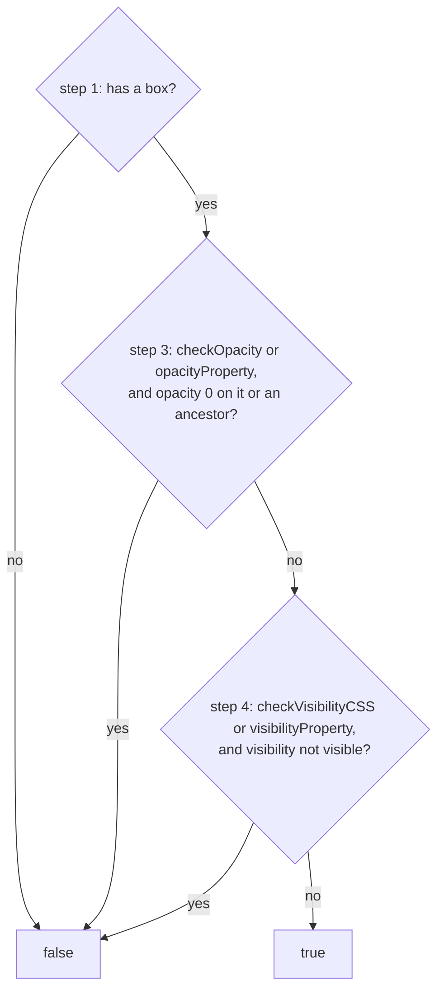

> One change of the Servo fork: `review/25`, 25 of 29 in the stack.
> Below it: [`review/24`](https://github.com/Airodonack/servo/tree/review/24). Above it: [`review/26`](https://github.com/Airodonack/servo/tree/review/26).
> The change itself: [commit 21a1dc94938102505ceceb40c1f5f09efa238dc8](https://github.com/Airodonack/servo/commit/21a1dc94938102505ceceb40c1f5f09efa238dc8). This README sits in a commit on top of it and is not part of the pull request.
> The whole stack: [overview README](https://github.com/Airodonack/servo/blob/vodscribe/main/README.md).

# Implement Element.checkVisibility()

`Element.checkVisibility()` did not exist in Servo. Twitch's embedded
player calls it before it starts playing, so in Servo the player never
started unless clicked. This change adds the method, as CSSOM View
specifies it. It is a small DOM addition, independent of the rest of the
stack.

## The problem

The method did not exist in Servo. Twitch's embedded player calls it
before it honours a play request (the embed API's play command, or
`autoplay` in its URL). The call threw "checkVisibility is not a
function", so the player stayed at Ready and never called `play()` on its
video, though the video had all the data it needed. A click on the
player's own button worked, which made it look like a media stall.

## The change

[`Element::CheckVisibility`](https://github.com/Airodonack/servo/blob/21a1dc94938102505ceceb40c1f5f09efa238dc8/components/script/dom/element/element.rs#L3379-L3425)
follows the spec's six steps, each quoted as a comment; the
[IDL](https://github.com/Airodonack/servo/blob/21a1dc94938102505ceceb40c1f5f09efa238dc8/components/script_bindings/webidls/Element.webidl#L101-L116)
adds the method and the `CheckVisibilityOptions` dictionary as the spec
writes them.

Step 1 asks layout for the element's border boxes, which also brings style
up to date for the later steps. Steps 2 and 5 are about
`content-visibility`, which Servo does not support, so they never return
false.

## Spec

[CSSOM View, `checkVisibility(options)`](https://drafts.csswg.org/cssom-view/#dom-element-checkvisibility):

> If this does not have an associated box, return false. If an ancestor of
> this in the flat tree has content-visibility: hidden, return false. If
> either the opacityProperty or the checkOpacity dictionary members of
> options are true, and this, or an ancestor of this in the flat tree, has
> a computed opacity value of 0, return false. [...]

## How it was checked

From the commit message (2026-11-01):

- A test page with Twitch's player in a frame, sent the embed API's play
  command from a timer, no click. Before: `RESULT twitch-play FAIL no
  Playing past 2 s in 40 s; last state Ready t=0.01`. After: `PASS`, three
  runs, and with `?autoplay=1`.
- A page of 10 direct cases: `FAIL checkVisibility is undefined` before,
  `PASS 10 cases` after.

The commit removes the `FAIL` expectations of 15 subtests of WPT
`css/cssom-view/checkVisibility.html` (the `content-visibility` ones still
fail) and 7 of `idlharness.html`.

On 2026-11-02 a build of the whole stack printed `RESULT check-visibility
PASS 10 cases` on the same page.

The restack's gate (2026-11-05) ran on this change before the day's fixups
to lower refs were folded in (the same patch): `mach fmt` changed nothing,
`test-tidy` passed, and `mach check` exited 0 with no warnings. At the
stack's tip the same checks and `mach clippy` pass.

## Questions a reviewer may ask

- **checkVisibility walks shadow-including ancestors; the spec says flat
  tree.** They differ for a slotted element: its flat-tree parent is the
  slot, inside the shadow tree, so an `opacity: 0` element between the
  shadow root and the slot counts in the spec and is missed here. No test
  covers it yet.
- **Why was this hard to find?** A click on the player's own button
  worked, so it looked like a media stall, not a missing method.
