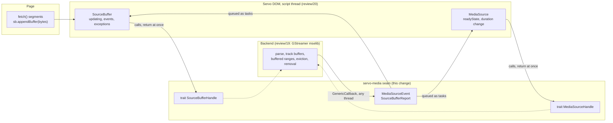
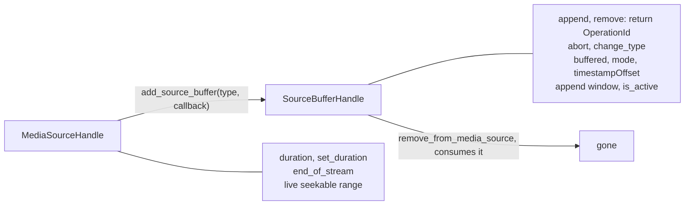
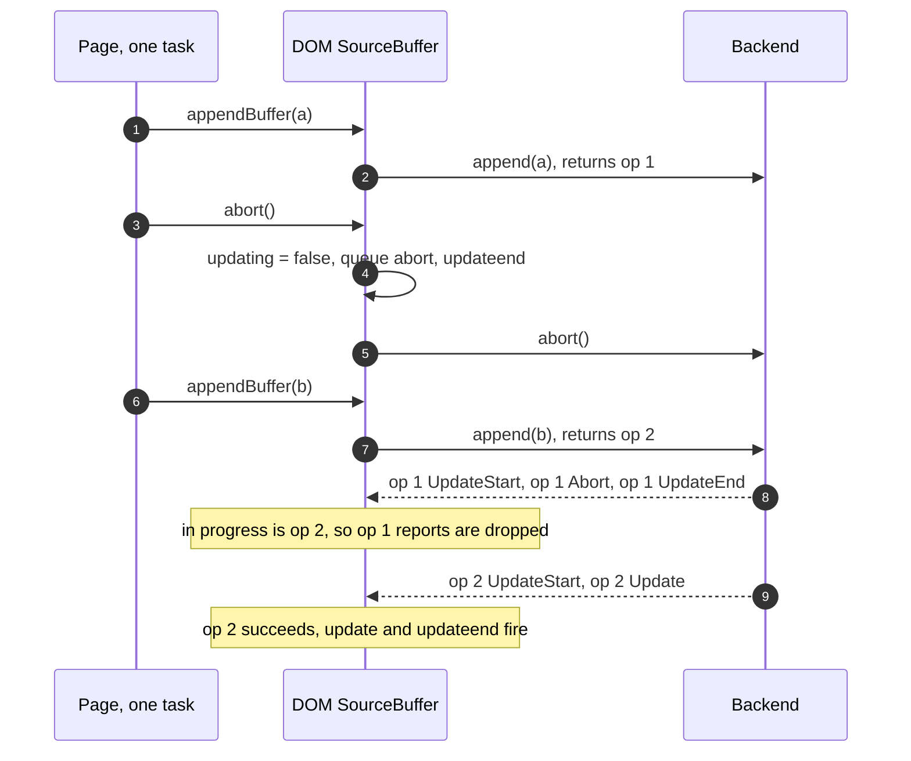
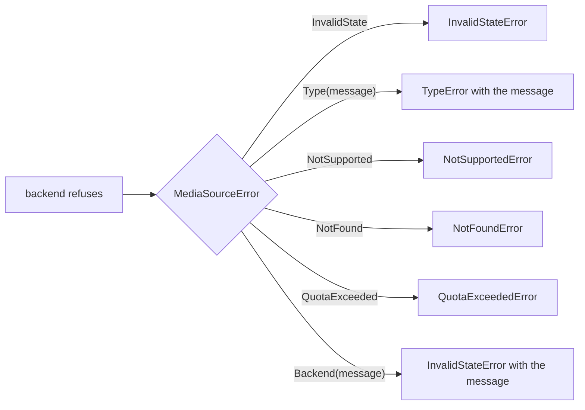
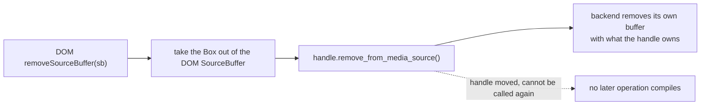
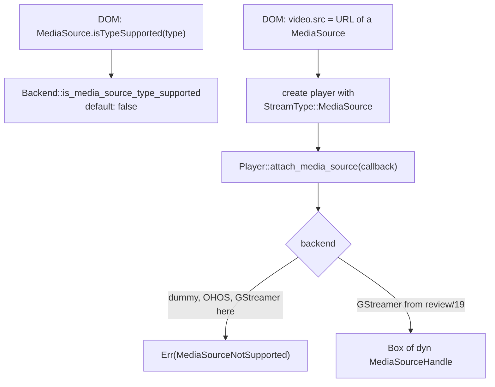

> One change of the Servo fork: `review/18`, 18 of 29 in the stack.
> Below it: [`review/17`](https://github.com/Airodonack/servo/tree/review/17). Above it: [`review/19`](https://github.com/Airodonack/servo/tree/review/19).
> The change itself: [commit 44f4c1d48ce9cd43646133d859c62d8ad530820e](https://github.com/Airodonack/servo/commit/44f4c1d48ce9cd43646133d859c62d8ad530820e). This README sits in a commit on top of it and is not part of the pull request.
> The whole stack: [overview README](https://github.com/Airodonack/servo/blob/vodscribe/main/README.md).

# Add the media backend seam for Media Source Extensions

With Media Source Extensions (MSE) a page fetches media itself and pushes the
bytes into a `<video>` through a `MediaSource` and its `SourceBuffer`s. The
spec's algorithms (ready states, the `updating` flag, events, exceptions)
belong in Servo's DOM. Parsing and buffering the media belongs in the media
backend. This change adds the interface between the two, in servo-media, and
nothing else: every backend still refuses Media Source players.

248 lines in 7 files, almost all of them one new file,
`components/media/player/media_source.rs`. Its shape is the main design
question of the whole MSE series, so it is the change to agree on first.

## Suggested reading order

| # | File | What to look for |
|---|---|---|
| 1 | [`player/media_source.rs`, lines 1 to 14](https://github.com/Airodonack/servo/blob/44f4c1d48ce9cd43646133d859c62d8ad530820e/components/media/player/media_source.rs#L1-L14) | Who owns what: the backend owns the media, the DOM owns the spec's state. |
| 2 | [`MediaSourceHandle`, lines 111 to 142](https://github.com/Airodonack/servo/blob/44f4c1d48ce9cd43646133d859c62d8ad530820e/components/media/player/media_source.rs#L111-L142) and [`SourceBufferHandle`, lines 144 to 196](https://github.com/Airodonack/servo/blob/44f4c1d48ce9cd43646133d859c62d8ad530820e/components/media/player/media_source.rs#L144-L196) | One method per spec operation, each linked to the spec. Calls return at once. |
| 3 | [Events and reports, lines 58 to 106](https://github.com/Airodonack/servo/blob/44f4c1d48ce9cd43646133d859c62d8ad530820e/components/media/player/media_source.rs#L58-L106) | `OperationId` and `SourceBufferReport`: why every event names its operation. |
| 4 | [`MediaSourceError`, lines 37 to 56](https://github.com/Airodonack/servo/blob/44f4c1d48ce9cd43646133d859c62d8ad530820e/components/media/player/media_source.rs#L37-L56) | One variant per exception the spec names. |
| 5 | [`remove_from_media_source`, lines 191 to 195](https://github.com/Airodonack/servo/blob/44f4c1d48ce9cd43646133d859c62d8ad530820e/components/media/player/media_source.rs#L191-L195) | Removal consumes the handle. |
| 6 | [`player/lib.rs`](https://github.com/Airodonack/servo/blob/44f4c1d48ce9cd43646133d859c62d8ad530820e/components/media/player/lib.rs#L141-L148) and [`servo-media/lib.rs`](https://github.com/Airodonack/servo/blob/44f4c1d48ce9cd43646133d859c62d8ad530820e/components/media/servo-media/lib.rs#L67-L79) | The two entry points: `Player::attach_media_source` and `Backend::is_media_source_type_supported`. |
| 7 | The dummy, OHOS and GStreamer backends | Each refuses, for now. |

## 1. Who does what



The module comment states the split
([lines 5 to 14](https://github.com/Airodonack/servo/blob/44f4c1d48ce9cd43646133d859c62d8ad530820e/components/media/player/media_source.rs#L5-L14)):
"The backend owns the media: the appended data, its parsing, the buffered
ranges, eviction and removal. Script keeps the state the spec's algorithms
decide: the ready state of the media source, the `updating` flag of each
source buffer and the events fired at the page."

Two directions, two styles:

- **DOM to backend: plain method calls** on `Box<dyn MediaSourceHandle>` and
  `Box<dyn SourceBufferHandle>`. Each says at once whether the operation is
  accepted or refused (`Result<_, MediaSourceError>`). `append` and `remove`
  return an `OperationId`.
- **Backend to DOM: events** through a `GenericCallback`, Servo's
  cross-thread callback. A backend may report from any of its threads; the
  DOM queues each event as a task, so the spec's ordering is kept on the
  script thread.

Everything the spec says about the media itself is behind the traits. A
backend that is not GStreamer (OHOS's player, or a future one) implements the
same two traits, and the DOM does not change.

## 2. The handles



`MediaSourceHandle` covers `duration`, `addSourceBuffer()`, `endOfStream()`
and the live seekable range. `SourceBufferHandle` covers `buffered`, `mode`,
`timestampOffset`, the append window, `appendBuffer()`, `abort()`,
`remove()`, `changeType()`, `activeSourceBuffers` membership (`is_active`),
and removal from the media source.

Spec values with no Rust equivalent are spelled out: a duration of `None` is
the spec's NaN
([line 117](https://github.com/Airodonack/servo/blob/44f4c1d48ce9cd43646133d859c62d8ad530820e/components/media/player/media_source.rs#L117)),
and a removal end of `None` is positive infinity
([lines 184 to 186](https://github.com/Airodonack/servo/blob/44f4c1d48ce9cd43646133d859c62d8ad530820e/components/media/player/media_source.rs#L184-L186)).
Dropping a `MediaSourceHandle` detaches it.

## 3. Events name their operation

```rust
pub type OperationId = u64;

pub struct SourceBufferReport {
    pub operation: OperationId,
    pub event: SourceBufferEvent,
}

fn append(&self, data: Vec<u8>) -> Result<OperationId, MediaSourceError>;
fn remove(&self, start: f64, end: Option<f64>) -> Result<OperationId, MediaSourceError>;
```

The DOM finishes some operations itself, without waiting for the backend.
`abort()` and `removeSourceBuffer()` set `updating` to false and queue
`abort` and `updateend` at once, while the backend's own reports for the
aborted append are still on their way. The page can then start the next
append in the same task. Without a number on each report, the late reports
of the aborted append look like reports of the new one:



A backend can also report with no operation behind it. Stock mselib 1.28
signals `update` and `update-end` every second while a buffer is idle
(measured in `review/19`'s README). The doc comment of `SourceBufferReport`
([lines 97 to 101](https://github.com/Airodonack/servo/blob/44f4c1d48ce9cd43646133d859c62d8ad530820e/components/media/player/media_source.rs#L97-L101))
names both cases: "the DOM acts only on events of the operation in progress."
The DOM side is one comparison in
[`handle_backend_event`](https://github.com/Airodonack/servo/blob/f40d550019c22480fc4fa1a73fa0717693a6bd48/components/script/dom/media/sourcebuffer.rs#L233-L240)
in `review/20`.

The event docs say what each event means to the DOM
([lines 72 to 91](https://github.com/Airodonack/servo/blob/44f4c1d48ce9cd43646133d859c62d8ad530820e/components/media/player/media_source.rs#L72-L91)):

| Event | Meaning to the DOM |
|---|---|
| `UpdateStart` | The operation started. The DOM queued `updatestart` itself when it accepted the call. |
| `Update` | Success: `updating` goes false, `update` and `updateend` are queued together, as the spec's buffer append and range removal algorithms do. |
| `UpdateEnd` | After `Update`, `Error` or `Abort`, nothing: the operation is over. On its own, the success it implies. |
| `Error` | The append failed; the media source is ended with a decode error. |
| `Abort` | The operation was aborted. |
| `MediaSourceEvent::SourceEnded` | Only for backends that end a stream on their own. The DOM makes the "ended" transition itself. |

## 4. Errors



The DOM maps each variant to the exception the spec names for the method
called (`review/20`). `Type` carries the backend's message, so the page reads
what was wrong: a content type, or the `mode` setter's refusal of
`"segments"` for a format that generates timestamps.

## 5. Removal consumes the handle



```rust
fn remove_from_media_source(self: Box<Self>) -> Result<(), MediaSourceError>;
```

`removeSourceBuffer()` is the last thing that happens to a source buffer, so
the call takes the handle by value and no operation can follow it in safe
Rust. The backend's handle already owns what it needs for the removal: in
`review/19` the GStreamer handle keeps its own mselib buffer and the media
source. The backend never has to find its object again from something the
DOM passes back.

It is not called `remove`, because `SourceBufferHandle::remove(start, end)`
is the spec's range removal.

## 6. Entry points and refusing backends



- [`StreamType::MediaSource`](https://github.com/Airodonack/servo/blob/44f4c1d48ce9cd43646133d859c62d8ad530820e/components/media/player/lib.rs#L101-L103):
  nothing is pushed with `push_data`; the data comes from the media source.
- [`Player::attach_media_source`](https://github.com/Airodonack/servo/blob/44f4c1d48ce9cd43646133d859c62d8ad530820e/components/media/player/lib.rs#L141-L148)
  and
  [`PlayerError::MediaSourceNotSupported`](https://github.com/Airodonack/servo/blob/44f4c1d48ce9cd43646133d859c62d8ad530820e/components/media/player/lib.rs#L49-L51).
- [`Backend::supports_media_source`](https://github.com/Airodonack/servo/blob/44f4c1d48ce9cd43646133d859c62d8ad530820e/components/media/servo-media/lib.rs#L67-L73),
  whether the backend plays a MediaSource at all, and
  [`Backend::is_media_source_type_supported`](https://github.com/Airodonack/servo/blob/44f4c1d48ce9cd43646133d859c62d8ad530820e/components/media/servo-media/lib.rs#L74-L79),
  both `false` unless a backend says otherwise.
- The [dummy player](https://github.com/Airodonack/servo/blob/44f4c1d48ce9cd43646133d859c62d8ad530820e/components/media/backends/dummy/lib.rs#L201-L206)
  and the OHOS player return `MediaSourceNotSupported`; OHOS's backend logs
  a warning when such a player is created. The GStreamer player refuses in
  `setup()`
  ([line 738](https://github.com/Airodonack/servo/blob/44f4c1d48ce9cd43646133d859c62d8ad530820e/components/media/backends/gstreamer/player.rs#L738))
  and in `attach_media_source`.

## Options considered

| Option | Why not chosen |
|---|---|
| **A backend-neutral seam in servo-media, spec state in the DOM** (this change) | Chosen: the DOM follows the spec once for every backend, script sees no GStreamer types, and a backend only has to handle media. |
| Let the backend run the spec's algorithms and the DOM only forward | mselib does keep its own ready state and `updating` flag, but another backend would have to reimplement them, and events would come in that backend's order, not the spec's. |
| Use mselib's GObjects from script directly | Ties script to GStreamer, and the OHOS and dummy backends could not build. |
| Plain events, with no operation numbers | The DOM cannot tell a late report of an aborted append, or an idle report, from the outcome of the current one (diagram 3). |
| A `remove_source_buffer(&handle)` on `MediaSourceHandle` | The backend would have to find its own buffer again from what the DOM passes back, which means an id per buffer, and the removed handle would still be usable. |
| Synchronous appends | Parsing takes time, and the spec runs the buffer append algorithm asynchronously. |

## Spec

[MSE, `abort()`](https://w3c.github.io/media-source/#dom-sourcebuffer-abort),
which finishes an append without the backend:

> If the updating attribute equals true, then run the following steps:
> Abort the buffer append algorithm if it is running. Set the updating
> attribute to false. Queue a task to fire an event named abort at this
> SourceBuffer object. Queue a task to fire an event named updateend at this
> SourceBuffer object.

[`removeSourceBuffer()`](https://w3c.github.io/media-source/#dom-mediasource-removesourcebuffer)
has the same steps. And
[`appendBuffer()`](https://w3c.github.io/media-source/#dom-sourcebuffer-appendbuffer)
ends with "Asynchronously run the buffer append algorithm", whose last steps
are "Set the updating attribute to false. Queue a task to fire an event named
update ... Queue a task to fire an event named updateend"
([buffer append](https://w3c.github.io/media-source/#sourcebuffer-buffer-append)).

## How it was checked

- The restack's gate (2026-11-05) ran on this change before the day's
  fixups to lower refs were folded in (the same patch): `mach fmt` changed
  nothing, `test-tidy` passed, and `mach check` exited 0 with no warnings.
  At the stack's tip the same checks and `mach clippy` pass.
- The seam is exercised from `review/19` and `review/20` up: the MSE
  web-platform-tests subset at the stack tip (2026-11-02, 23 test files, with
  the mselib fixes): 186 subtests pass, 10 fail.
- The OHOS stub was checked by reading only: its imports resolve in the file.
  No OHOS build was run.

Nothing here can be tested on its own: it is an interface that every backend
refuses.

## Questions a reviewer may ask

- **Why `GenericCallback` and not a channel the DOM polls?** Servo's
  `create_player` already reports `PlayerEvent`s through one, and it works
  across threads and, in multi-process mode, processes. It requires
  `Serialize`, which is why the event types derive it.
- **Why does `UpdateStart` exist if the DOM ignores it?** It is the event
  that opens an operation on the backend side; `review/19` numbers the
  operations from it.
- **Why is `is_active` on the source buffer and not a list on the media
  source?** The DOM keeps the `sourceBuffers` list and its order. It only
  needs to ask each buffer whether it has had an initialization segment.
