> One change of the Servo fork: `review/20`, 20 of 29 in the stack.
> Below it: [`review/19`](https://github.com/Airodonack/servo/tree/review/19). Above it: [`review/21`](https://github.com/Airodonack/servo/tree/review/21).
> The change itself: [commit f40d550019c22480fc4fa1a73fa0717693a6bd48](https://github.com/Airodonack/servo/commit/f40d550019c22480fc4fa1a73fa0717693a6bd48). This README sits in a commit on top of it and is not part of the pull request.
> The whole stack: [overview README](https://github.com/Airodonack/servo/blob/vodscribe/main/README.md).

# Implement Media Source Extensions: MediaSource and SourceBuffer

With the pref `dom_media_source_enabled` on (it is off by default), and in a
build whose media backend supports MSE, pages get
`MediaSource`, `SourceBuffer` and `SourceBufferList`, can attach a
`MediaSource` to a `<video>` or `<audio>`, and the element takes its
`buffered`, `seekable` and `duration` from it. This is the DOM half of Media
Source Extensions (MSE): the spec's algorithms and the state a page can see.
The media itself is held and parsed by the backend, through the seam of
[`review/18`](https://github.com/Airodonack/servo/tree/review/18) and the
GStreamer backend of [`review/19`](https://github.com/Airodonack/servo/tree/review/19).

It is about 2,000 lines in 17 files, the largest change of the stack. This
README follows a suggested reading order, with a diagram before each piece.

## The problem

Most video sites do not give the media element a file. Their player fetches
small pieces of the stream itself, picks a quality, and feeds the bytes to the
element through MSE:

```js
const ms = new MediaSource();
video.src = URL.createObjectURL(ms);
ms.onsourceopen = () => {
  const sb = ms.addSourceBuffer('video/mp4; codecs="avc1.64001f"');
  sb.appendBuffer(initSegment);           // then media segments, one per updateend
};
```

Without this change the first line throws `ReferenceError: MediaSource is not
defined`, and the video does not play.
The web-platform-tests of the `media-source` directory show the same thing:
on Servo's 0.7.0 release, 569 of 591 subtests fail, nearly all with
"MediaSource is not defined" (from the commit message of
[`review/17`](https://github.com/Airodonack/servo/tree/review/17), which
records that baseline).

The backend side exists by this point in the stack. What is missing is the
layer a page talks to:

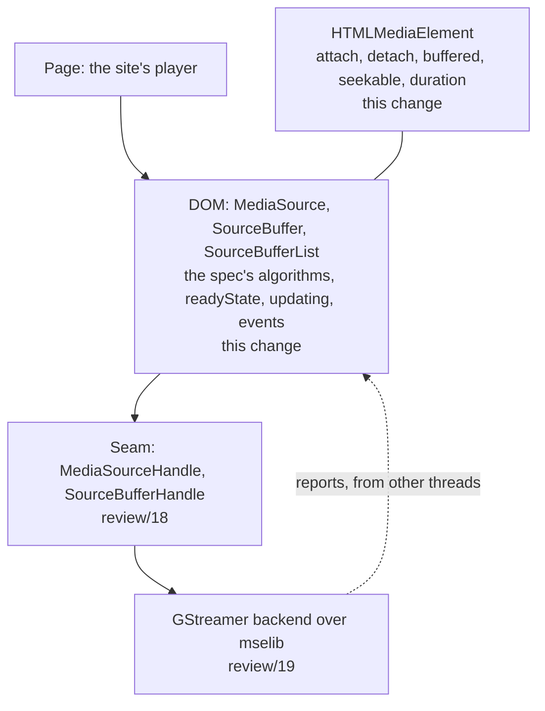

## Suggested reading order

| # | File | What to look for |
|---|---|---|
| 1 | [MediaSource.webidl](https://github.com/Airodonack/servo/blob/f40d550019c22480fc4fa1a73fa0717693a6bd48/components/script_bindings/webidls/MediaSource.webidl), [SourceBuffer.webidl](https://github.com/Airodonack/servo/blob/f40d550019c22480fc4fa1a73fa0717693a6bd48/components/script_bindings/webidls/SourceBuffer.webidl), [SourceBufferList.webidl](https://github.com/Airodonack/servo/blob/f40d550019c22480fc4fa1a73fa0717693a6bd48/components/script_bindings/webidls/SourceBufferList.webidl) | The API surface, as in the spec, behind the pref and the backend check. `SourceBuffer.audioTracks` and friends are left out (a TODO line). |
| 2 | [sourcebufferlist.rs](https://github.com/Airodonack/servo/blob/f40d550019c22480fc4fa1a73fa0717693a6bd48/components/script/dom/media/sourcebufferlist.rs) (146 lines) | A list that queues `addsourcebuffer` and `removesourcebuffer`. [`add_in_order_of`](https://github.com/Airodonack/servo/blob/f40d550019c22480fc4fa1a73fa0717693a6bd48/components/script/dom/media/sourcebufferlist.rs#L60-L87) keeps `activeSourceBuffers` in `sourceBuffers` order. |
| 3 | [mediasource.rs: the struct](https://github.com/Airodonack/servo/blob/f40d550019c22480fc4fa1a73fa0717693a6bd48/components/script/dom/media/mediasource.rs#L210-L235), [`attach`](https://github.com/Airodonack/servo/blob/f40d550019c22480fc4fa1a73fa0717693a6bd48/components/script/dom/media/mediasource.rs#L304-L346), [`detach`](https://github.com/Airodonack/servo/blob/f40d550019c22480fc4fa1a73fa0717693a6bd48/components/script/dom/media/mediasource.rs#L348-L375), [`handle_backend_event`](https://github.com/Airodonack/servo/blob/f40d550019c22480fc4fa1a73fa0717693a6bd48/components/script/dom/media/mediasource.rs#L377-L399) | The life of a media source: who sets `readyState`, and which backend reports are ignored. |
| 4 | [sourcebuffer.rs: the struct](https://github.com/Airodonack/servo/blob/f40d550019c22480fc4fa1a73fa0717693a6bd48/components/script/dom/media/sourcebuffer.rs#L38-L71), [`start_update`](https://github.com/Airodonack/servo/blob/f40d550019c22480fc4fa1a73fa0717693a6bd48/components/script/dom/media/sourcebuffer.rs#L190-L197), [`handle_backend_event`](https://github.com/Airodonack/servo/blob/f40d550019c22480fc4fa1a73fa0717693a6bd48/components/script/dom/media/sourcebuffer.rs#L233-L273), [`AppendBuffer`](https://github.com/Airodonack/servo/blob/f40d550019c22480fc4fa1a73fa0717693a6bd48/components/script/dom/media/sourcebuffer.rs#L450-L482), [`Abort`](https://github.com/Airodonack/servo/blob/f40d550019c22480fc4fa1a73fa0717693a6bd48/components/script/dom/media/sourcebuffer.rs#L484-L514), [`Remove`](https://github.com/Airodonack/servo/blob/f40d550019c22480fc4fa1a73fa0717693a6bd48/components/script/dom/media/sourcebuffer.rs#L540-L573) | The `updating` state machine and the operation number that guards it. |
| 5 | mediasource.rs: [`change_duration`](https://github.com/Airodonack/servo/blob/f40d550019c22480fc4fa1a73fa0717693a6bd48/components/script/dom/media/mediasource.rs#L414-L456), [`end_of_stream_steps`](https://github.com/Airodonack/servo/blob/f40d550019c22480fc4fa1a73fa0717693a6bd48/components/script/dom/media/mediasource.rs#L505-L538), [`buffered`](https://github.com/Airodonack/servo/blob/f40d550019c22480fc4fa1a73fa0717693a6bd48/components/script/dom/media/mediasource.rs#L565-L607), [`seekable`](https://github.com/Airodonack/servo/blob/f40d550019c22480fc4fa1a73fa0717693a6bd48/components/script/dom/media/mediasource.rs#L609-L652) | The duration change, end of stream and buffered algorithms. |
| 6 | mediasource.rs: [`BackendCallbackTarget`](https://github.com/Airodonack/servo/blob/f40d550019c22480fc4fa1a73fa0717693a6bd48/components/script/dom/media/mediasource.rs#L56-L81) | How a backend callback reaches a DOM object without keeping it alive. |
| 7 | [url.rs](https://github.com/Airodonack/servo/blob/f40d550019c22480fc4fa1a73fa0717693a6bd48/components/script/dom/url/url.rs#L195-L215), [globalscope.rs](https://github.com/Airodonack/servo/blob/f40d550019c22480fc4fa1a73fa0717693a6bd48/components/script/dom/globalscope/globalscope.rs#L1715-L1735) | MediaSource object URLs, kept per global. |
| 8 | [htmlmediaelement.rs](https://github.com/Airodonack/servo/blob/f40d550019c22480fc4fa1a73fa0717693a6bd48/components/script/dom/html/embedded_content/htmlmediaelement.rs#L1785-L1816) and the links in sections 3, 6, 7 and 8 | How the element attaches, detaches and reads from a MediaSource. |
| 9 | mediasource.rs: [`is_valid_media_source_type`](https://github.com/Airodonack/servo/blob/f40d550019c22480fc4fa1a73fa0717693a6bd48/components/script/dom/media/mediasource.rs#L117-L208) | The type check before the backend is asked. |
| 10 | [prefs.rs](https://github.com/Airodonack/servo/blob/f40d550019c22480fc4fa1a73fa0717693a6bd48/components/config/prefs.rs#L192-L193), [Bindings.conf](https://github.com/Airodonack/servo/blob/f40d550019c22480fc4fa1a73fa0717693a6bd48/components/script_bindings/codegen/Bindings.conf#L956-L960) ([and](https://github.com/Airodonack/servo/blob/f40d550019c22480fc4fa1a73fa0717693a6bd48/components/script_bindings/codegen/Bindings.conf#L1334-L1337)), [media/mod.rs](https://github.com/Airodonack/servo/blob/f40d550019c22480fc4fa1a73fa0717693a6bd48/components/script/dom/media/mod.rs) | Wiring: the pref, `weakReferenceable`, the methods that take a `JSContext`, the helper trait for the backend check. |

## 1. The objects and who points at whom

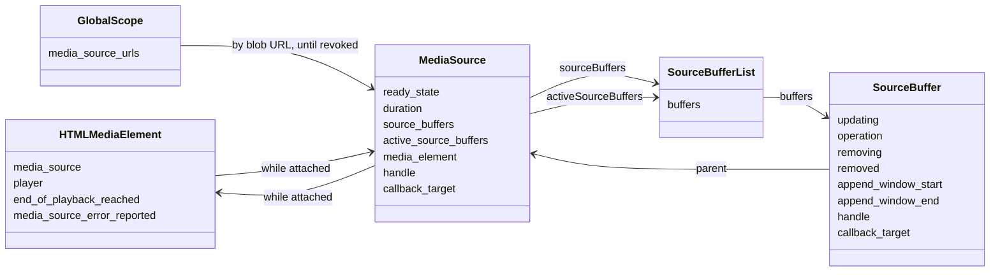

The two `handle` fields are the backend side: a `MediaSourceHandle` while
attached, a `SourceBufferHandle` until the buffer is removed. Every DOM method
checks the spec's conditions first, then forwards to its handle.

The split of state is the main design choice of the change:

| State | Kept by | Why |
|---|---|---|
| `readyState`, `duration` | DOM ([struct](https://github.com/Airodonack/servo/blob/f40d550019c22480fc4fa1a73fa0717693a6bd48/components/script/dom/media/mediasource.rs#L210-L235)) | The page must see a change in the same task that made it: `endOfStream()` returns with `readyState` already `"ended"`. The duration is also passed to the backend. |
| `updating`, the operation in progress | DOM ([struct](https://github.com/Airodonack/servo/blob/f40d550019c22480fc4fa1a73fa0717693a6bd48/components/script/dom/media/sourcebuffer.rs#L38-L71)) | `appendBuffer()` returns with `updating` true, and the next call in the same task must throw. |
| append window | DOM, copied to the backend | The getters must return what the page set even when the backend refuses it. |
| `mode`, `timestampOffset`, `buffered`, active or not | backend, read through the handle | They depend on the parsed media. |

## 2. A media source's life: `readyState`

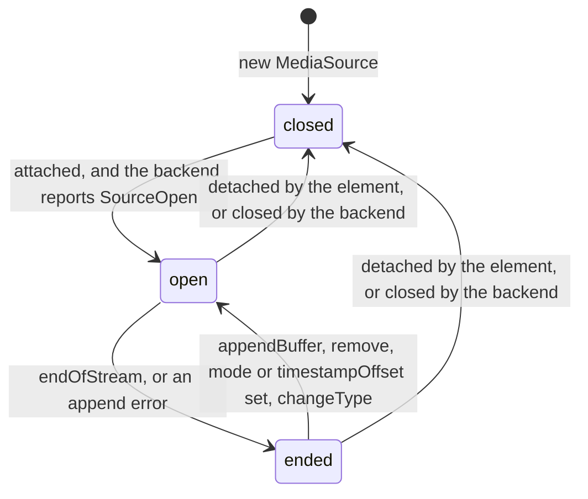

| Transition | Made by |
|---|---|
| closed to open | [`handle_backend_event`](https://github.com/Airodonack/servo/blob/f40d550019c22480fc4fa1a73fa0717693a6bd48/components/script/dom/media/mediasource.rs#L377-L399) on `SourceOpen`, only while closed and attached, through [`open`](https://github.com/Airodonack/servo/blob/f40d550019c22480fc4fa1a73fa0717693a6bd48/components/script/dom/media/mediasource.rs#L401-L412) |
| open to ended | [`end_of_stream_steps`](https://github.com/Airodonack/servo/blob/f40d550019c22480fc4fa1a73fa0717693a6bd48/components/script/dom/media/mediasource.rs#L505-L538), from [`EndOfStream`](https://github.com/Airodonack/servo/blob/f40d550019c22480fc4fa1a73fa0717693a6bd48/components/script/dom/media/mediasource.rs#L833-L863) or from [`append_error`](https://github.com/Airodonack/servo/blob/f40d550019c22480fc4fa1a73fa0717693a6bd48/components/script/dom/media/mediasource.rs#L540-L548) |
| ended to open | `open`, from [`SourceBuffer::check_state(reopen = true)`](https://github.com/Airodonack/servo/blob/f40d550019c22480fc4fa1a73fa0717693a6bd48/components/script/dom/media/sourcebuffer.rs#L286-L298) and from `Remove` |
| to closed | [`detach`](https://github.com/Airodonack/servo/blob/f40d550019c22480fc4fa1a73fa0717693a6bd48/components/script/dom/media/mediasource.rs#L348-L375), from the element's load algorithm or from the backend's `SourceClose` |

The backend also reports `SourceEnded`, and the DOM ignores it. The DOM has
already made that transition itself, and the report can arrive after the page
has reopened the source:

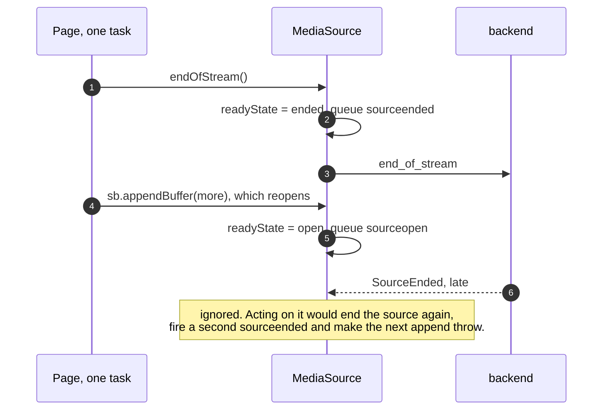

`SourceClose` runs the full detach steps, and `detach` does nothing on a
source that is already detached, so the element's own detach afterwards fires
no second `sourceclose`. mselib 1.28 sends `SourceClose` only when the DOM
detaches or drops the source, so in practice this arm is reached only through
a backend that closes on its own.

## 3. Attaching: from `createObjectURL` to `sourceopen`

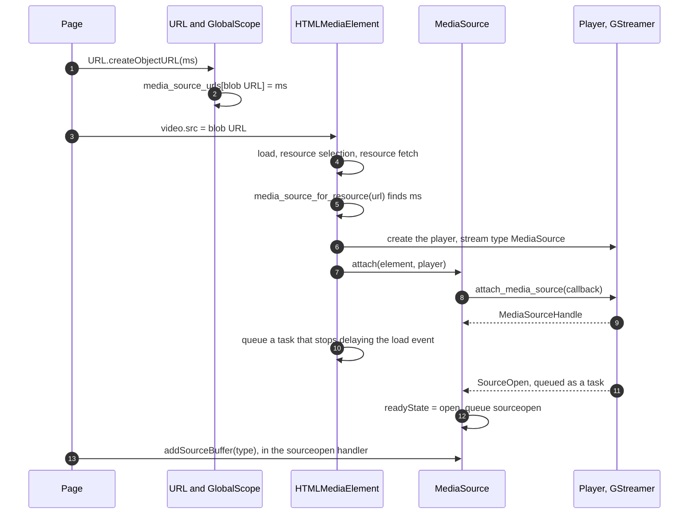

- **Object URLs.** [`CreateObjectURL`](https://github.com/Airodonack/servo/blob/f40d550019c22480fc4fa1a73fa0717693a6bd48/components/script/dom/url/url.rs#L195-L215)
  takes `Blob or MediaSource`. A MediaSource gets a fresh `blob:` URL that is
  stored in a [per-global map](https://github.com/Airodonack/servo/blob/f40d550019c22480fc4fa1a73fa0717693a6bd48/components/script/dom/globalscope/globalscope.rs#L206-L211),
  not in Servo's blob URL store, which holds bytes for other processes.
  `revokeObjectURL` [removes it](https://github.com/Airodonack/servo/blob/f40d550019c22480fc4fa1a73fa0717693a6bd48/components/script/dom/url/url.rs#L224-L226)
  before the blob path runs.
- **`srcObject = ms`** works too: `SrcObject` gains a
  [`MediaSource` arm](https://github.com/Airodonack/servo/blob/f40d550019c22480fc4fa1a73fa0717693a6bd48/components/script/dom/html/embedded_content/htmlmediaelement.rs#L129-L148),
  and [`media_source_for_resource`](https://github.com/Airodonack/servo/blob/f40d550019c22480fc4fa1a73fa0717693a6bd48/components/script/dom/html/embedded_content/htmlmediaelement.rs#L2347-L2362)
  answers for both forms.
- **The fetch is skipped.** The resource fetch algorithm
  [attaches instead](https://github.com/Airodonack/servo/blob/f40d550019c22480fc4fa1a73fa0717693a6bd48/components/script/dom/html/embedded_content/htmlmediaelement.rs#L1691-L1697)
  and [`attach_media_source`](https://github.com/Airodonack/servo/blob/f40d550019c22480fc4fa1a73fa0717693a6bd48/components/script/dom/html/embedded_content/htmlmediaelement.rs#L1785-L1816)
  runs the dedicated failure steps if the source is not closed or the backend
  refuses. It then stops delaying the document's load event, as the spec's
  attach steps say, since nothing is fetched.
- **Detaching.** The load algorithm's step 7.3
  [detaches](https://github.com/Airodonack/servo/blob/f40d550019c22480fc4fa1a73fa0717693a6bd48/components/script/dom/html/embedded_content/htmlmediaelement.rs#L1957-L1962)
  the source whatever the network state, because the source's handle refers
  to the player that was just reset.

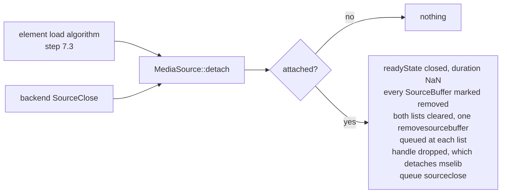

## 4. Appends and removes: the `updating` state machine

Every append and every remove runs one cycle. The backend accepts the
operation at once and returns a number for it; its outcome arrives later as a
report carrying that number
([`SourceBufferReport`](https://github.com/Airodonack/servo/blob/f40d550019c22480fc4fa1a73fa0717693a6bd48/components/media/player/media_source.rs#L93-L106)).

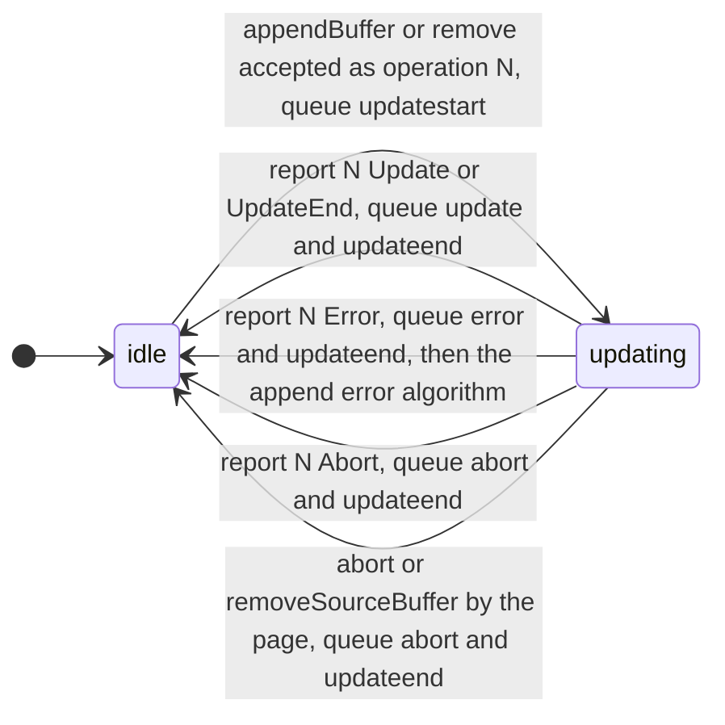

The guard at the top of
[`handle_backend_event`](https://github.com/Airodonack/servo/blob/f40d550019c22480fc4fa1a73fa0717693a6bd48/components/script/dom/media/sourcebuffer.rs#L233-L273)
drops every report that is not the outcome of the operation in progress:

```rust
if self.removed.get() || !self.updating.get() || self.operation.get() != Some(operation) {
    return;
}
```

Reports go stale for three reasons, and the guard covers each:

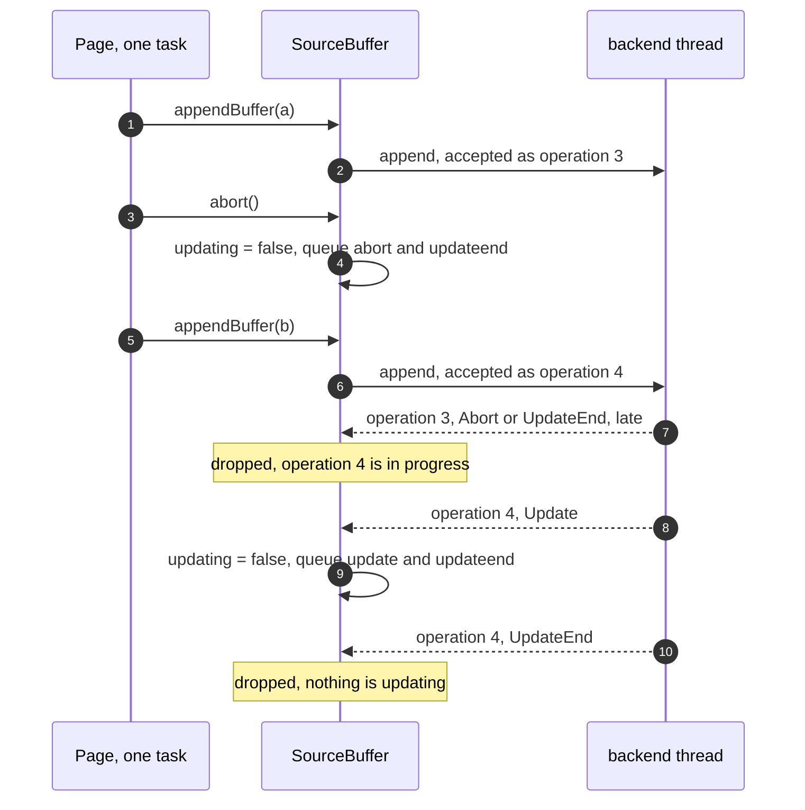

- An abort, or `removeSourceBuffer()`, finishes the operation on the DOM side
  ([`abort_update`](https://github.com/Airodonack/servo/blob/f40d550019c22480fc4fa1a73fa0717693a6bd48/components/script/dom/media/sourcebuffer.rs#L173-L188))
  without waiting for the backend, so the backend's own report of it comes
  after the fact.
- The page may start the next operation in the same task.
- mselib 1.28.6 sends `update` and `update-end` every second from an idle
  buffer. The backend gives those the number of the operation that already
  ended
  ([`Operations`](https://github.com/Airodonack/servo/blob/f40d550019c22480fc4fa1a73fa0717693a6bd48/components/media/backends/gstreamer/media_source.rs#L179-L195),
  in `review/19`).

## 5. One append, step by step

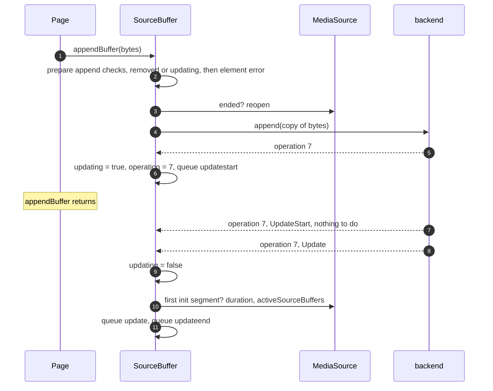

[`AppendBuffer`](https://github.com/Airodonack/servo/blob/f40d550019c22480fc4fa1a73fa0717693a6bd48/components/script/dom/media/sourcebuffer.rs#L450-L482)
runs the prepare append checks in the spec's order: removed or updating
(steps 1 and 2), a recent element error (steps 3 and 4,
[`element_has_error`](https://github.com/Airodonack/servo/blob/f40d550019c22480fc4fa1a73fa0717693a6bd48/components/script/dom/media/mediasource.rs#L284-L290)),
then the reopen (step 5). The backend evicts what it must and refuses with
`QuotaExceededError` when it cannot (steps 6 and 7).

**The `Update` report finishes the operation.** Buffer append steps 3 to 5
set `updating` to false and queue `update` and `updateend` in one go, so the
`Update` arm does all three. A page whose `update` listener appends the next
segment depends on it:

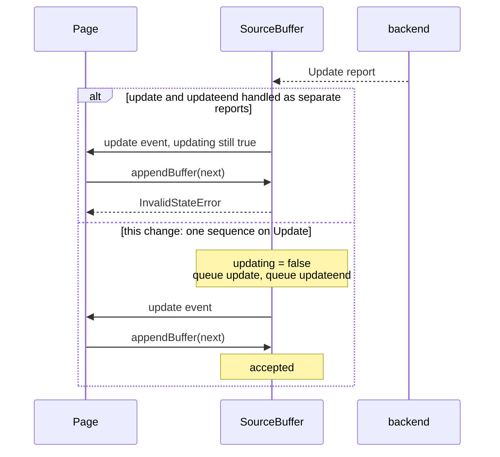

The backend's later `UpdateEnd` for the same operation finds nothing updating
and is dropped. An `UpdateEnd` with no `Update` before it is taken as the
success it implies.

**The first initialization segment.** On `Update`,
[`initialization_segment_received`](https://github.com/Airodonack/servo/blob/f40d550019c22480fc4fa1a73fa0717693a6bd48/components/script/dom/media/sourcebuffer.rs#L210-L231)
asks the backend whether the buffer is active, which mselib makes it once it
has parsed an initialization segment. The first time,
[`first_initialization_segment_received`](https://github.com/Airodonack/servo/blob/f40d550019c22480fc4fa1a73fa0717693a6bd48/components/script/dom/media/mediasource.rs#L472-L484)
sets the duration if it is still NaN
([`refresh_duration`](https://github.com/Airodonack/servo/blob/f40d550019c22480fc4fa1a73fa0717693a6bd48/components/script/dom/media/mediasource.rs#L486-L503):
the backend's duration, or positive Infinity) and adds the buffer to
`activeSourceBuffers`. Tracks and `loadedmetadata` from the initialization
segment come in [`review/22`](https://github.com/Airodonack/servo/tree/review/22).

Buffers can receive their first initialization segment in any order, and the
spec wants `activeSourceBuffers` in `sourceBuffers` order:

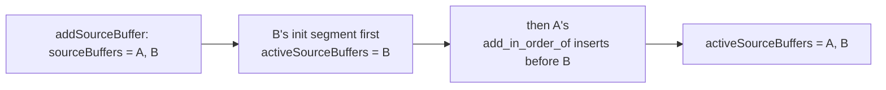

### Abort and remove

- [`Abort`](https://github.com/Airodonack/servo/blob/f40d550019c22480fc4fa1a73fa0717693a6bd48/components/script/dom/media/sourcebuffer.rs#L484-L514)
  refuses on a removed buffer, a source that is not open, and during a
    remove (steps 1 to 3). During an append it runs `abort_update` (step 4);
  otherwise it asks the backend to abort. Either way
  [`reset_after_abort`](https://github.com/Airodonack/servo/blob/f40d550019c22480fc4fa1a73fa0717693a6bd48/components/script/dom/media/sourcebuffer.rs#L199-L208)
  resets the parser state and the append window (steps 5 to 7).
- [`Remove`](https://github.com/Airodonack/servo/blob/f40d550019c22480fc4fa1a73fa0717693a6bd48/components/script/dom/media/sourcebuffer.rs#L540-L573)
  checks the duration and the range (steps 3 to 5), reopens an ended source
  (step 6) and starts a numbered removal that runs the same cycle as an
  append.
- [`RemoveSourceBuffer`](https://github.com/Airodonack/servo/blob/f40d550019c22480fc4fa1a73fa0717693a6bd48/components/script/dom/media/mediasource.rs#L803-L831)
  aborts an update in progress (step 2), then hands the buffer's handle to
  the backend to remove. Step 1's `NotFoundError` is the only exception the
  method names, so a backend refusal after step 2 is logged and the buffer
  still leaves both lists.

## 6. Durations

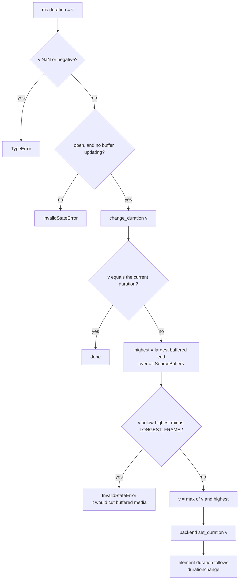

The spec throws when the new duration is below the highest presentation
timestamp of any buffered frame, and raises it to the highest end time when
it falls between the two. The seam reports buffered ranges, not frame
timestamps, so
[`change_duration`](https://github.com/Airodonack/servo/blob/f40d550019c22480fc4fa1a73fa0717693a6bd48/components/script/dom/media/mediasource.rs#L414-L456)
takes the last frame to start at most
[`LONGEST_FRAME`](https://github.com/Airodonack/servo/blob/f40d550019c22480fc4fa1a73fa0717693a6bd48/components/script/dom/media/mediasource.rs#L45-L49)
(0.1 s) before the highest end, the bound the web-platform-tests assume for
their media:

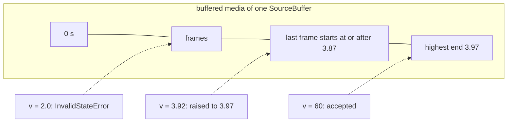

Buffered media is never removed by a duration change.

On the element's side:

- [`media_source_duration_changed`](https://github.com/Airodonack/servo/blob/f40d550019c22480fc4fa1a73fa0717693a6bd48/components/script/dom/html/embedded_content/htmlmediaelement.rs#L2934-L2942)
  takes the new duration in seconds, since a page may set a finite duration
  larger than a Rust `Duration` holds.
- The player's own `DurationChanged` is
  [ignored](https://github.com/Airodonack/servo/blob/f40d550019c22480fc4fa1a73fa0717693a6bd48/components/script/dom/html/embedded_content/htmlmediaelement.rs#L4601-L4607)
  while a MediaSource is attached, and the metadata steps
  [take the MediaSource's duration](https://github.com/Airodonack/servo/blob/f40d550019c22480fc4fa1a73fa0717693a6bd48/components/script/dom/html/embedded_content/htmlmediaelement.rs#L2835-L2845).
- Playback ends at the MediaSource's duration even if the pipeline holds
  media past it: the position is
  [clamped](https://github.com/Airodonack/servo/blob/f40d550019c22480fc4fa1a73fa0717693a6bd48/components/script/dom/html/embedded_content/htmlmediaelement.rs#L3058-L3074)
  and the end of playback steps
  [run there](https://github.com/Airodonack/servo/blob/f40d550019c22480fc4fa1a73fa0717693a6bd48/components/script/dom/html/embedded_content/htmlmediaelement.rs#L3105-L3108).
  Both the backend's end of stream and this clamp can report the end, so
  `end_of_playback_reached`
  [makes the steps run once](https://github.com/Airodonack/servo/blob/f40d550019c22480fc4fa1a73fa0717693a6bd48/components/script/dom/html/embedded_content/htmlmediaelement.rs#L2634-L2636);
  a seek, a reload or a position before the end clears it.

## 7. Ending the stream

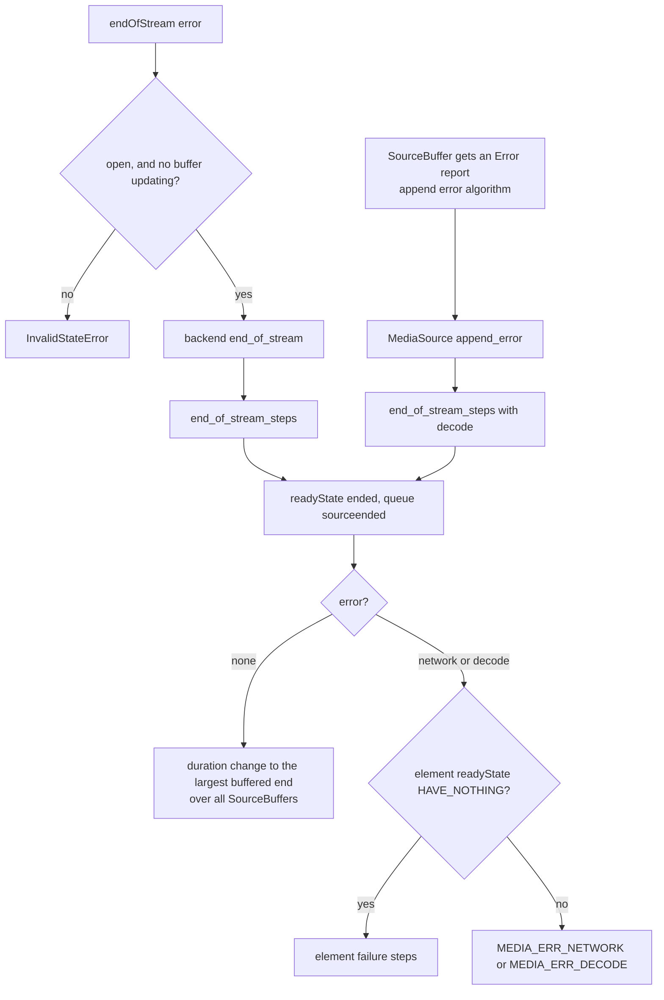

- Without an error, the duration becomes the largest buffered end over all
  buffers, as step 3 says.
- With an error, the DOM runs the element's steps itself
  ([`media_source_ended_with_error`](https://github.com/Airodonack/servo/blob/f40d550019c22480fc4fa1a73fa0717693a6bd48/components/script/dom/html/embedded_content/htmlmediaelement.rs#L2915-L2932)),
  so `endOfStream("network")` gives error code 2. The backend reports the same
  failure as a player error, which can arrive before the element's `error` is
  set, so `media_source_error_reported` makes the element
  [skip it](https://github.com/Airodonack/servo/blob/f40d550019c22480fc4fa1a73fa0717693a6bd48/components/script/dom/html/embedded_content/htmlmediaelement.rs#L2650):
  `error` fires once.

## 8. What the element sees: `buffered` and `seekable`

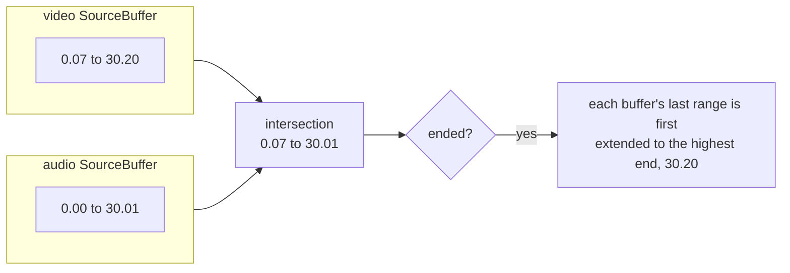

[`MediaSource::buffered`](https://github.com/Airodonack/servo/blob/f40d550019c22480fc4fa1a73fa0717693a6bd48/components/script/dom/media/mediasource.rs#L565-L607)
intersects the ranges of the active buffers, so a video that has only its
audio buffered is not playable there.
[`seekable`](https://github.com/Airodonack/servo/blob/f40d550019c22480fc4fa1a73fa0717693a6bd48/components/script/dom/media/mediasource.rs#L609-L652)
is `[0, duration]` for a finite duration. For an infinite one it is one range
over the live seekable range and `buffered`, or `[0, highest buffered end]`
without a live range. The element
[`buffered`](https://github.com/Airodonack/servo/blob/f40d550019c22480fc4fa1a73fa0717693a6bd48/components/script/dom/html/embedded_content/htmlmediaelement.rs#L3791-L3799)
and [`seekable`](https://github.com/Airodonack/servo/blob/f40d550019c22480fc4fa1a73fa0717693a6bd48/components/script/dom/html/embedded_content/htmlmediaelement.rs#L3162-L3169)
return these while a MediaSource is attached.

## 9. Ownership: backend callbacks do not keep pages alive

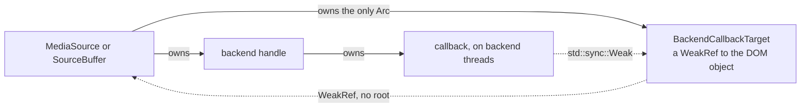

The backend calls back from its own threads. A strong reference from the
callback would close a cycle (DOM object, handle, callback, DOM object) and
keep every MediaSource, its element and its pipeline alive for good.
[`BackendCallbackTarget`](https://github.com/Airodonack/servo/blob/f40d550019c22480fc4fa1a73fa0717693a6bd48/components/script/dom/media/mediasource.rs#L56-L81)
breaks it the way `HTMLMediaElement` already does for its player callback:
the callback holds a `std::sync::Weak`, and the task it queues upgrades it on
the script thread and roots the object only if it is still alive. That needs
both interfaces `weakReferenceable` in
[Bindings.conf](https://github.com/Airodonack/servo/blob/f40d550019c22480fc4fa1a73fa0717693a6bd48/components/script_bindings/codegen/Bindings.conf#L956-L960),
which is why they are allocated with `Rc`.

A MediaSource takes at most
[`MAX_SOURCE_BUFFERS`](https://github.com/Airodonack/servo/blob/f40d550019c22480fc4fa1a73fa0717693a6bd48/components/script/dom/media/mediasource.rs#L51-L54)
(4) buffers; each runs a parsing pipeline and several threads in the backend.

## 10. Type checks

[`is_media_source_type_supported`](https://github.com/Airodonack/servo/blob/f40d550019c22480fc4fa1a73fa0717693a6bd48/components/script/dom/media/mediasource.rs#L106-L115)
serves `addSourceBuffer` (step 2), `isTypeSupported` and `changeType` (step 4,
before step 5 reopens an ended source): first
[`is_valid_media_source_type`](https://github.com/Airodonack/servo/blob/f40d550019c22480fc4fa1a73fa0717693a6bd48/components/script/dom/media/mediasource.rs#L117-L208),
a script-side table of the byte stream format registry, then the backend.
The table accepts `video/mp4`, `audio/mp4`, `video/webm` and `audio/webm`
with codecs their container allows (MP4 needs the profile part, as in
`avc1.64001f` and `mp4a.40.2`), and `audio/mpeg` and `audio/aac` without
codecs.

Backend refusals become the exception the spec names
([`media_source_error`](https://github.com/Airodonack/servo/blob/f40d550019c22480fc4fa1a73fa0717693a6bd48/components/script/dom/media/mediasource.rs#L83-L104));
a backend `Type` error keeps the backend's message, so the page reads why
`mode = "segments"` was refused on a format that generates timestamps.

## 11. Exposed only where the backend supports MSE

Servo's CI builds on Ubuntu 22.04, whose GStreamer 1.20 has no mselib, so its
build has no MSE backend. If the interfaces were exposed there, a page would
create a `MediaSource` that never opens, and the `media-source` tests would wait
until they time out. A browser without MSE does not expose it, so pages check
`"MediaSource" in window` and fall back to other media.

Each of the three IDL files carries a `Func` beside its `Pref`
([MediaSource.webidl, lines 18 to 19](https://github.com/Airodonack/servo/blob/f40d550019c22480fc4fa1a73fa0717693a6bd48/components/script_bindings/webidls/MediaSource.webidl#L18-L19)),
the way WebGL 2 and `ServoInternals` gate theirs. The generated check is the
pref, then the function. The function is
[`MediaSource::is_supported_by_media_backend`](https://github.com/Airodonack/servo/blob/f40d550019c22480fc4fa1a73fa0717693a6bd48/components/script/dom/media/mediasource.rs#L669-L682),
declared in
[`MediaSourceHelpers`](https://github.com/Airodonack/servo/blob/f40d550019c22480fc4fa1a73fa0717693a6bd48/components/script_bindings/interfaces.rs#L137-L139).
It asks the backend's `supports_media_source()` once per process; the
GStreamer backend answers true only when built with mselib.

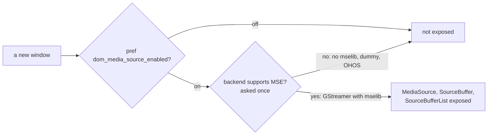

## Options considered

| Question | Chosen | Turned down, and why |
|---|---|---|
| Who keeps `readyState` and `updating` | The DOM, from the spec's algorithms. The backend reports outcomes. | **Read mselib's own state** (`gst_media_source_get_ready_state`, `gst_source_buffer_get_updating`): mselib clears `updating` on its append thread when an append ends, so the value a page reads could change between two lines of one script, before `update` is even queued. The spec changes page-visible state only inside its algorithms, in task order. |
| Telling a report's operation apart | A number per append or remove, returned by the backend and carried by every report. | **Flags only** (`updating`): an abort and a new append in one task leave the old operation's late reports looking current. **Ignoring reports after an abort** for a while: no time bound is right. |
| When `update` and `updateend` fire | Both, with `updating` false, on the `Update` report. | **One task per backend report**, as first written: `update` fired with `updating` still true, so a listener appending the next segment got `InvalidStateError` (see "How it was checked"). |
| Who makes the ended transition | The DOM, in `endOfStream()` and the append error algorithm. | **Wait for the backend's `SourceEnded`**: it can arrive after the page has reopened the source, and ends it again. |
| When the source opens | On the backend's `SourceOpen`. | **Open inside `attach()`**, as the spec's attach steps read: works with mselib, which opens synchronously, but the seam does not promise a backend can take buffers when `attach` returns. Costs one task hop. |
| The highest presentation timestamp | The highest buffered end minus `LONGEST_FRAME`. | **A seam method for the last frame's timestamp**: mselib 1.28.6 has no API for it (its source buffer reports only ranges). **Truncating buffered media**, as an older spec did: the current spec refuses instead. |
| How callbacks reach the DOM | `BackendCallbackTarget`, a weak reference. | **`Trusted`**, a strong one: keeps every MediaSource, element and pipeline alive (measured below). |
| How many SourceBuffers | At most 4. | **No limit**: each buffer costs a pipeline and threads, and pages use one per stream type. **Ask the backend**: the seam has no such query; the spec allows `QuotaExceededError` when "the user agent can't handle any more". |
| Where MediaSource URLs live | A map in `GlobalScope`. | **Servo's blob URL store**: it holds bytes for the network side, while a MediaSource is a script-thread object only its own global may resolve. |
| `removeSourceBuffer()` when the backend refuses | Log it, remove the buffer anyway. | **Throw**: the spec names no exception after step 1, and step 2 has already aborted the update, so the page would hold an aborted buffer still listed in `sourceBuffers`. |
| Where MSE is exposed | Where the pref is on and the backend supports MSE. | **The pref alone**: a build without mselib exposes a `MediaSource` that never opens, and pages wait for it. **`isTypeSupported` only**: pages test for the interface, not for a type. |
| The type check | A script-side registry table, then the backend. | **The backend only**: mselib 1.28 accepts types the registry refuses. A later fork commit replaces the table with mselib's format table from the GStreamer series. |

## What it costs

- Size: 2,016 lines added, 31 removed, most of it the three new files.
- Each SourceBuffer is a parsing pipeline with its own threads in the
  backend, hence the cap of 4.
- A MediaSource with an object URL stays alive until the URL is revoked or
  the global goes, as a Blob does.
- With the pref off, or a backend without MSE, the interfaces are not
  exposed, and the element's new
  paths run only with a MediaSource attached, with one exception:
  `end_of_playback_reached` also makes the end of playback steps of a plain
  file run once per arrival at the end.

## Spec

[Media Source Extensions](https://w3c.github.io/media-source/), the editor's
draft. The algorithms implemented: attaching and detaching, `addSourceBuffer`,
`removeSourceBuffer`, `endOfStream`, the duration change, end of stream and
append error algorithms, prepare append, buffer append and range removal,
`abort`, `changeType`, the append window, and the element's `buffered`,
`seekable` and `duration` extensions. The sentences the design rests on:

- [Buffer append](https://w3c.github.io/media-source/#sourcebuffer-buffer-append),
  steps 3 to 5: "Set the updating attribute to false. Queue a task to fire an
  event named update at this SourceBuffer object. Queue a task to fire an
  event named updateend at this SourceBuffer object."
- [activeSourceBuffers](https://w3c.github.io/media-source/#dom-mediasource-activesourcebuffers):
  "SourceBuffer objects in this list MUST appear in the same order as they
  appear in the sourceBuffers attribute".
- [Duration change](https://w3c.github.io/media-source/#duration-change-algorithm),
  step 2: "If new duration is less than the highest presentation timestamp of
  any buffered coded frames for all SourceBuffer objects in sourceBuffers,
  then throw an InvalidStateError exception and abort these steps." Its note:
  "Duration reductions that would truncate currently buffered media are
  disallowed."
- [addSourceBuffer](https://w3c.github.io/media-source/#dom-mediasource-addsourcebuffer),
  step 3: "If the user agent can't handle any more SourceBuffer objects [...]
  then throw a QuotaExceededError exception".
- [Attaching to a media element](https://w3c.github.io/media-source/#mediasource-attach):
  "Set the media element's delaying-the-load-event-flag to false. [...] Set
  the readyState attribute to "open". Queue a task to fire an event named
  sourceopen at the MediaSource."

Not implemented: MediaSource in workers (`canConstructInDedicatedWorker` is
false), `ManagedMediaSource`, and `SourceBuffer.audioTracks`, `videoTracks`
and `textTracks`.

## How it was checked

- **Builds:** at this commit, the restack's gate (2026-11-05): `mach fmt`
  changed nothing, `test-tidy` passed, and `mach check` exited 0 with no
  warnings. At the stack's tip the same checks and `mach clippy` pass.
- **One `removesourcebuffer` per list, from the commit message and the
  restack's gate (2026-11-05):** the detach steps queue one event at
  `sourceBuffers` and one at `activeSourceBuffers`, whatever the number of
  buffers removed
  ([`SourceBufferList::clear`](https://github.com/Airodonack/servo/blob/f40d550019c22480fc4fa1a73fa0717693a6bd48/components/script/dom/media/sourcebufferlist.rs#L102-L112)).
  The web-platform-test "Test that only 1 removesourcebuffer event fires on
  each SourceBufferList when the MediaSource closes" passed with one event
  per buffer only because the harness's listener removes itself after the
  first event. This commit makes it count with listeners that stay
  ([mediasource-sourcebufferlist.html, lines 73 to 98](https://github.com/Airodonack/servo/blob/f40d550019c22480fc4fa1a73fa0717693a6bd48/tests/wpt/tests/media-source/mediasource-sourcebufferlist.html#L73-L98));
  with an event per removed buffer it failed with "removesourcebuffer
  events at sourceBuffers expected 1 but got 2". `host/mse_detach_events.html`
  (two buffers, `video.src = ""`) gives `sb=1 active=1`, as Chrome 157
  does. The gate ran `mediasource-sourcebufferlist.html` three times with
  the MSE pref: at this commit, `TIMEOUT, Subtests passed 4/5` each time,
  the counting subtest passing and "Test removesourcebuffer event firing on
  sourceBuffers and activeSourceBuffers when MediaSource closes" timing out,
  as it does at this commit before the fix; at the stack's tip, `OK,
  Subtests passed 5/5` each time.
- **Exposure, 2026-11-05:** on a build without mselib (mach's mselib check
  turned off, as on CI) with the pref on, `host/mse_exposure.html` gave
  `MediaSource=function/true` before and `MediaSource=undefined/false`
  after, the same for `SourceBuffer` and `SourceBufferList`;
  `mediasource-play.html` went from `TIMEOUT` after 60 s to `OK` in 3.5 s.
  On the build with mselib, the interfaces stay, `isTypeSupported` answers
  `true` for MP4 and WebM types, and `host/mse_two_buffer_play.html` plays
  (`RESULT two-buffer plays t=1.47`).
- **The update ordering, from the commit message:** a temporary 50 ms delay
  before the backend relayed update-end, never committed, made it
  deterministic. `media-source/mediasource-seek-during-pending-seek.html`
  ended with a file-level ERROR ("uncaught exception: InvalidStateError") in
  3 of 3 runs before the change and 0 of 3 after; without the delay, 4 of 10
  before and 0 of 10 after, with no other subtest change in the directory.
- **Pages, on the build of the ported series (2026-11-02, before three fork
  fixes were folded into this commit and `review/22`):**
  - `host/mse_active_order.html` (B gets its init segment first):
    `RESULT active=[A,B] inOrder=true`. The 2026-10-23 review recorded `[B,A]`
    in 3 of 3 runs before `add_in_order_of`.
  - `host/mse_close.html` (`src = ""` with one buffer): `removesourcebuffer`
    on each list, then `sourceclose readyState=closed`, lists empty.
  - `host/mse_eos.html?error` (an append of bytes that are not media):
    `sourceended`, element error code 4 at HAVE_NOTHING, and the next append
    throws `InvalidStateError`.
- **Collection, an older run (2026-10-22):** `host/mse_gc.html`, 40
  unreferenced Media Source videos: 652 threads stayed with strong callbacks,
  91 with `BackendCallbackTarget`.
- **From the commit message:** the web-platform-tests `media-source`
  directory, pages appending DASH-style audio and video, seeking, removing a
  buffer and ending the stream, and YouTube and Twitch embeds, on GStreamer
  1.28 with the mselib fixes of the GStreamer series. The checked-in
  expectations are those of CI's build, without MSE (see
  [`review/23`](https://github.com/Airodonack/servo/tree/review/23)).

Not yet done: a run of the pages on this commit alone; the pages above ran on
the series build. The edit to `mediasource-sourcebufferlist.html` is a
change to an upstream web-platform-test, to be sent to WPT on its own.

## Questions a reviewer may ask

- **Can it be split?** Possible cuts: the three interfaces with no element
  integration; object URLs and attaching; `buffered`, `seekable` and duration
  on the element. Each part alone needs scaffolding to build and is not
  testable from a page.
- **Is the `LONGEST_FRAME` approximation acceptable?** It can accept a
  duration up to 0.1 s inside the last frame, which the spec would refuse.
  The exact rule needs the last frame's timestamp from the backend, which
  means a new seam method and a new mselib API.
- **Why 4 buffers?** A safety limit for the backend's cost, with the
  exception the spec names for it. It could become a backend query.
- **Why the pref, and off?** The implementation passes most of the
  directory but not all of it, and it depends on mselib fixes that are not
  in a GStreamer release yet.
- **Why also a backend check?** Without mselib the build has no MSE, and a
  page should see a browser without it, not a `MediaSource` that never
  opens.
- **The type table looks hand-written.** It is. A later fork commit replaces
  it with the format table the GStreamer series adds to mselib.
- **How many `removesourcebuffer` events does a detach fire?** One at each
  list, even at an empty `activeSourceBuffers`, as the detach steps say:
  "Remove all the SourceBuffer objects from activeSourceBuffers. Queue a
  task to fire an event named removesourcebuffer at activeSourceBuffers."
  Chrome 157 fires one at each list too.
- **Why change a web-platform-test in this pull request?** The test's own
  check could not see a second event, so it passed with the old code. The
  edit shows the fix; it belongs in WPT as well.
