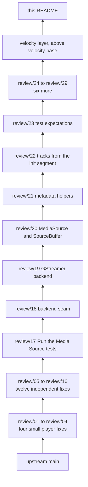
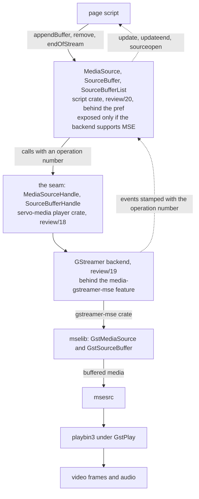
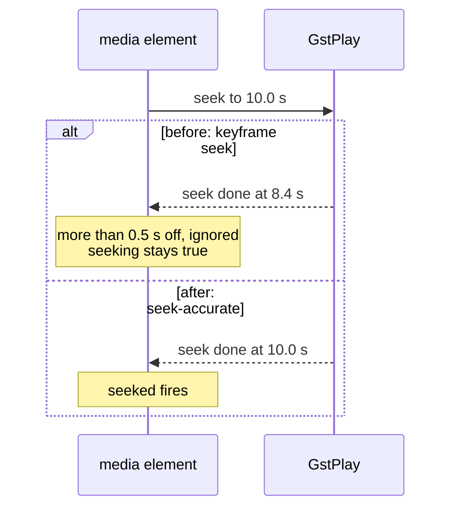
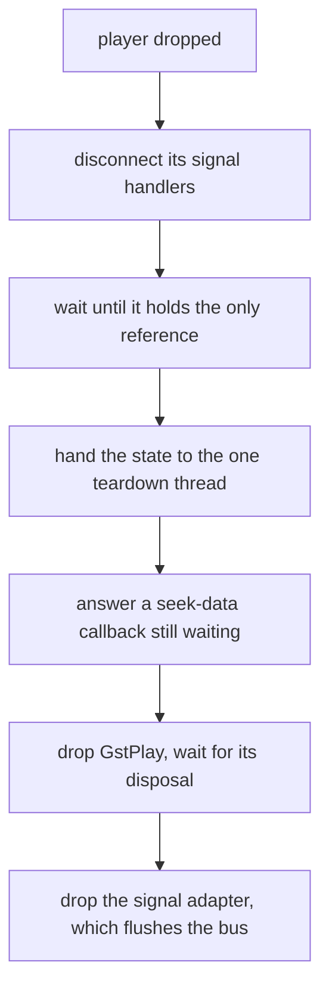
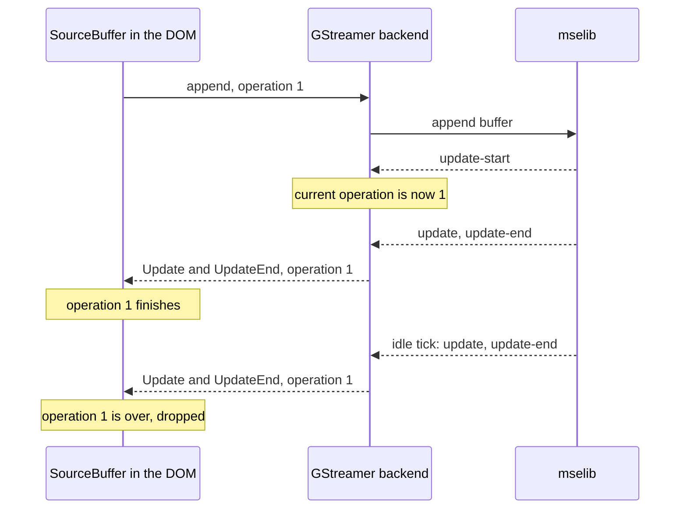
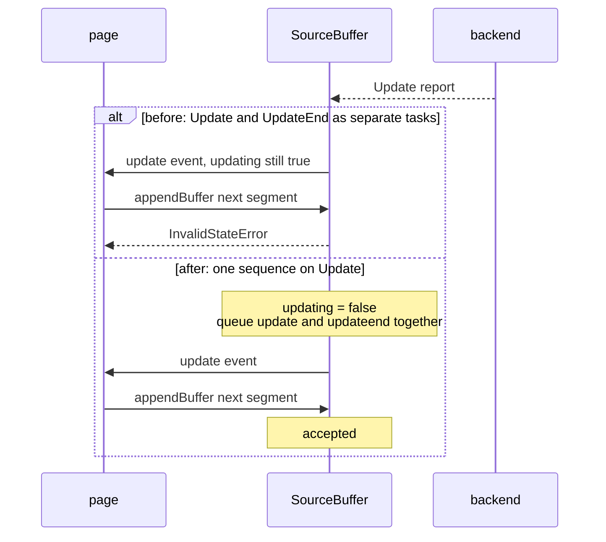
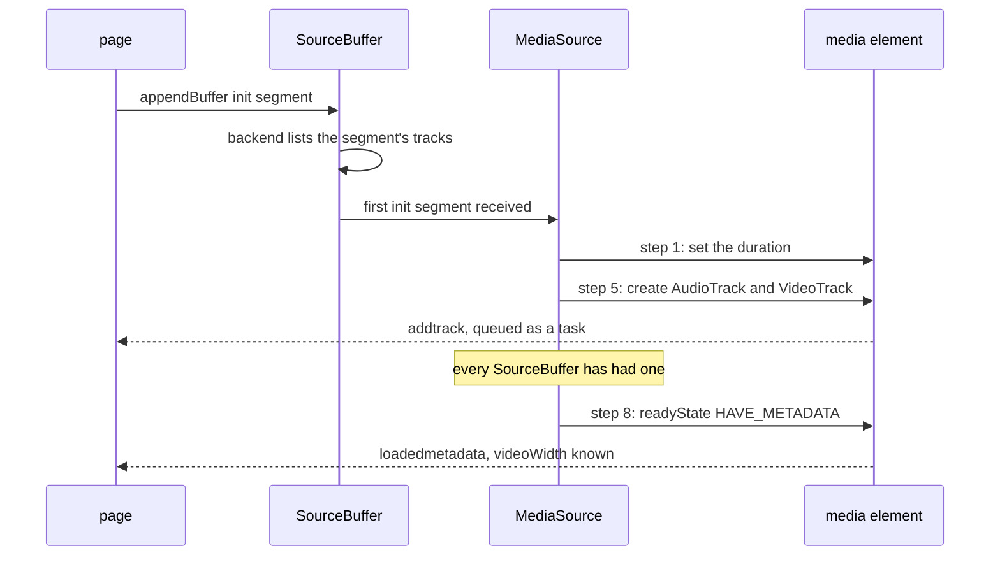
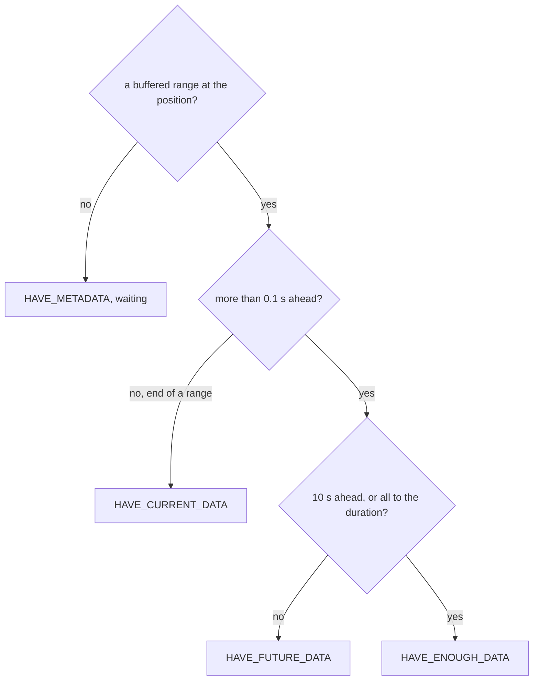
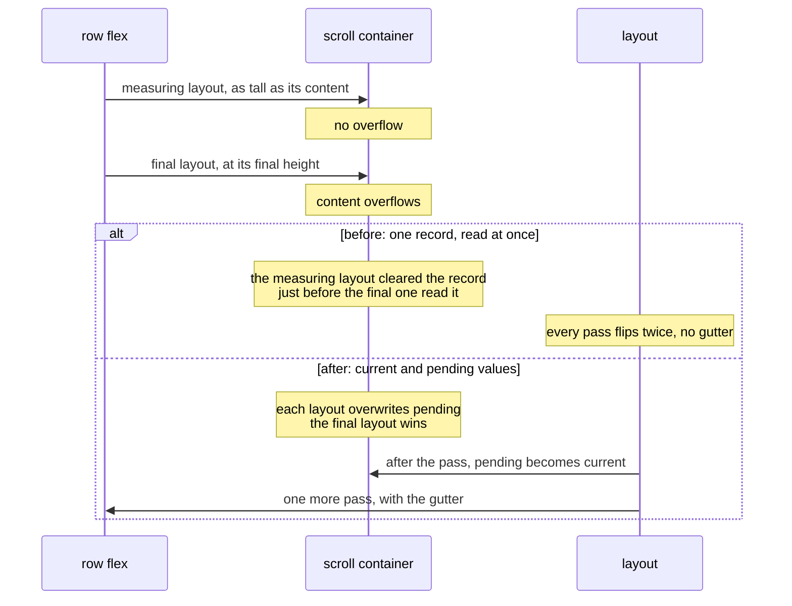
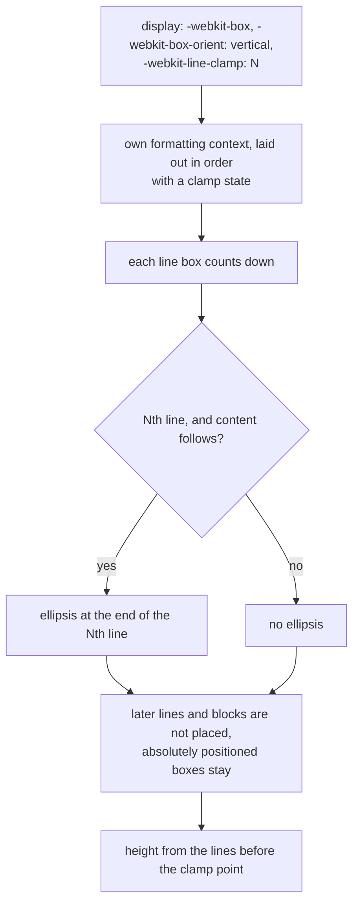

# Servo for VODscribe

This is a fork of [Servo](https://servo.org/), maintained for the VODscribe
desktop app. VODscribe is a video player and transcriber built on Tauri. It
embeds Servo so that video sites' own players run in it unchanged. The fork
tracks upstream `main`. On top of it sit two layers of changes. The first is
meant for upstream, as a stack of pull requests. The second, the velocity layer,
holds changes the app needs now that are not meant for upstream. Where a layout
question has no clear answer in the specs, the fork does what Chrome does.

Build it as you build upstream Servo: see the [Servo
Book](https://book.servo.org/building/building.html). Media Source Extensions
(MSE) need two more things: mselib from the fork's patched GStreamer,
[github.com/Airodonack/gstreamer](https://github.com/Airodonack/gstreamer)
branch `mse-fixes`, and the Cargo feature `media-gstreamer-mse`. `mach build`
turns the feature on when it finds `gstreamer-mse-1.0` 1.24 or newer; embedders
enable it on the `servo` crate. Pages see MSE only with the pref
`dom_media_source_enabled` on, for example `--pref
dom_media_source_enabled=true` in servoshell, and only in a build with mselib.

The stylo crates come from the fork
[github.com/Airodonack/stylo](https://github.com/Airodonack/stylo), pinned by
revision. Report problems with the fork in this repository's issues, not
upstream. The licence is upstream's, MPL-2.0.

## The stack

The history is one line of commits. Each pull request ends at a ref named
`review/NN`. To read one, take the range from the ref below it:

```sh
git log --reverse review/19..review/20   # the MSE DOM pull request
git log --reverse velocity-base..        # the velocity layer and this README
```

`review/01` to `review/16` need nothing else in the stack and sit on upstream
`main`. `review/17` switches on the Media Source tests before any MSE code. The
MSE series runs `review/18` to `review/23`, one commit each. `review/24` to
`review/29` sit above it. `velocity-base` is `review/29`.



Most refs outside the MSE series do not depend on each other:

| Ref | Pull request | Depends on |
| --- | --- | --- |
| review/05 | HTTP/2 response headers up to 256 KiB | nothing |
| review/06 | console memory | nothing |
| review/07 | freeing GStreamer players | nothing; review/19 changes code it touches |
| review/08 | fractional pointer coordinates | nothing |
| review/09 | WebDriver key order | nothing |
| review/10 | SVG currentColor | nothing |
| review/11 | form control sizes | nothing |
| review/12 | focus outlines on controls | nothing |
| review/13 | aspect-ratio, two commits | nothing |
| review/14 | text-overflow | nothing |
| review/15 | inline grid baselines | nothing |
| review/16 | font metrics on Linux | nothing |
| review/24 | ready states, seeks and replay | the MSE series |
| review/25 | checkVisibility | nothing |
| review/26 | WebDriver listen address | nothing |
| review/27 | scrollbars | the stylo fork |
| review/28 | accent-color | the stylo revision review/27 pins |
| review/29 | -webkit-line-clamp | review/14's ellipsis and the stylo fork |

Markers in the headings below: **[Cargo]** adds a Cargo feature, a dependency
feature or a `[patch]` pin. **[embedder API]** changes what an app embedding
Servo sees. **[pref]** puts a feature behind a preference.

## How the MSE pieces fit

With MSE, the page fetches media segments itself and appends them to buffers.
The DOM objects run the spec's algorithms; the media backend parses and holds
the media. A set of traits, the seam, sits between them.



## The pull requests

### review/01: Calling play() on a playing video no longer pauses it

A second `play()` keeps the video playing instead of freezing it. Twitch's
player calls `play()` after every seek, so its embed froze.

`HTMLMediaElement::update_media_state` paused the player whenever it was
playing, even when the element was still potentially playing. It now pauses only
when the element is not potentially playing. It does not need MSE.

- **Follows:** the HTML internal play steps; a playing element needs nothing
  from the pipeline.
- **Checked:** `play()` again 2 s into an MP4. `currentTime` stopped at 1.80
  before and advances after. Twitch seeks play on.

### review/02: Videos without text tracks fire timeupdate again during playback

A video with no captions fires `timeupdate` while it plays. Custom controls and
the MSE seek tests depend on it.

`time_marches_on` returned early when the text track list did not exist. That
list is made lazily, so step 6, the periodic `timeupdate`, never ran. Step 6
moves to its own helper, which runs either way.

- **Follows:** HTML "time marches on", step 6.
- **Checked:** 0 events in 5 s before, in the 0.7.0 release too; 8 in 3.5 s
  after.

### review/03: Seeks in the GStreamer player land on the requested time

A seek ends where it was asked, and `seeking` no longer sticks. The element
ignores a seek-done more than 0.5 s from the target, and some demuxers seek only
to keyframes, so their seeks never completed.

The change is one GstPlay setting, `seek-accurate`, in the GStreamer player.



- **Follows:** no spec text.
- **Checked:** a progressive MPEG-TS file with 2 s keyframes landed 1.2 to 1.8 s
  early before and completes after. MP4 seeks were already exact.
- **Cost:** a seek into a long keyframe gap decodes from the keyframe to the
  target, so it takes longer.

### review/04: Seeking past 584 years into media no longer crashes the page

A seek time too large for GStreamer no longer kills the page. One line of
script could panic the script thread, in release builds too.

`GStreamerPlayer::seek` turned seconds into nanoseconds with a plain cast, which
saturates past about 584 years to GStreamer's "no time" value, and `ClockTime`
panics on it. A `clock_time()` helper now treats NaN and negative times as zero
and caps large ones at `ClockTime::MAX`. For a plain `src` the element clamps the
seek to the duration first, so only media claiming a duration past 584 years
reaches it; with MSE the page sets the duration, and the MSE backend reuses the
helper for every time.

- **Follows:** no spec; a security review found it.
- **Checked:** with MSE above it, `duration = 1e20` and then `currentTime = 1e19`
  panicked before and waits for data after. Unit tests for `clock_time()` run
  in `./mach test-unit`: 3 passed.

### review/05: YouTube pages load instead of failing with a network error

YouTube's embed and watch pages load. Servo's HTTP/2 client advertised a 16 KiB
limit for response headers. YouTube sends Servo's user agent 16,791 octets of headers, so
the client reset the stream itself and the fetch failed.

The net crate's HTTP client now sets `http2_max_header_list_size` to 256 KiB,
the size Chromium advertises.

- **Follows:** [RFC 9113, section
  6.5.2](https://www.rfc-editor.org/rfc/rfc9113#section-6.5.2): the limit is
  advisory and the client's choice.
- **Checked:** 10 of 10 loads reset before, 0 of 10 after.
- **Gaps:** no WPT covers it.

### review/06: Logging large objects no longer exhausts memory

Pages that log big objects no longer eat all memory. Upstream `main` has the
bug: Twitch's player page grew to 8 GB in 15 s and was killed.

The console built a devtools preview of every logged object. The preview walks
every path to an object, so a shared graph costs one walk per path, and a long
chain recursed until the stack overflowed. The walk is now bounded: at most
10,000 values and 20 levels per call, each prototype previewed once per call.
`Console::method()` also builds the preview only when the devtools server runs.

- **Follows:** the [Console Standard](https://console.spec.whatwg.org/#printer)
  leaves printing to the user agent.
- **Checked:** five tests in `components/servo/tests/console.rs`. A page logging
  objects with 2^n paths: 2,898 ms and 2.3 GB before, 1.9 ms after; with the
  devtools server on, 2,191 ms before, 7.3 ms after.
- **Gaps:** past the limits devtools shows "…".

### review/07: Videos free their decoders and GPU memory when their source changes

Changing a video's source no longer leaks a decoder and about 190 MiB of GPU
memory. No GStreamer player was ever freed, so long sessions ran out of memory.

Signal handlers held the player's state strongly, and the state owns them; they
now hold it weakly. Freeing then needs an order: dropping the last GstPlay
reference on its own thread crashed about once in 40 loads.



- **Follows:** GstPlay's own threading; no spec.
- **Checked:** no crash in 1,733 loads over ten modes; GPU memory and threads
  flat.
- **Gaps:** glibc arenas still grow. A detached `<video>` keeps its player until
  garbage collection. About 1.4 streams per load leak inside parsebin.

### review/08: Pointer events keep fractional coordinates

Pointer positions keep their fraction, as in Chrome, so a player that maps
`clientX` to a time no longer lands a frame early.

`MouseEvent`'s coordinates become doubles. A `PointerEvent` keeps the fraction,
except for click, auxclick and contextmenu; other mouse events floor it, as
Chrome does.

- **Follows:** [MouseEvent
  extensions](https://drafts.csswg.org/cssom-view/#extensions-to-the-mouseevent-interface),
  [Pointer Events
  coordinates](https://w3c.github.io/pointerevents/#event-coordinates).
- **Checked:** 435 pointer subtests now pass.
- **Gaps:** no `DragEvent`. Chrome rounds `offsetX` on a MouseEvent; the fork
  floors it.

### review/09: WebDriver returns objects with their keys in JavaScript's order [embedder API] [Cargo]

Clients that compare JSON text failed at random: an object came back with its
keys in a different order on almost every call.

- `JSValue::Object` holds an `IndexMap` instead of a `HashMap`, filled in
  property order.
- **Embedder API:** code that builds `JSValue::Object` must change.
- **Cargo:** `indexmap` with its `serde` feature in the embedder crate;
  `serde_json`'s `preserve_order` in `webdriver_server`.
- **Follows:** WebDriver [clone an
  object](https://w3c.github.io/webdriver/#dfn-clone-an-object) visits
  properties in
  [`[[OwnPropertyKeys]]`](https://tc39.es/ecma262/#sec-ordinaryownpropertykeys)
  order. Chrome's driver keeps it.
- **Checked:** 6 to 10 distinct orders in 10 calls before, 1 after. WPT
  `execute_script` as expected.

### review/10: Icons drawn with currentColor take the colour of the text around them

Inline SVG icons take the colour of the text around them; they were black.
Inline SVG is drawn by usvg, which never sees CSS inheritance. Layout now
passes the computed `color`, and the serializer writes it on the SVG root.

- **Follows:** [CSS Color 4,
  currentcolor](https://drafts.csswg.org/css-color-4/#currentcolor-color).
- **Checked:** 3 of 8 SVG cases right before, 7 of 8 after, against headless
  Chrome. WPT `/svg` and `css-color` as expected.
- **Gaps:** page stylesheets still do not reach inline SVG. `color-svg-visited`
  now fails, as Servo has no `:visited`.

### review/11: Sliders, radio buttons and checkboxes get the usual size and margins

Rows of form controls no longer move a page by 6 to 12 px. servo.css gives
range, radio and checkbox inputs Chrome's sizes and margins.

- **Follows:** other engines' form defaults; HTML leaves them to the user agent.
- **Checked:** margins, padding and sizes match headless Chrome.

### review/12: Keyboard focus shows an outline on buttons and other controls

Keyboard users see where focus is on buttons, selects, sliders and radio
buttons. Upstream's user agent sheet draws focus outlines on `:focus-visible`,
but servo.css still removed them from these controls on `:focus`. That rule is
gone; a clicked button still shows no outline.

- **Follows:** Selectors 4
  [:focus-visible](https://drafts.csswg.org/selectors-4/#the-focus-visible-pseudo).
- **Checked:** keyboard and pointer focus give the same matches and outlines as
  headless Chrome. WPT `focus-visible-018-2` now passes.

### review/13: Boxes with aspect-ratio and a max-height narrow to keep their shape

Two commits; the first is "Boxes with aspect-ratio get their height from their
width, and back".
Boxes with `aspect-ratio` get a height; before, an auto-height box with a ratio
was 0 px tall. Posters keep their shape under `max-height`.

- Sizing transfers a size through the ratio, as for a replaced element, and
  transfers min and max sizes from one axis to the other.
- **Follows:** [css-sizing-4](https://drafts.csswg.org/css-sizing-4/) sections
  4, 4.3 and 4.4.
- **Checked:** repro pages against headless Chrome. WPT
  `css-sizing/aspect-ratio`: 97 tests newly pass.
- **Gaps:** two aspect-ratio subtests now fail; they passed only because the
  ratio was ignored.

### review/14: Text that overflows a clipped box can end in an ellipsis

`text-overflow: ellipsis` works. An ellipsis is shaped and placed at the end of
an overflowing line. Hidden content stays on the line, so `scrollWidth` does not
change. Prefs turn on stylo's `text-overflow`.

- **Follows:** [CSS Overflow 3](https://drafts.csswg.org/css-overflow-3/#text-overflow)
  `text-overflow`.
- **Checked:** ten cases against headless Chrome.
- **Gaps:** the `text-overflow` string value goes beyond Chrome.

### review/15: Inline grids sit on the baseline of their first item's text

Inline grids line up with their text. An inline grid takes its baseline from its
first item's text, not from the bottom of the item's box.

- **Follows:** [CSS Grid 1](https://drafts.csswg.org/css-grid-1/) 10.8.
- **Checked:** the line is 15.13 px where it was 18.20, Chrome 15.00.

### review/16: Line heights and baselines land on whole pixels as in Chrome

Two commits; the first is "Text keeps its designed width instead of whole-pixel
glyphs". On Linux, text widths and line heights now match Chrome to a hundredth
of a pixel. Hinted advances moved each glyph by up to half a pixel, and
unrounded line metrics drifted down a page.

The FreeType backend measures advances without hinting, draws glyphs at
fractional positions and rounds ascent, descent and line gap, as Blink does.
`text-align: center` now halves the free space by truncating, as flex alignment
does, so the same text centered both ways lands on the same app unit.

- **Follows:** no spec; Chrome on Linux.
- **Checked:** 100 "a" at 14 px: 800 px before, 786.67 after, 785.41 in Chrome.
  WPT text, inline and font directories: 17,994 results, 0 changed; two
  css-flexbox tests pass only with the centering change.
- **Gaps:** macOS and Windows are not touched. Reftests on other machines' fonts
  may change.

### review/17: Run the Media Source web-platform-tests

A page gets nothing directly. Servo's test runs now include the `media-source`
directory of the web-platform-tests (WPT), with today's results recorded. It goes before the MSE code.

The change is one line in `tests/wpt/include.ini` and 86 expectation files,
written by `mach update-wpt` with no hand edits.

- **Checked:** 88 tests, 78 OK and 10 ERROR. Three files were missing until
  2026-11-05; a run here then had 3 tests unexpected.
- **Gaps:** 83 of the files come from the 0.7.0 release binary, not `main`.

### review/18: Add the media backend seam for Media Source Extensions

Nothing changes for a page yet: this is the interface the next two pull requests
fill in. MSE goes through the media backend, as the rest of servo-media does, so
script stays backend-neutral. It changes the media backend traits.

In the servo-media player crate: `MediaSourceHandle` and `SourceBufferHandle`
carry every MSE operation; `MediaSourceEvent`, `SourceBufferEvent` and
`MediaSourceError` come back; `Player` gains `attach_media_source()`, and
`Backend` gains `supports_media_source()` and
`is_media_source_type_supported()`, both false by default.

Every append and removal returns an `OperationId`, and each report carries it.
Backends report late, so the DOM must tell the current operation's outcome from
an old one's. The dummy, OpenHarmony and GStreamer backends refuse MSE players
for now.

- **Follows:** the MSE spec's split of work between the DOM and the backend.
- **Checked:** the release build and the WPT run at the series tip. The
  OpenHarmony stub was checked by reading only, not built.

### review/19: GStreamer backend: Media Source Extensions through mselib [Cargo]

With the feature on, MSE pages play through GStreamer. The backend uses mselib,
GStreamer's own MSE library, so Servo parses no media bytes itself.

A new `media_source` module forwards each call to mselib and relays its signals
as events. An MSE player opens an `mse://` URI, and the player attaches the
media source to the msesrc playbin3 makes for it.

mselib signals `update-start` once per accepted operation, in order. Every later
signal belongs to that operation until the next `update-start`, so the backend
stamps each signal with that number. mselib 1.28 also signals `update` and
`update-end` every second while a buffer is idle; those carry the number of an
operation that is over, and the DOM drops them.



The one `unsafe` block calls `gst_source_buffer_get_buffered`, which the Rust
binding lacks. A negative `timestampOffset` needs the GStreamer series; stock
mselib 1.28 clamps it to 0.

- **Cargo:** the backend's feature `mse` pulls in `gstreamer-mse` 0.25; the
  `servo` crate and servoshell turn it on with `media-gstreamer-mse`. Without
  it, a GStreamer 1.22 build stays green and says it supports no MSE.
- **Checked** on GStreamer 1.28.6 with the GStreamer series: a page that adds,
  appends to and removes two buffers, and the WPT run at the series tip.
- **Gaps:** stock mselib 1.28.6 has bugs this backend hits: two buffers can
  hang, `buffered()` can lag, `abort()` and `remove()` do not work. The fixes
  are on the `mse-fixes` branch; the backend works around none of them.

### review/20: Implement Media Source Extensions: MediaSource and SourceBuffer [pref]

Pages can use `MediaSource`, `SourceBuffer` and `SourceBufferList` when the pref
`dom_media_source_enabled` is on; it is off by default. This is the DOM half of
MSE, which most video sites need. A build whose backend has no MSE, such as
Servo's CI without mselib, does not expose them, so pages fall back to other
media.

The script crate gains the three interfaces and MediaSource object URLs. The
media element attaches a MediaSource and takes its `buffered`, `seekable` and
`duration` from it.

`SourceBuffer` acts only on reports for its operation in progress. The `Update`
report finishes the operation in one go: `updating` turns false, then `update`
and `updateend` are queued together, as buffer append steps 3 to 5 say. Separate
tasks let `update` fire with `updating` still true.



Also: MediaSource makes its own open and ended transitions, so a late backend
report cannot end a media source the page reopened. Backend callbacks hold the
DOM objects weakly, so pages can be collected. A MediaSource takes at most 4
SourceBuffers. A detach queues one `removesourcebuffer` at each list, however
many buffers it removes, as the detach steps say.

- **Follows:** [Media Source Extensions](https://w3c.github.io/media-source/):
  addSourceBuffer, removeSourceBuffer, buffer append, range removal, duration
  change, endOfStream, detach.
- **Checked:** the WPT `media-source` directory; pages that append DASH-style
  audio and video, seek, remove a buffer and end the stream; YouTube and Twitch
  embeds. Without mselib, `"MediaSource" in window` was true and
  `mediasource-play.html` timed out; now it is false and the test ends at once. The update order was reproduced with a temporary 50 ms delay: 3 of 3
  runs failed before, 0 of 3 after. The WPT `mediasource-sourcebufferlist.html`
  now counts the `removesourcebuffer` events, an edit to send to WPT.
- **Gaps:** `SourceBuffer.audioTracks` and `videoTracks`; MSE in workers;
  ManagedMediaSource. The change is about 2,000 lines.

### review/21: Split the media element's metadata steps into helpers

No change in behaviour; it keeps review/22 small. `playback_metadata_updated`
becomes `add_audio_track`, `add_video_track` and `media_metadata_established`,
which review/22 also runs for MSE. The moved code is unchanged apart from
indentation: read it with `git show --color-moved`.

### review/22: Media Source videos get tracks and metadata from the init segment

An MSE video fires `loadedmetadata`, lists its tracks and knows its size as soon
as the init segment arrives. Players wait for `loadedmetadata` before they send
media. Before, it waited for GstPlay to preroll, which needs a media segment, so
such a player stalled.

The seam gains `SourceBufferHandle::tracks()`. The GStreamer backend reads
mselib's per-buffer `tracks` property, new in the GStreamer series, or falls
back to msesrc's track counts. `removeSourceBuffer()` removes the tracks the
buffer created.



- **Follows:** MSE "Initialization Segment Received" steps 1, 5 and 8;
  removeSourceBuffer steps 3 to 5.
- **Checked:** pages that append only an init segment, then media, and whose
  `addtrack` handler removes the buffer or reloads. The size at `loadedmetadata`
  went from 0x0 to 1280x720.
- **Gaps:** step 7, a buffer added during playback, and text tracks. WebM tracks
  still wait for the first cluster. On an older mselib the size comes with the
  first frame.

### review/23: Update the Media Source test expectations

A page gets nothing directly. The directory now runs with the pref on, through
`tests/wpt/meta/media-source/__dir__.ini`, and its expectations are those of
the build Servo's CI makes.

CI's GStreamer 1.20 has no mselib, so MediaSource is not exposed there. The
expectations come from three runs of such a build, and match review/17's.

- **Checked:** 88 tests, 78 OK, 10 ERROR, the same in every run; three more
  runs: "88 ran as expected".
- **Gaps:** the MSE results, with mselib and the GStreamer series, are not
  recorded: about 426 of 726 subtests pass there.

### review/24: A video that played to its end starts again when played

Six commits: "Video fires waiting when playback runs out of media", "A video's
ready state follows the player's buffering", "Video with a MediaSource waits for
media it lacks", "Video plays on after a MediaSource that ended gets more
media", "A seek the player refuses now ends instead of leaving seeking stuck",
and this one. It adds `Player::at_end_of_media()` and `Player::position()` to
the media seam.

Pages see `waiting` when media runs out and `canplay` and `playing` when it
arrives. A seek to unbuffered MSE media waits for it, `play()` after `ended`
restarts, a MediaSource that ended and got more media plays on, and a refused
seek ends. Before, `readyState` jumped to HAVE_ENOUGH_DATA on player state
changes, so sites never saw `waiting`.

With a MediaSource, `readyState` follows the buffered ranges at the current
position:



Ten seconds is Firefox's estimate; a first range starting before 1 s counts as
the start, as in Chrome. A refused seek now ends where the player is, and a
page seek that GstPlay merges into its own rewind after the end ends at the
player's next position report. At the end of a file GstPlay's last position
falls short of the duration, so the element moves it there; then `ended` is
true and `play()` seeks back.

- **Follows:** MSE "SourceBuffer Monitoring" and "Seeking" step 1; HTML [ready
  states](https://html.spec.whatwg.org/multipage/media.html#ready-states),
  [seeking](https://html.spec.whatwg.org/multipage/#dom-media-seek) step 12,
  [reaches the end](https://html.spec.whatwg.org/multipage/#reaches-the-end),
  [internal play
  steps](https://html.spec.whatwg.org/multipage/#internal-play-steps).
- **Checked:** the repro pages go from FAIL to PASS; WPT `played-loop` now
  passes; the MSE subset is unchanged. No real case of a refused seek is known;
  it was tested with a temporary switch that refused every seek.
- **Gaps:** `removeSourceBuffer()` does not re-check `readyState`. Plain files
  still use GStreamer's buffering percentage.

### review/25: Implement Element.checkVisibility()

Twitch's embedded player starts when its page asks it to play. It calls
`Element.checkVisibility()` first, and the method was missing.

- `Element.checkVisibility(options)` follows CSSOM View steps 1 to 6. Servo has
  no `content-visibility`, so steps 2 and 5 never return false.
- **Follows:**
  [checkVisibility](https://drafts.csswg.org/cssom-view/#dom-element-checkvisibility).
- **Checked:** the Twitch embed goes from FAIL to PASS. 15 WPT subtests and 7
  idlharness checks pass.

### review/26: Embedders can choose the address the WebDriver server listens on [embedder API]

Binding 0.0.0.0 exposed a server that runs script in pages to the network.
`start_server` takes the address before the port; servoshell passes 0.0.0.0,
as before.

- **Embedder API:** code that calls `start_server` must change.
- **Checked:** an embedder listened on 127.0.0.1 only; `mach check` builds
  servoshell's call.

### review/27: Scrollbars appear in scroll containers inside nested flex layouts [Cargo]

Four commits: the `scrollbar-width`, `scrollbar-color` and `scrollbar-gutter`
properties; room for scrollbars; drawing a scrollbar that follows scrolling; and
this one. Nothing painted scrollbars, and `clientWidth` was 15 px off other
engines.

- A new layout module computes each box's gutter: 15 px, or 10 px for `thin`, as
  Chromium.
- The thumb is a WebRender property binding, so it moves with compositor
  scrolling.
- Layout runs again, at most twice, when an `overflow: auto` bar appears or
  goes.
- A box sized smaller than its scrollbar keeps its size, as in other engines.
- **Cargo:** the eleven stylo crates are patched to the stylo fork, which builds
  `scrollbar-gutter` for Servo.

The last commit fixes nested flex layouts, where a row flex lays a column out
twice per pass:



- **Follows:** CSS 2.1 11.1.1;
  [css-overflow-3](https://drafts.csswg.org/css-overflow-3/) section 3;
  [css-scrollbars-1](https://drafts.csswg.org/css-scrollbars-1/).
- **Checked:** two repro pages match headless Chrome, 17 of 17 and 13 of 13
  values. WPT `css-scrollbars`: 73 subtests pass, up from 39.
- **Gaps:** no viewport or overlay scrollbars. Thirteen `css-overflow` reftests
  now fail; Chrome fails three of them too. The stylo change has to reach
  upstream stylo first.

### review/28: Radio buttons, checkboxes and sliders follow accent-color

`accent-color` colours checked radio buttons, checkboxes and sliders. Every
engine ships it.

Servo draws these controls with user agent CSS, which cannot read another
property. So the stylo fork adds a colour keyword for user agent sheets only,
`-servo-accent-color`, which computes to the parent's `accent-color`. servo.css
uses it. Pages cannot.

- **Follows:** [CSS UI 4
  accent-color](https://drafts.csswg.org/css-ui-4/#widget-accent); a translucent
  accent is composed over the canvas colour, as WPT expects.
- **Checked:** against headless Chrome, accent pixels appear where Chrome has
  them.
- **Gaps:** it needs the stylo revision review/27 pins.

### review/29: Clamped text shows only its first lines, ending in an ellipsis [Cargo]

A title with `-webkit-line-clamp: 2` shows two lines and an ellipsis. It is a
common pattern for card titles, and Servo kept every line.



- The clamp reuses review/14's ellipsis. An unclamped `-webkit-box` is laid out
  as a flex container.
- **Cargo:** the stylo pin moves to the stylo commit that builds these
  properties for Servo.
- **Follows:** [CSS Overflow 4](https://drafts.csswg.org/css-overflow-4/) 5.1.1,
  5.2 `max-lines`, 4.1 `block-ellipsis`; a draft.
- **Checked:** a repro box went from 105 px to 42 px tall, as in Chrome. WPT: 31
  tests and 17 subtests go from FAIL to PASS.
- **Gaps:** `max-lines: auto`; the legacy box's own alignment. `scrollHeight` is
  42 where Chrome gives 105. Unprefixed `line-clamp` stays behind its pref, as
  Chrome does not ship it.

## The velocity layer

These commits sit above `velocity-base` and are not meant for upstream.

- **Local build fix: keep the Nix shell's glibc no newer than Debian 13's.** It
  fixes one build machine only.
- **mach test-tidy accepts the stylo fork as a git source.** It exists only
  because of the fork's stylo pin.
- **Media Source type support follows the media backend's format table.** It
  relies on an mselib change in the GStreamer series that no release has.
- **MSE accepts a codecs list without quotes, as Chrome does.** It builds on the
  commit above.
- **Videos no longer play HLS or DASH playlists given as their source.**
  Refusing them, as desktop Chrome does, is the app's choice: those segments
  were fetched outside Servo's fetch, with no cookies, CSP or CORS.
- **Web animations play, pause, finish and cancel on the page's timeline.**
  Nothing is drawn, as keyframes do not reach style. The commit records no
  checks of its own.
- **Animation effects keep the timing they are created with.** The commit
  records no checks of its own.
- **element.animate() starts its animation, and getAnimations() lists them.**
  WPT interface subtests pass 421, up from 220.
- **Pages can use the Web Animations API.** Turning the pref on by default, with
  no motion drawn, is the app's choice.
- **Long audio in a preloading video no longer crashes the browser.** servosrc answers GStreamer's URI query. Not yet part of a pull request.

## Glossary

- **MSE, Media Source Extensions:** a web API that lets a page feed media bytes
  to a `<video>` itself.
- **SourceBuffer:** one stream of appended bytes in a MediaSource, such as the
  video or the audio.
- **Init segment:** the first bytes of a stream; it lists the tracks and codecs
  and holds no frames.
- **mselib:** GStreamer's MSE library, in gst-plugins-bad since 1.24.
- **msesrc:** the mselib element that feeds buffered media to playback.
- **parsebin:** the GStreamer element that finds a stream's format and splits it
  into tracks.
- **GstPlay:** GStreamer's ready-made playback object, which Servo's GStreamer
  player wraps.
- **servosrc:** Servo's GStreamer source element, which hands fetched bytes to
  GStreamer.
- **The seam:** the traits between Servo's DOM and a media backend.
- **WPT, web-platform-tests:** the browsers' shared test suite. Servo keeps its
  expected results in `.ini` files.
- **stylo:** Servo's CSS engine, shared with Firefox.
- **Velocity layer:** the fork's commits the app needs now and upstream does not
  get.
