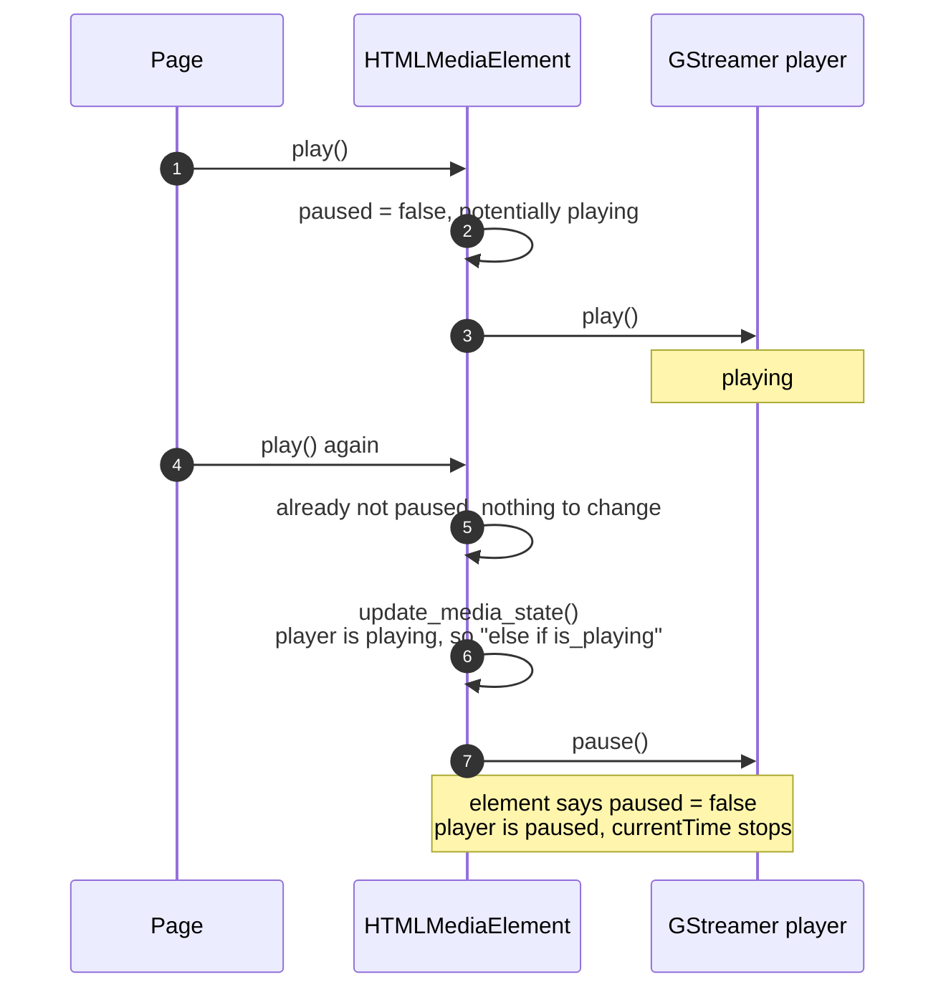

> One change of the Servo fork: `review/01`, 1 of 29 in the stack.
> Below it: the upstream base, Servo `main` at [b88af263d1](https://github.com/Airodonack/servo/commit/b88af263d11e12288ff3eca0848aaa675d6a52f0). Above it: [`review/02`](https://github.com/Airodonack/servo/tree/review/02).
> The change itself: [commit dc538187abc1fe135141b955db869ca18a371b0c](https://github.com/Airodonack/servo/commit/dc538187abc1fe135141b955db869ca18a371b0c). This README sits in a commit on top of it and is not part of the pull request.
> The whole stack: [overview README](https://github.com/Airodonack/servo/blob/vodscribe/main/README.md).

# Calling play() on a playing video no longer pauses it

A page that called `play()` on a video that was already playing froze it:
`paused` stayed `false`, but `currentTime` stopped and nothing resumed it.
Twitch's player calls `play()` after every seek, so every seek in its embed
froze the video. This change keeps the player playing. It is two lines in
one function.

## The problem

[`update_media_state`](https://github.com/Airodonack/servo/blob/dc538187abc1fe135141b955db869ca18a371b0c/components/script/dom/html/embedded_content/htmlmediaelement.rs#L479-L511)
keeps the backend player in step with the element. Before this change it
read:

```rust
if self.is_potentially_playing() && !is_playing {
    // play the player
} else if is_playing {
    // pause the player
}
```

The second branch runs whenever the player is playing, whatever the element
wants. Any call made during playback pauses the player, even though the
element is still [potentially playing](https://github.com/Airodonack/servo/blob/dc538187abc1fe135141b955db869ca18a371b0c/components/script/dom/html/embedded_content/htmlmediaelement.rs#L1802-L1812)
and still says `paused == false`.

`play()` reaches it through the
[internal play steps](https://github.com/Airodonack/servo/blob/dc538187abc1fe135141b955db869ca18a371b0c/components/script/dom/html/embedded_content/htmlmediaelement.rs#L857-L940),
which end with `update_media_state()`. A second `play()` changes nothing in
the element, since it is not paused, so the call takes the pause branch:



The same branch also runs from the end of
[`change_ready_state`](https://github.com/Airodonack/servo/blob/dc538187abc1fe135141b955db869ca18a371b0c/components/script/dom/html/embedded_content/htmlmediaelement.rs#L1183),
so a ready state change during playback, such as `HAVE_FUTURE_DATA` to
`HAVE_ENOUGH_DATA`, takes it too.

The condition dates from upstream commit
[9a1d86cc88](https://github.com/Airodonack/servo/commit/9a1d86cc88af44dda6a5bd65c17db5cd40ff6428)
(December 2025), which added the check of the player's own state so that
`play()` and `pause()` are only sent when they change something. Before it
the code was `if potentially playing { play } else { pause }`; the rewrite
dropped "not potentially playing" from the pause branch.

## The change

[Lines 486 to 508](https://github.com/Airodonack/servo/blob/dc538187abc1fe135141b955db869ca18a371b0c/components/script/dom/html/embedded_content/htmlmediaelement.rs#L486-L508):

```rust
let potentially_playing = self.is_potentially_playing();
if potentially_playing && !is_playing {
    // play the player
} else if !potentially_playing &&
    is_playing &&
    let Some(ref player) = *self.player.borrow() &&
    let Err(error) = player.lock().unwrap().pause()
{
    error!("Could not pause player: {error:?}");
}
```

The player is paused only when the element should not be playing. The
four cases:

| Element potentially playing | Player playing | Before | After |
|---|---|---|---|
| yes | no | play | play |
| yes | yes | **pause** | nothing |
| no | yes | pause | pause |
| no | no | nothing | nothing |

The upstream commit's purpose, no redundant `play()` or `pause()`, still
holds.

## Options considered

| Option | Why not chosen |
|---|---|
| **Add "not potentially playing" to the pause branch** (this change) | Chosen: restores the old meaning and keeps the upstream optimisation. |
| Return early from `play()` when the element is already playing | Only covers `play()`. The ready state path keeps the bug. |
| Go back to `if potentially playing { play } else { pause }` | Undoes the upstream commit, which avoided resending the playback rate and volume on every call. |

## Spec

[HTML, internal play steps](https://html.spec.whatwg.org/multipage/media.html#internal-play-steps),
step 4, for an element that is not paused:

> Otherwise, if the media element's readyState attribute has the value
> HAVE_FUTURE_DATA or HAVE_ENOUGH_DATA, take pending play promises and queue a
> media element task given the media element to resolve pending play promises
> with the result.

followed by the note "The media element is already playing." Nothing else
happens. And from
[playing the media resource](https://html.spec.whatwg.org/multipage/media.html#playing-the-media-resource):

> When a media element is potentially playing and its Document is a fully
> active Document, its current playback position must increase monotonically

## How it was checked

From the runs of `host/play_twice.html` (a progressive MP4, `play()` again
two seconds in, `currentTime` printed every second) on 2026-10-22, with the
fork then on the 0.7.0 base:

| Build | Before second `play()` | 1 s, 2 s, 3 s, 4 s after |
|---|---|---|
| without the fix | 1.36 | 1.80, 1.80, 1.80, 1.80 |
| with the fix | 1.34 | 2.21, 3.07, 4.03, 4.92 |

The same page on the rebased stack (2026-11-01, `rebase-rebase-play_twice`)
keeps advancing: 2.46, 3.46, 4.47, 5.48. In the Twitch embed, arrow-key seeks
forward and back play on. At this commit, the restack's gate
(2026-11-05): `mach fmt` changed nothing, `test-tidy` passed, and `mach check`
exited 0 with no warnings.

Not yet done: a run without the fix on the current upstream base, and a
web-platform-test (`play()` twice, then `currentTime` advances). Nothing in
the existing suites covers it.

## Questions a reviewer may ask

- **Why did nobody see this upstream?** Most pages call `play()` once. The
  bug needs a second call, or a ready state change, while the player plays.
- **Does the ready state path matter in practice?** It runs on every ready
  state change that reaches the end of `change_ready_state`. Not observed on
  its own in these runs.
- **Could the pause branch ever be needed while potentially playing?** No.
  While the element is potentially playing its position must advance.
