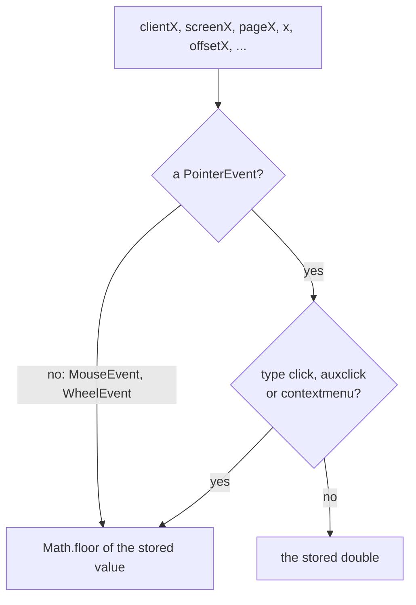

> One change of the Servo fork: `review/08`, 8 of 29 in the stack.
> Below it: [`review/07`](https://github.com/Airodonack/servo/tree/review/07). Above it: [`review/09`](https://github.com/Airodonack/servo/tree/review/09).
> The change itself: [commit bfd5c5aef553349197c1f488c853d5a4244b88d3](https://github.com/Airodonack/servo/commit/bfd5c5aef553349197c1f488c853d5a4244b88d3). This README sits in a commit on top of it and is not part of the pull request.
> The whole stack: [overview README](https://github.com/Airodonack/servo/blob/vodscribe/main/README.md).

# Pointer events keep fractional coordinates

`PointerEvent.clientX` and the other coordinates lost their fraction in
Servo: every coordinate attribute of `MouseEvent` was a `long`. This change
makes them `double`, as CSSOM View defines them, and keeps the fraction on
pointer events as Chrome does. It is a small DOM fix, independent of the
rest of the stack.

## The problem

All ten coordinate attributes of `MouseEvent` were `long`.
`new PointerEvent("pointerdown", {clientX: 110.6}).clientX` read 110, and
a real pointer at a fractional position read the truncated pixel: the
input paths turned the hit test's point into integers with `to_i32()`.
Chrome reads 110.6. A video player that maps `clientX` to a seek time
landed a frame early.

## The change

The IDL types become `double`, as CSSOM View defines them
([MouseEvent.webidl](https://github.com/Airodonack/servo/blob/bfd5c5aef553349197c1f488c853d5a4244b88d3/components/script_bindings/webidls/MouseEvent.webidl#L6-L41)).
`MouseEvent` stores its screen, client and page points as `f64`
([fields](https://github.com/Airodonack/servo/blob/bfd5c5aef553349197c1f488c853d5a4244b88d3/components/script/dom/event/mouseevent.rs#L50-L71)),
the input paths keep the hit test's fractional point (`cast()` instead of
`to_i32()`, for example in
[document_event_handler.rs](https://github.com/Airodonack/servo/blob/bfd5c5aef553349197c1f488c853d5a4244b88d3/components/script/dom/document/document_event_handler.rs#L1361-L1365)),
and touch passes its own doubles through
([touch.rs](https://github.com/Airodonack/servo/blob/bfd5c5aef553349197c1f488c853d5a4244b88d3/components/script/dom/touch/touch.rs#L178-L180)).

One rule, in
[`has_fractional_coordinates` and `coordinate`](https://github.com/Airodonack/servo/blob/bfd5c5aef553349197c1f488c853d5a4244b88d3/components/script/dom/event/mouseevent.rs#L468-L494),
decides what every getter returns
([getters](https://github.com/Airodonack/servo/blob/bfd5c5aef553349197c1f488c853d5a4244b88d3/components/script/dom/event/mouseevent.rs#L541-L647)):

So a plain `MouseEvent` still reads whole numbers, as in Chrome, but by
flooring: `new MouseEvent("x", {clientX: -1.5}).clientX` is now -2, where
the old `long` conversion gave -1. `initMouseEvent()` keeps its `long`
arguments, as in Chrome
([lines 685 to 725](https://github.com/Airodonack/servo/blob/bfd5c5aef553349197c1f488c853d5a4244b88d3/components/script/dom/event/mouseevent.rs#L685-L725)).
The range input's slider now uses the fractional pointer position
([range_input_type.rs](https://github.com/Airodonack/servo/blob/bfd5c5aef553349197c1f488c853d5a4244b88d3/components/script/dom/html/form_controls/input_type/range_input_type.rs#L320-L327)).
The image map, `<input type=image>` and `<a>` with `ismap` read the
floored click coordinates as numbers, and the dialog's light dismiss hit
test takes the fractional client point
([htmldialogelement.rs, line 626](https://github.com/Airodonack/servo/blob/bfd5c5aef553349197c1f488c853d5a4244b88d3/components/script/dom/html/interactive/htmldialogelement.rs#L626)).

## Options considered

| Option | What it would take | Why not chosen |
|---|---|---|
| **Doubles in the IDL; fractions on PointerEvent except click, auxclick, contextmenu; floor elsewhere** (this change) | One rule in every getter | Chosen: Pointer Events' rule for a browser that keeps fractions only on PointerEvent, and what Chrome 156 does (checked on the test page). |
| Fractions on every MouseEvent, as CSSOM View reads alone | No floor at all | Pages written against Chrome expect whole numbers from mouse events. Chrome does not do it. |
| Keep `long` | Nothing | The bug above; the fractional-coordinates WPTs stay failing. |
| Round instead of floor on MouseEvent | `round()` | Pointer Events asks for `Math.floor` for the three types, and Chrome floors `clientX` on a MouseEvent. |

## Spec

[CSSOM View, Extensions to the MouseEvent Interface](https://drafts.csswg.org/cssom-view/#extensions-to-the-mouseevent-interface)
declares the ten attributes and the four `MouseEventInit` members as
`double`. [Pointer Events, event coordinates](https://w3c.github.io/pointerevents/#event-coordinates):

> user agents that have implemented the proposed change in [CSSOM-VIEW]
> only for PointerEvent MUST convert the various coordinate properties for
> the click, auxclick, and contextmenu to long values (as defined in the
> original Mouse Events) using Math.floor

## How it was checked

From the commit message (2026-11-01):

- A test page, also run in Chrome 156 headless.
  Before: `RESULT pointer {"clientX":110,...} ok=false`, `RESULT negative
  pointer=-1 mouse=-1 ok=false`. After: `{"clientX":110.6,"clientY":20.25,
  "screenX":5.5,"x":110.6,"pageX":110.6} ok=true`, `negative pointer=-1.5
  mouse=-2 ok=true`. Real input through WebDriver actions at
  (110.6, 20.25): `pointerdown` clientX 110 before, 110.5999984741211 after
  (the hit test's `f32`); `mousedown` and `click` 110 both times.
- WPT for pointer events, cssom-view and uievents (47 files): 435 subtests
  that were expected to fail now pass. `pointerevent_fractional_coordinates.html`
  passes for mouse, pen and touch; in the `_untrusted` file every subtest
  passes and the file stays `ERROR`, because it constructs a `DragEvent`,
  which Servo does not have.

On 2026-11-02 a build of the whole stack printed `ok=true` on every line of
the page, including `RESULT offsets pointerdown offsetX=110.6 mousedown
offsetX=110`.

The restack's gate (2026-11-05) ran on this change before the day's fixups
to lower refs were folded in (the same patch): `mach fmt` changed nothing,
`test-tidy` passed, and `mach check` exited 0 with no warnings. At the
stack's tip the same checks and `mach clippy` pass.

## Questions a reviewer may ask

- **Why floor plain MouseEvents?** Chrome does, and Pointer Events allows
  a browser to keep fractions on PointerEvent only. Firefox keeps `long`
  on MouseEvent.
- **Does Chrome do exactly this?** Except one case: Chrome rounds
  `offsetX` and `offsetY` on a plain MouseEvent; this change floors them
  with the rest.
