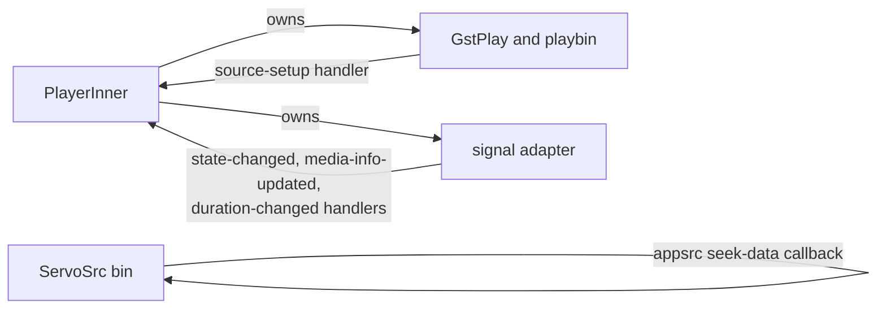
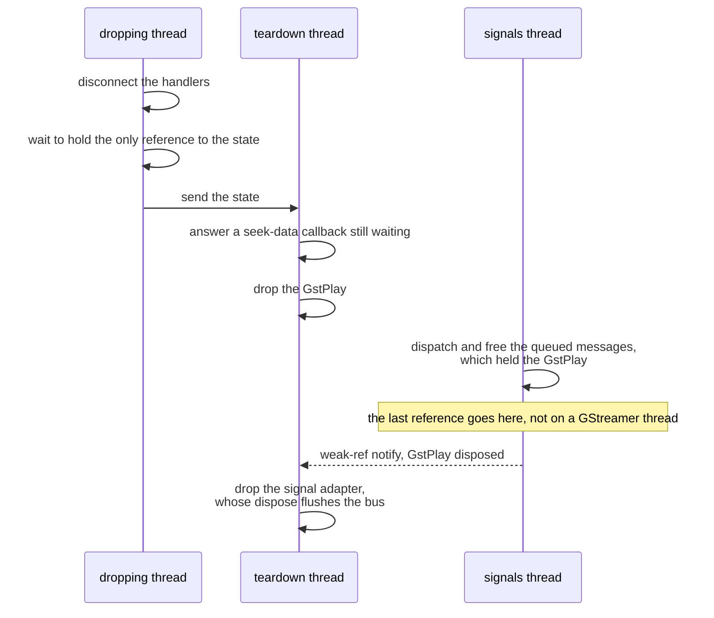

> One change of the Servo fork: `review/07`, 7 of 29 in the stack.
> Below it: [`review/06`](https://github.com/Airodonack/servo/tree/review/06). Above it: [`review/08`](https://github.com/Airodonack/servo/tree/review/08).
> The change itself: [commit 60bd3f31a392d93197e5d79db1b725198899e754](https://github.com/Airodonack/servo/commit/60bd3f31a392d93197e5d79db1b725198899e754). This README sits in a commit on top of it and is not part of the pull request.
> The whole stack: [overview README](https://github.com/Airodonack/servo/blob/vodscribe/main/README.md).

# Videos free their decoders and GPU memory when their source changes

No GStreamer player that Servo made for a media element was ever freed.
Each load left behind a GstPlay thread, a playbin with its decoders, about
190 MiB of GPU memory and 100 to 150 MB of RSS, until the process exited. A
page that changes a video's source a few dozen times runs out of memory.

The change is in one file, the GStreamer player backend. It has two parts:
break the reference cycles, then free things in an order GStreamer's
threads allow. The second part is the one to read carefully.

## The problem

### Reference cycles

`PlayerInner`, the player's state, owns the GstPlay, its pipeline and the
signal adapter that turns GstPlay's messages into signals. The handlers
connected to those objects held the state strongly:

Every arrow back is a strong `Arc` or a strong GObject reference, so
dropping the `GStreamerPlayer` freed none of it.

### The order of freeing

Making those references weak is not enough. With weak handlers alone the
process crashed with SIGSEGV about once in 40 loads. The reason is in
GstPlay:

- Every message GstPlay posts on its API bus holds a reference to the
  GstPlay
  ([gstplay.c, lines 341 and 342](https://github.com/Airodonack/gstreamer/blob/1.28.6/subprojects/gst-plugins-bad/gst-libs/gst/play/gstplay.c#L341-L342)).
- The backend used a **sync-emit** adapter, which emits and frees each
  message on the thread that posted it
  ([gstplay-signal-adapter.c, lines 205 to 214](https://github.com/Airodonack/gstreamer/blob/1.28.6/subprojects/gst-plugins-bad/gst-libs/gst/play/gstplay-signal-adapter.c#L205-L214)):
  GstPlay's own thread or a streaming thread.
- So the last reference to the GstPlay could go on GstPlay's own thread.
  Its dispose cannot join that thread, so it only unrefs it and frees the
  main loop and context while that thread still runs on them
  ([gstplay.c, lines 466 to 494](https://github.com/Airodonack/gstreamer/blob/1.28.6/subprojects/gst-plugins-bad/gst-libs/gst/play/gstplay.c#L466-L494)).
  A trace with `GST_DEBUG=gst-play:7` showed "Created message" and
  "Stopping main thread" on the same GstPlay thread.
- Or the adapter could be freed inside its own signal emission, by a
  handler that held the last reference.

## The change

All in [player.rs](https://github.com/Airodonack/servo/blob/60bd3f31a392d93197e5d79db1b725198899e754/components/media/backends/gstreamer/player.rs):

1. **Weak captures.** The three adapter handlers and the `source-setup`
   handler hold a `Weak<Mutex<PlayerInner>>` and return when it is gone
   ([state-changed](https://github.com/Airodonack/servo/blob/60bd3f31a392d93197e5d79db1b725198899e754/components/media/backends/gstreamer/player.rs#L781-L792),
   [media-info-updated](https://github.com/Airodonack/servo/blob/60bd3f31a392d93197e5d79db1b725198899e754/components/media/backends/gstreamer/player.rs#L821-L833),
   [duration-changed](https://github.com/Airodonack/servo/blob/60bd3f31a392d93197e5d79db1b725198899e754/components/media/backends/gstreamer/player.rs#L868-L882),
   [source-setup](https://github.com/Airodonack/servo/blob/60bd3f31a392d93197e5d79db1b725198899e754/components/media/backends/gstreamer/player.rs#L949-L963)).
   The seek-data callback holds its ServoSrc weakly
   ([lines 980 to 1009](https://github.com/Airodonack/servo/blob/60bd3f31a392d93197e5d79db1b725198899e754/components/media/backends/gstreamer/player.rs#L980-L1009)).
   The state keeps the handler ids
   ([lines 158 to 163](https://github.com/Airodonack/servo/blob/60bd3f31a392d93197e5d79db1b725198899e754/components/media/backends/gstreamer/player.rs#L158-L163))
   so it can disconnect them.
2. **One signals thread.** The adapter is made with
   `with_main_context` on a GLib main context that one thread runs for the
   whole process
   ([`signal_context`, lines 166 to 181](https://github.com/Airodonack/servo/blob/60bd3f31a392d93197e5d79db1b725198899e754/components/media/backends/gstreamer/player.rs#L166-L181);
   [used at line 609](https://github.com/Airodonack/servo/blob/60bd3f31a392d93197e5d79db1b725198899e754/components/media/backends/gstreamer/player.rs#L609-L610)).
   GstPlay's messages now wait on the bus and are dispatched and freed on
   that thread, never on GstPlay's thread or a streaming thread.
3. **Drop hands off.** [`Drop`](https://github.com/Airodonack/servo/blob/60bd3f31a392d93197e5d79db1b725198899e754/components/media/backends/gstreamer/player.rs#L1179-L1213)
   disconnects the handlers, waits until it holds the only `Arc` to the
   state (a handler already running may still hold one for a moment), and
   sends the state to one teardown thread for the process
   ([`tear_down_later`, lines 183 to 200](https://github.com/Airodonack/servo/blob/60bd3f31a392d93197e5d79db1b725198899e754/components/media/backends/gstreamer/player.rs#L183-L200)).
4. **Teardown in order**
   ([`tear_down`, lines 203 to 234](https://github.com/Airodonack/servo/blob/60bd3f31a392d93197e5d79db1b725198899e754/components/media/backends/gstreamer/player.rs#L203-L234)):

A seek-data callback blocked on the script thread would never be answered
once the player is gone, and GstPlay's dispose would wait for it, so the
teardown answers it first. The adapter goes last because freeing it
flushes the bus
([gstplay-signal-adapter.c, lines 348 to 364](https://github.com/Airodonack/gstreamer/blob/1.28.6/subprojects/gst-plugins-bad/gst-libs/gst/play/gstplay-signal-adapter.c#L348-L364)),
after which GstPlay's threads would drop their own messages again. If the
GstPlay is not disposed within 10 s, the adapter is leaked on purpose, with
a warning, rather than freed early.

GStreamer itself is unchanged.

## Options considered

| Option | What it would take | Why not chosen |
|---|---|---|
| **Weak captures, one signals thread, ordered teardown on one thread** (this change) | About 150 lines in one file | Chosen: frees everything, and every free happens on a thread where GStreamer allows it. |
| Weak captures only | The first part alone | Tried first: SIGSEGV about once in 40 loads, for the reason above. |
| Keep sync-emit, free on the dropping thread | Drop joins GstPlay's thread | The last message reference still lands on whichever thread posted it. The dropping thread, often the script thread, would also block on GStreamer. |
| `PlaySignalAdapter::new`, on the default main context | A GLib main loop running that context | The backend runs one only on GStreamer 1.19.1 to 1.22.7 ([lib.rs, lines 77 to 91](https://github.com/Airodonack/servo/blob/60bd3f31a392d93197e5d79db1b725198899e754/components/media/backends/gstreamer/lib.rs#L77-L91)); on other versions nothing would dispatch the signals. A context of its own is clearer. |
| A main context and thread per player | One thread more per player | Works, but adds a thread per element for nothing one shared thread cannot do. |
| Fix GstPlay so dispose on its own thread is safe | A GStreamer change | Worth reporting there. The backend must still work with the GStreamer releases people have. |

## What it costs

- Two threads for the process: "GStreamerPlayer signals" and
  "GStreamerPlayer teardown".
- Signals reach the handlers through the signals thread, one hop later
  than before. Nothing measured shows a difference.
- `Drop` spins with `yield_now()` while a handler finishes; handlers are
  short.
- A player whose GstPlay never disposes keeps its adapter, logged.

## How it was checked

With a test page that loads media in a loop in ten modes (swap the `src`,
new element per load, same-src reload, no seek, seek then swap, metadata
only, audio, and three canvas or fetch paths), headless servoshell, one process per
mode, RSS, threads and GPU memory sampled every 10 s, a forced GC every 10
loads (from the commit message, 2026-11-02):

| | Before | After |
|---|---|---|
| RSS per load | 103 to 149 MB in every media mode | 0.08 to 1.0 MB where one element is reused |
| GPU memory | about 190 MiB more per load; runs stopped by a 3 GB guard within 2 min | flat, at most 291 MiB, where one element is reused |
| Threads | about 3.5 more per load | flat, 47 to 65 |
| Crashes | | 0 in 1,733 loads, 10 minutes per mode |

In the new-element mode each removed element waits for a GC, so threads
and GPU memory rise and fall with it (at most 1.9 GB of GPU); RSS grows
6.5 MB per load, all of it glibc arena retention: `MALLOC_ARENA_MAX=2`
keeps it flat, and GStreamer's leaks tracer shows every GstPlay and
playbin freed.

On 2026-11-02 a build of the whole stack ran the swap-src mode for 52 loads
in 3 minutes: no crash; jemalloc's allocated heap stayed at 46 MB from
load 10 to load 50, while glibc's reserved heap grew from 211 to 327 MB.

The restack's gate (2026-11-05) ran on this change before the day's fixups
to lower refs were folded in (the same patch): `mach fmt` changed nothing,
`test-tidy` passed, and `mach check` exited 0 with no warnings. At the
stack's tip the same checks and `mach clippy` pass.

## Questions a reviewer may ask

- **Why a teardown thread at all?** So the thread that drops the player,
  often the script thread, never waits on GstPlay's threads, and so the
  order above holds whichever thread drops it.
- **Why wait for the only `Arc` in `Drop`?** A handler that upgraded its
  `Weak` just before the disconnect could otherwise be the last owner, and
  free the GstPlay and adapter inside their own signal emission.
- **What is left?** About 1.4 GstStream objects per load stay alive inside
  GStreamer's parsebin (kilobytes, GStreamer's side), and a removed
  `<video>` keeps its player until a JavaScript GC runs.
- **Does it depend on the MSE series?** No. It sits below it, and
  `review/19` changes the same `source-setup` code on top of this one.
