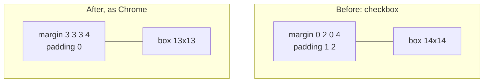

> One change of the Servo fork: `review/11`, 11 of 29 in the stack.
> Below it: [`review/10`](https://github.com/Airodonack/servo/tree/review/10). Above it: [`review/12`](https://github.com/Airodonack/servo/tree/review/12).
> The change itself: [commit 17a1076bb85af1164f086871753d25c1193bb3c2](https://github.com/Airodonack/servo/commit/17a1076bb85af1164f086871753d25c1193bb3c2). This README sits in a commit on top of it and is not part of the pull request.
> The whole stack: [overview README](https://github.com/Airodonack/servo/blob/vodscribe/main/README.md).

# Sliders, radio buttons and checkboxes get the usual size and margins

Servo's checkboxes, radio buttons and sliders were a pixel larger than in
other browsers and spaced differently, so rows of controls moved a page by
6 to 12 px. This change gives them Chrome's sizes and margins, in Servo's
user agent style sheet only. It is independent of the rest of the stack.

## The problem

```html
<label><input type="checkbox"> Remember me</label>
```

Before, Servo's checkbox was 14x14 with 1 px 2 px of padding and margins
`0 2px 0 4px`. Other engines give 13x13, no padding, margins `3px 3px 3px 4px`.
Radio buttons and range inputs differed the same way, so a form laid out
against Chrome came out 6 to 12 px off.



## The change

[servo.css](https://github.com/Airodonack/servo/blob/17a1076bb85af1164f086871753d25c1193bb3c2/components/layout/stylesheets/servo.css) only:

| Control | Before | After (Chrome's values) | Lines |
|---|---|---|---|
| range | `margin-inline: 8px` | `margin: 2px` | [215 to 216](https://github.com/Airodonack/servo/blob/17a1076bb85af1164f086871753d25c1193bb3c2/components/layout/stylesheets/servo.css#L215-L216) |
| checkbox, radio | padding 1px 2px | `padding: 0` | [281 to 291](https://github.com/Airodonack/servo/blob/17a1076bb85af1164f086871753d25c1193bb3c2/components/layout/stylesheets/servo.css#L281-L291) |
| checkbox | 14x14, `margin-inline: 4px 2px` | 13x13, `margin: 3px 3px 3px 4px` | [301 to 311](https://github.com/Airodonack/servo/blob/17a1076bb85af1164f086871753d25c1193bb3c2/components/layout/stylesheets/servo.css#L301-L311) |
| radio | 14x14, `margin-inline: 4px 2px` | 13x13, `margin: 3px 3px 0 5px`, ring and bullet 1 px smaller | [340 to 384](https://github.com/Airodonack/servo/blob/17a1076bb85af1164f086871753d25c1193bb3c2/components/layout/stylesheets/servo.css#L340-L384) |
| text inputs | `white-space: pre` on the element | not set; the inner editor keeps it | [415 to 420](https://github.com/Airodonack/servo/blob/17a1076bb85af1164f086871753d25c1193bb3c2/components/layout/stylesheets/servo.css#L415-L420) |

The last row changes no layout: the inner editor and placeholder still keep
spaces. It makes `getComputedStyle(input).whiteSpace` report `normal`, as
other engines do.

## Options considered

| Option | Why not chosen |
|---|---|
| **Copy Chrome's computed values** (this change) | Chosen: pages are tuned against Chrome, and the WPT has no reference for these sizes. |
| Keep Servo's sizes | Rows of controls stay misaligned against every other engine. |
| Draw controls natively | The long-term direction for form controls, much larger than CSS values. |

There is no spec for these sizes; HTML leaves the rendering of controls to the
user agent.

## How it was checked

From the commit's own run: `host/form-defaults.html` in servoshell and
headless Chrome 156; margins, padding, sizes and `white-space` of range,
radio, checkbox, text and search inputs match Chrome.

Rerun on 2026-11-03, Chrome side only (no Servo build here), `host/form-defaults.html`:

```
RESULT checkbox box=13x13 margin=3px 3px 3px 4px padding=0px ...
RESULT radio box=13x13 margin=3px 3px 0px 5px padding=0px ...
RESULT range box=129x16 margin=2px padding=0px width=129px ...
```

Checkbox and radio match the new servo.css values. The range input is 129 px
wide in Chrome and stays 100 px in Servo; this change does not touch widths.

The restack's gate (2026-11-05) ran on this change before the day's fixups
to lower refs were folded in (the same patch): `mach fmt` changed nothing,
`test-tidy` passed, and `mach check` exited 0 with no warnings. At the
stack's tip the same checks and `mach clippy` pass.

## Questions a reviewer may ask

- **Why match Chrome's pixel sizes?** Pages are built and tested against them,
  and the spec leaves the values to the user agent.
