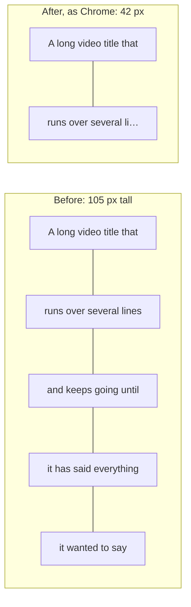
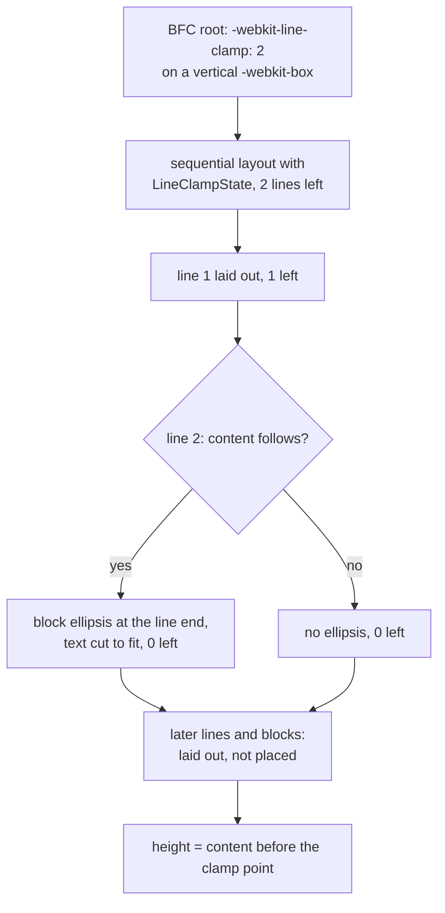

> One change of the Servo fork: `review/29`, 29 of 29 in the stack.
> Below it: [`review/28`](https://github.com/Airodonack/servo/tree/review/28). Above it: the velocity layer.
> The change itself: [commit e8d26e0db7500c777b56ac42caee71c29e627ace](https://github.com/Airodonack/servo/commit/e8d26e0db7500c777b56ac42caee71c29e627ace). This README sits in a commit on top of it and is not part of the pull request.
> The whole stack: [overview README](https://github.com/Airodonack/servo/blob/vodscribe/main/README.md).

# Clamped text shows only its first lines, ending in an ellipsis

## The problem

Card titles across the web are clamped to a few lines with this legacy
combination, which every engine supports:

```css
.title {
  display: -webkit-box;
  -webkit-box-orient: vertical;
  -webkit-line-clamp: 2;
  overflow: hidden;
}
```

Stylo parsed none of it for Servo, so every declaration was dropped and the
title kept all its lines.



## Depends on the stylo fork

The parsing is in [stylo `review/03`](https://github.com/Airodonack/stylo/tree/review/03),
which builds `-webkit-line-clamp`, `-webkit-box-orient` and
`display: -webkit-box` for Servo and turns a clamped vertical `-webkit-box`
into `flow-root` at computed-value time. This commit moves the eleven
`[patch]` entries to that stylo revision, eb9f6ae050
([Cargo.toml, lines 506 to 522](https://github.com/Airodonack/servo/blob/e8d26e0db7500c777b56ac42caee71c29e627ace/Cargo.toml#L506-L522)). Upstream, the
stylo change lands first and this pull request bumps stylo instead.

## The change

Layout treats such a box as a line-clamp container: it counts in-flow line
boxes in tree order, puts an ellipsis at the end of the Nth when more content
follows, drops what comes after, and sizes the box to what is left.



| Step | Code |
|---|---|
| The clamp state: lines left, the ellipsis, whether content follows, how far floats before the clamp point reach | [`LineClampState`, float.rs lines 951 to 992](https://github.com/Airodonack/servo/blob/e8d26e0db7500c777b56ac42caee71c29e627ace/components/layout/flow/float.rs#L951-L992) |
| Which boxes clamp: `webkit_legacy`, original display `-webkit-box`, orient vertical | [`line_clamp_state`, flow/mod.rs lines 1026 to 1050](https://github.com/Airodonack/servo/blob/e8d26e0db7500c777b56ac42caee71c29e627ace/components/layout/flow/mod.rs#L1026-L1050) |
| Clamping needs tree order, so the BFC is laid out sequentially | [flow/mod.rs, lines 485 to 496](https://github.com/Airodonack/servo/blob/e8d26e0db7500c777b56ac42caee71c29e627ace/components/layout/flow/mod.rs#L485-L496) |
| Each in-flow line counts; a line holding a block-level box does not, its lines do | [inline/mod.rs, lines 1332 to 1338](https://github.com/Airodonack/servo/blob/e8d26e0db7500c777b56ac42caee71c29e627ace/components/layout/flow/inline/mod.rs#L1332-L1338) and [`count_line_for_line_clamp`](https://github.com/Airodonack/servo/blob/e8d26e0db7500c777b56ac42caee71c29e627ace/components/layout/flow/float.rs#L1013-L1031) |
| The Nth line gets the ellipsis, reusing the `text-overflow` cut from [`review/14`](https://github.com/Airodonack/servo/tree/review/14) | [`block_ellipsis_for_current_line`, lines 1519 to 1546](https://github.com/Airodonack/servo/blob/e8d26e0db7500c777b56ac42caee71c29e627ace/components/layout/flow/inline/mod.rs#L1519-L1546) |
| Lines after the clamp point are dropped, keeping absolutely positioned boxes | [`discard_current_line_after_clamp_point`, lines 1483 to 1517](https://github.com/Airodonack/servo/blob/e8d26e0db7500c777b56ac42caee71c29e627ace/components/layout/flow/inline/mod.rs#L1483-L1517) |
| Block-level children after it are laid out on their own and not placed | [flow/mod.rs, lines 970 to 1024](https://github.com/Airodonack/servo/blob/e8d26e0db7500c777b56ac42caee71c29e627ace/components/layout/flow/mod.rs#L970-L1024) and [lines 1052 to 1072](https://github.com/Airodonack/servo/blob/e8d26e0db7500c777b56ac42caee71c29e627ace/components/layout/flow/mod.rs#L1052-L1072) |
| The box's height counts floats placed before the clamp point only | [flow/mod.rs, lines 522 to 541](https://github.com/Airodonack/servo/blob/e8d26e0db7500c777b56ac42caee71c29e627ace/components/layout/flow/mod.rs#L522-L541) |
| An unclamped `-webkit-box` is a flex container, direction from `-webkit-box-orient` | [style_ext.rs, lines 1504 to 1508](https://github.com/Airodonack/servo/blob/e8d26e0db7500c777b56ac42caee71c29e627ace/components/layout/style_ext.rs#L1504-L1508) and [flexbox/mod.rs, lines 52 to 62](https://github.com/Airodonack/servo/blob/e8d26e0db7500c777b56ac42caee71c29e627ace/components/layout/flexbox/mod.rs#L52-L62) |

Fixed on the way: a line whose first word is wider than the box was placed
among floats with that word's width, so with any float in the formatting
context (and, now, with clamping, which lays out sequentially) the
`text-overflow` ellipsis never appeared. The line box now ends at the
containing block's end edge
([`current_line_box_start_and_inline_size`](https://github.com/Airodonack/servo/blob/e8d26e0db7500c777b56ac42caee71c29e627ace/components/layout/flow/inline/mod.rs#L1555-L1572)).

## Options considered

| Option | Why not chosen |
|---|---|
| **Clamp in block layout, counting lines in a per-BFC state** (this change) | Chosen: the spec defines the clamp point by line count in tree order, and the ellipsis must reduce the Nth line's space before it is laid out. |
| Lay out normally, then cut the fragment tree after N lines | The box's height and the ellipsis on line N would need a second layout anyway. |
| Use `max-height` of N line heights and `text-overflow` | No ellipsis on a wrapped line, and wrong with mixed line heights or nested blocks. |
| Implement the unprefixed `line-clamp` too | The spec is a draft and Chrome does not ship it; it stays behind stylo's `layout.css.line-clamp.enabled`. |

## What it costs

A clamped box is laid out sequentially, without parallel layout inside it.
Stylo's `ComputedValues` grows from 232 to 240 bytes for the XUL style struct
that holds `-webkit-box-orient` (see the stylo change).

## Spec

[CSS Overflow 4](https://drafts.csswg.org/css-overflow-4/#webkit-line-clamp), 5.1.1:

> The -webkit-legacy value behaves identically to collapse, except that it
> only takes effect if the specified value of the display property is
> -webkit-box or -webkit-inline-box and the value of the -webkit-box-orient
> property is vertical.

[5.2, collapse](https://drafts.csswg.org/css-overflow-4/#valdef-continue-collapse):

> This causes all content after the clamp point to be visually suppressed,
> and to not be taken into account for the box's automatic block size.

[max-lines](https://drafts.csswg.org/css-overflow-4/#max-lines):

> if the line-clamp container has exactly N lines, and there are no boxes
> after the Nth line, then there are no possible clamp points after it, so no
> block overflow ellipsis is shown.

## How it was checked

From the commit's own run (servoshell, headless Chrome 156):

- `host/cmp_line_clamp.html`: before `height=105 display=block
  -webkit-line-clamp=undefined`; after `height=42 scrollHeight=42
  display=flow-root -webkit-line-clamp=2`. A ten-case page (nested blocks,
  `-webkit-inline-box`, fewer lines than N, no `-webkit-box`, horizontal
  orient, unclamped boxes) matches Chrome in every height, display and
  computed value.
- WPT `css/css-overflow/line-clamp` and the line-clamp and `-webkit-box`
  parsing tests (330 files): 31 tests and 17 subtests FAIL to PASS, no crash.
  `line-clamp-018` PASS to FAIL: it uses the unprefixed `line-clamp`, which
    stays off, on a `-webkit-box` that is now a flex container; Chrome fails it
  the same way.
- From the record of the fixup folded into this commit (2026-11-05):
  subtest 10 of `css-inline/baseline-source-{first,last}-00{2,3}` fails
  now. Its `display: -webkit-inline-box` was dropped before, so the box
  was a block at the expected offset by chance; inline-level now, it sits
  where Servo puts the plain inline-blocks of the other subtests, which
  already fail, since Servo does not lay these vertical lines out
  (`host/webkit-inline-box-offset.html`: `offsetLeft=35`, Chrome 157 10).

Rerun on 2026-11-03, Chrome side only (no Servo build), `host/cmp_line_clamp.html`:

```
RESULT height=42 scrollHeight=105 display=flow-root -webkit-line-clamp=2 line-clamp=
RESULT supports display:-webkit-box=true -webkit-line-clamp:2=true line-clamp:2=false
```

The restack's gate (2026-11-05) ran on this change before the day's fixups
to lower refs were folded in (the same patch): `mach fmt` changed nothing
and `mach check` exited 0 with no warnings. `test-tidy` fails at this
commit: cargo-deny does not allow the stylo fork as a git source until
the velocity layer's "mach test-tidy accepts the stylo fork as a git
source". At the stack's tip `test-tidy` and `mach clippy` pass.

## Where it differs from Chrome

- `scrollHeight`: 42 here, 105 in Chrome. Chrome still lays out and, with
  `overflow: visible`, paints the lines after the clamp point; the spec
  suppresses them, and so does this change.
- The legacy box's own `-webkit-box-align`, `-pack` and `-flex`, and its
  grouping of inline children into one item, are not done: an unclamped
  vertical `-webkit-box` with two inline spans is 40 px tall here, 20 px in
  Chrome.
- `max-lines: auto` is not done.

## Questions a reviewer may ask

- **Why keep absolutely positioned boxes after the clamp point?** Chrome and
  Firefox keep them, and the WPT tests expect it.
- **Why lay out suppressed blocks at all?** So their boxes do not keep
  fragments from an earlier layout (see the comment on
  `layout_block_level_child_after_clamp_point`).
- **Is 8 more bytes per `ComputedValues` acceptable?** The maintainers' call;
  the alternative is moving `-webkit-box-orient` out of the XUL struct in
  stylo, which Gecko would also have to accept.
